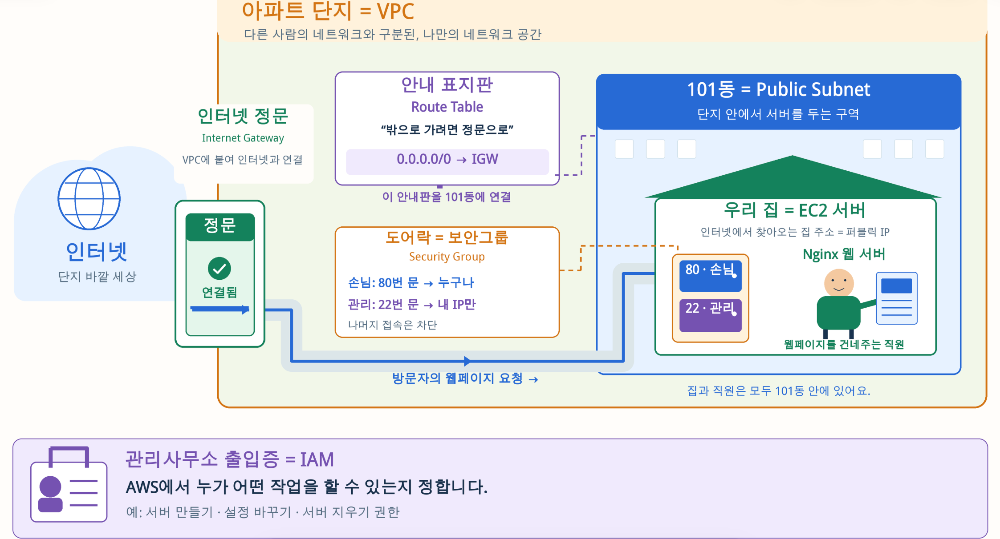

# B3-1 · 내가 만든 웹사이트를 인터넷에 올려 누구나 쓰게 하기

> **AWS 클라우드에 내 서버를 직접 만들어 누구나 웹사이트에 접속할 수 있게 하고, 필요한 것만 열어 안전하게 운영하는 방법을 익히는 미션**

| 구성 | 내용 |
|---|---|
| **Ⅰ. 서론** | 이 미션은 **왜**, **무엇을**, **어떻게** 하는가 |
| **Ⅱ. 본론** | 실제로 **어떻게 구축하고 검증했는가** (실행 순서대로) |
| **Ⅲ. 결론** | 요구사항을 **충족했는가**, 무엇을 **설명할 수 있게 되었는가** |
| **부록** | 용어 정리 · 재현 방법 · 파일 구성 |

> 단계별 수행 절차: [GUIDE.md](GUIDE.md) · 미션 원문: [mission.md](mission.md)

---

# Ⅰ. 서론 — 이 미션은 무엇인가

## 1-1. 한눈에 보기

| ❓ 왜? | ➡️ 무엇을? | 🛠️ 어떻게? |
|---|---|---|
| 내 PC의 웹사이트는 **나만** 볼 수 있다 → 인터넷 서버가 필요하다.<br>단, 열어 둔 문 하나로 **해킹**될 수 있다 | **AWS**에 나만의 네트워크(VPC)와 서버(EC2)를 직접 만들고, **필요한 문만** 열어 웹사이트를 공개한다 | 권한 준비 → 네트워크 → 보안 → 서버 → 외부 접속 확인 → 문제 해결 기록 → 리소스 정리 |

| 질문 | 답 |
|---|---|
| **목적** | 클라우드가 "빠른 컴퓨터"가 아니라 **네트워크 + 보안 + 권한이 묶인 환경**임을 직접 만들면서 이해한다 |
| **사용 환경** | **AWS** (Amazon Web Services) · 서울 리전 `ap-northeast-2` · 프리 티어(무료 범위) |
| **최종 결과** | 누구나 `http://<퍼블릭IP>`로 접속할 수 있는 웹 서버, 그리고 이를 증명하는 문서 4종 |
| **과제 정보** | AI/SW 기초 (필수) · 클라우드와 AI API · 40시간 |

## 1-2. 왜 하는가 — 미션의 목적

웹사이트를 만들어도 **내 컴퓨터 안에만 있으면 다른 사람은 볼 수 없다.** 24시간 켜져 있는 인터넷 서버에 올려야 하지만, 서버를 직접 사는 것은 비싸고 오래 걸린다. 그래서 **클라우드(AWS)에서 서버를 빌려 쓴다.**

```
 [직접 구매]  서버 컴퓨터 구매 → 설치 → 인터넷 연결 → 관리       (며칠~몇 주, 큰 비용)
 [AWS 클라우드] 콘솔에서 클릭 몇 번 → 서버 생성 → 바로 사용      (몇 분, 쓴 만큼만 비용)
```

하지만 빌려 쓰기만 해서는 끝나지 않는다. 현실에서 자주 생기는 문제는 다음과 같다.

| 현실의 문제 | 원인 | 이 미션에서 배우는 해결법 |
|---|---|---|
| "서버에 올렸는데 밖에서 안 들어와요" | 네트워크 **길**이나 **문(포트)**이 없다 | 요청이 서버까지 가는 길을 **직접 설계**한다 |
| "포트 하나 열어 놨다가 해킹당했어요" | 문을 **필요 이상으로** 열었다 | **필요한 문만** 연다 (Security Group) |
| "실수로 다른 서비스까지 건드렸어요" | 계정에 권한을 **너무 많이** 줬다 | **필요한 권한만** 준다 (IAM 최소 권한) |
| "안 쓰는데 요금이 나왔어요" | 실습 후 리소스를 **안 지웠다** | 끝나면 **순서대로 정리**한다 |

> **핵심**: 공개는 하되 **최소한만 열고, 최소한만 주고, 끝나면 정리**한다.

## 1-3. 무엇을 만드는가 — AWS 구성 요소

이 미션에서 AWS에 만드는 것들을 **아파트 단지**에 비유하면 이렇다.

```
🌐 인터넷 (바깥 세상)
 │
 ▼
🚪 정문 ─────────── Internet Gateway
 │
🏢 아파트 단지 ──── VPC (나만 쓰는 네트워크)
 ├─ 🪧 안내 표지판 ─ Route Table : "밖으로 가려면 정문으로"
 └─ 🏠 101동 ─────── Public Subnet
     └─ 🔒 도어락 ── Security Group : 손님은 80번 문, 집주인은 22번 문만
         └─ 🏡 우리 집 ─ EC2 서버 (주소 = 퍼블릭 IP)
             └─ 🍽️ 손님 맞이 ─ Nginx 웹 서버

🪪 관리사무소 출입증 ─ IAM : AWS에서 누가 무엇을 만들고 지울 수 있는지
```



**그림 읽는 법 — 손님(방문자)이 웹페이지를 받기까지**

```
① 인터넷에서 집 주소(퍼블릭 IP)로 찾아옴 → ② 정문(IGW) 통과 → ③ 101동(Subnet) 도착
→ ④ 도어락(Security Group)이 80번 문인지 확인 → ⑤ 직원(Nginx)이 웹페이지를 건넴
   돌아갈 때는 ⑥ 안내 표지판(Route Table)의 "밖으로 가려면 정문으로"를 따라 나감
```

| AWS 서비스 | 비유 | 하는 일 | 없으면? |
|---|---|---|---|
| **VPC**<br>*Virtual Private Cloud* | 아파트 단지 | 다른 사람과 분리된 **나만의 네트워크** | 서버를 둘 공간이 없다 |
| **Subnet**<br>*Subnetwork* | 동 | VPC를 나눈 **구역**. 정문으로 가는 길이 이어진 동을 **Public** Subnet이라 한다 | 서버를 배치할 수 없다 |
| **Internet Gateway** | 정문 | VPC ↔ 인터넷 **출입구** | 인터넷과 완전히 단절된다 |
| **Route Table** | 안내 표지판 | 데이터(요청·응답)가 **어느 길로 갈지** 정한다 | 정문이 있어도 길을 못 찾는다 |
| **Security Group** | 도어락 | 어떤 **문 번호(포트)**를 **누구에게** 열지 정한다 | 허용 규칙이 없으면 외부 접속이 모두 막힌다 |
| **EC2**<br>*Elastic Compute Cloud* | 집 | AWS에서 빌린 컴퓨터(**가상 서버**). 웹사이트가 여기서 돌아간다 | 웹사이트를 실행할 곳이 없다 |
| **퍼블릭 IP**<br>*Public IP (Internet Protocol) address* | 집 주소 | 인터넷에서 EC2를 **찾아오는 주소** | 손님이 집을 찾지 못한다 |
| **Nginx** | 손님 맞는 직원 | 요청이 오면 **웹페이지를 건네는** 프로그램 | 집에 와도 아무도 응답하지 않는다 |
| **IAM**<br>*Identity and Access Management* | 관리사무소 출입증 | AWS에서 **누가 무엇을**(만들기·바꾸기·지우기) 할 수 있는지 정한다 | 모든 작업을 마스터키(루트 계정)로 하게 되어, 실수 하나가 계정 전체 사고가 된다 |

> 💡 **처음 보는 말 두 가지**
> - **포트** = 한 컴퓨터에 있는 **문 번호**. 웹페이지는 **80번 문**, 원격 관리(SSH)는 **22번 문**으로 들어온다.
> - **IAM은 단지 밖**에 그려져 있다. 서버로 들어오는 통신을 막는 것이 아니라, **AWS 콘솔에서 사람이 하는 작업**을 막기 때문이다.

## 1-4. 어떻게 하는가 — 실행 흐름

```
① 권한 준비 → ② 네트워크 → ③ 보안 → ④ 서버 → ⑤ 검증 → ⑥ 문제 해결 → ⑦ 정리
```

| 단계 | 할 일 | 결과 | 본론 |
|---|---|---|---|
| ① 권한 준비 | IAM 사용자 생성, 필요한 권한만 부여 | 실습 전용 계정 | 2-1 |
| ② 네트워크 | VPC · Subnet · IGW · Route Table 생성·연결 | 인터넷과 통하는 네트워크 | 2-2 |
| ③ 보안 | Security Group: 80 누구나, 22 나만 | 필요한 문만 열린 상태 | 2-3 |
| ④ 서버 | EC2 생성, Nginx 설치 | 웹 서버 실행 | 2-4 |
| ⑤ 검증 | 서버 내부·외부에서 접속 확인 | HTTP 200 `OK` | 2-6 |
| ⑥ 문제 해결 | 오류를 증상·근거로 분석해 해결 | 트러블슈팅 보고서 | 2-7 |
| ⑦ 정리 | 리소스를 순서대로 삭제 | 과금 리소스 0개 | 2-8 |

## 1-5. 성공 기준

**① 반드시 지켜야 할 규칙**

| ✅ 반드시 | ❌ 금지 |
|---|---|
| 서울 리전(`ap-northeast-2`)에서만 생성 | 루트 계정으로 실습 |
| 프리 티어 범위 (micro 서버 1대, 디스크 8~10GiB) | 관리자 권한(`AdministratorAccess`) 부여 |
| 웹(80)은 누구나, SSH(22)는 **내 IP만** | 전체 포트를 전 세계(`0.0.0.0/0`)에 개방 |
| 실습 후 **모든 리소스 삭제** | 쓰지 않는 리소스 방치 |

**② 제출해야 할 결과물**

| 결과물 | 증명하는 것 | 파일 |
|---|---|---|
| 아키텍처 다이어그램 | 구조를 **이해**했다 | [docs/architecture.png](docs/architecture.png) |
| 외부 접속 증빙 | 실제로 **동작**한다 | 본론 2-6 + [docs/evidence/](docs/evidence/) |
| 트러블슈팅 보고서 | 문제를 **근거로 해결**할 수 있다 | [docs/troubleshooting.md](docs/troubleshooting.md) |
| 리소스 정리 체크리스트 | 비용까지 **책임지고 관리**했다 | [docs/cleanup-checklist.md](docs/cleanup-checklist.md) |

**③ 끝나면 설명할 수 있어야 하는 것** → [결론 3-2](#3-2-미션-목표-달성--설명할-수-있게-된-것)에서 답한다

1. VPC · Subnet · Route Table · IGW의 역할과 트래픽 흐름
2. Security Group과 IAM의 차이, 최소 권한 원칙
3. 외부 요청이 서버까지 도달하기 위한 조건
4. 증상과 로그를 근거로 한 트러블슈팅 과정
5. 과금 요인과 안전한 정리 순서

---

# Ⅱ. 본론 — 어떻게 구축하고 검증했는가

## 2-1. 권한 준비 — IAM 최소 권한

**원칙**: 실습에 필요한 작업만 허용하고, 나머지는 모두 차단한다.

| 허용 ✅ | 차단 ❌ |
|---|---|
| EC2 · VPC · 서브넷 · IGW · 라우팅 · 보안 그룹 · 키 페어 · EBS 생성/조회/삭제 | 실습과 무관한 서비스 (S3, RDS, Lambda 등) |
| 생성·변경은 **서울 리전에서만** | 다른 리전에서 리소스 생성 |
| EC2 조회(`Describe*` · `Get*`): 콘솔 화면 표시용 | IAM 사용자·정책 생성, `AdministratorAccess` |
| AMI 목록 조회(SSM 공개 파라미터 읽기 전용): 인스턴스 시작 화면용 | |
| 자기 비밀번호 변경 | |

- IAM 사용자: `b3-1-practice` · 정책: [infra/iam-policy.json](infra/iam-policy.json)
- EC2 외 서비스 권한은 **EC2 실행에 꼭 필요한 읽기 전용(AMI 조회)**과 **본인 비밀번호 변경**뿐이다.
- 루트 계정은 IAM 사용자를 만들 때만 사용했고, 실습 작업은 모두 IAM 사용자로 했다.
- 콘솔 일부 화면(추천, 비용 정보 등)에 권한 오류가 보일 수 있다. **보조 화면의 조회 권한이 없어서** 생기는 것이며, 실제 생성·연결 작업은 따로 성공을 확인했다.

## 2-2. 네트워크 구성 — VPC · Subnet · IGW · Route Table

| 순서 | 구성 요소 | 이름 | ID | 설정 |
|---|---|---|---|---|
| 1 | VPC | `b3-1-vpc` | `<vpc-...>` | `10.0.0.0/16` |
| 2 | Public Subnet | `b3-1-subnet-public` | `<subnet-...>` | `10.0.1.0/24`, `ap-northeast-2a`, 퍼블릭 IP 자동 할당 ON |
| 3 | Internet Gateway | `b3-1-igw` | `<igw-...>` | 생성 직후 `Detached` → VPC 연결 후 `Attached` |
| 4 | Route Table | `b3-1-rtb-public` | `<rtb-...>` | `local`만 있던 상태에 `0.0.0.0/0 → igw` 추가 |
| 5 | 서브넷 연결 | — | — | Route Table을 Public Subnet에 **명시적으로 연결** |

> 💡 서브넷 이름에 "public"이 붙는다고 인터넷에 연결되는 것은 아니다. **IGW 연결 + 라우팅 경로 + 퍼블릭 IP**가 모두 있어야 퍼블릭 서브넷이 된다.

## 2-3. 보안 구성 — Security Group

| 방향 | 포트 | 허용 대상 | 이유 |
|---|---|---|---|
| 인바운드 | **80** (HTTP) | `0.0.0.0/0` (누구나) | 웹사이트는 누구나 볼 수 있어야 한다 |
| 인바운드 | **22** (SSH) | **내 IP `/32`** (나만) | 서버 관리는 나만 할 수 있어야 한다 |
| 아웃바운드 | 전체 | `0.0.0.0/0` | 서버가 패키지를 내려받을 수 있어야 한다 |

- 보안 그룹: `b3-1-web-sg` (`<sg-...>`). 위 두 규칙 외의 인바운드는 **모두 차단**한다.

**Security Group과 IAM은 무엇이 다른가?**

| 구분 | Security Group | IAM |
|---|---|---|
| 통제 대상 | **네트워크 통신** (포트 · IP) | **AWS 작업** (생성 · 조회 · 삭제) |
| 막는 대상 | 서버에 접속하려는 **컴퓨터** | 콘솔·API를 쓰는 **사람·프로그램** |
| 이번 설정 | 80 ← 누구나, 22 ← 내 IP만 | EC2·VPC 작업만, 서울 리전만 |

> 둘은 서로를 대신하지 못한다. IAM 권한을 늘려도 80번 포트가 열리지 않고, 포트를 열어도 IAM 권한이 생기지 않는다.

## 2-4. 서버 구성 — EC2 · EBS · Nginx

| 항목 | 설정 | 선택 이유 |
|---|---|---|
| 인스턴스 | `b3-1-web` (`<i-...>`), `t3.micro` | 프리 티어 대상 |
| OS | Ubuntu 24.04 LTS | 장기 지원 버전 |
| CPU 크레딧 | **Standard** | 기본값 Unlimited는 초과 사용 시 **추가 과금** 가능 |
| 디스크 (EBS) | gp3 8GiB, **암호화**, **종료 시 삭제** | 서버 삭제 시 디스크가 남아 과금되는 것 방지 |
| IP | 퍼블릭 `<x.x.x.x>` / 프라이빗 `<10.0.1.x>` | 자동 할당 IP 사용 (Elastic IP 불필요) |
| 키 페어 | `b3-1-key` | 개인 키는 저장소에 넣지 않음 |
| 웹 서버 | Nginx: `/` → Hello Cloud, `/health` → `OK` | [infra/user-data.sh](infra/user-data.sh)로 첫 부팅 때 자동 설치 |

## 2-5. 전체 구조와 요청 흐름


```
 [요청] 내 브라우저 ─HTTP:80─▶ 퍼블릭 IP ─▶ Internet Gateway ─▶ Security Group ─▶ EC2 · Nginx
                                         (퍼블릭 IP → 프라이빗 IP 변환)  (80 허용 확인)

 [응답] EC2 · Nginx ─▶ Route Table (0.0.0.0/0 → IGW) ─▶ Internet Gateway ─▶ 내 브라우저
```

| 조건 | 구성 요소 | 하는 일 | 빠지면 생기는 증상 |
|---|---|---|---|
| ① | **퍼블릭 IP** | 인터넷에서 서버를 찾아오는 주소 | 찾아갈 주소가 없음 |
| ② | **Internet Gateway** (VPC에 연결) | 인터넷 ↔ VPC 출입구. 퍼블릭 IP를 서버의 프라이빗 IP로 연결 | 인터넷과 완전히 단절 |
| ③ | **Route Table** (`0.0.0.0/0 → IGW`) | 서버에서 **나가는** 트래픽(응답 포함)을 IGW로 안내 | 응답이 돌아가지 못함 → **타임아웃** |
| ④ | **Security Group** (80 허용) | **들어오는** 요청 중 허용된 포트만 통과 | 요청이 서버 앞에서 막힘 → **타임아웃** |
| ⑤ | **Nginx 실행** | 요청을 받아 웹페이지를 응답 | **Connection refused** |

> Security Group은 **들어온 요청에 대한 응답은 자동으로 내보낸다**(상태 저장). 그래서 아웃바운드 규칙을 따로 열지 않아도 응답이 나간다.

## 2-6. 동작 검증

**외부 접속 (방식 B 선택)**

| 항목 | 내용 |
|---|---|
| 선택 방식 | **(B) 헬스체크** `GET http://<퍼블릭IP>/health` (방식 A 화면도 함께 첨부) |
| 접속 주소 | 웹페이지 `http://<퍼블릭IP>/` · 상태 확인 `http://<퍼블릭IP>/health` |
| 검증 시각 | `<YYYY-MM-DD HH:MM KST>` |
| 결과 | **HTTP 200**, 본문 `OK` |

```bash
# 내 Mac (외부)에서 실행
$ curl -i http://<퍼블릭IP>/health
<실제 출력 붙여넣기>
```


> ⚠️ 퍼블릭 IP는 자동 할당 IP라서 인스턴스를 종료하면 더 이상 쓸 수 없다. 리소스를 정리한 뒤에는 위 주소로 접속되지 않는다.

**서버 내부**

| 요구사항 | 확인 명령 (EC2 안에서) | 기대 결과 | 결과 |
|---|---|---|---|
| SSH 접속 | `ssh -i b3-1-key.pem ubuntu@<퍼블릭IP>` | 로그인 성공 | ⬜ |
| Nginx 실행 | `systemctl is-active nginx` | `active` | ⬜ |
| 로컬 응답 | `curl -I http://localhost` | `200 OK` | ⬜ |
| 헬스체크 | `curl http://localhost/health` | `OK` | ⬜ |
| 아웃바운드 인터넷 | `curl -I https://example.com` | `200` | ⬜ |


**텍스트 증빙 원본**: [external-health.txt](docs/evidence/external-health.txt) · [server-checks.txt](docs/evidence/server-checks.txt) · [resources.txt](docs/evidence/resources.txt)

## 2-7. 문제 해결 (트러블슈팅)

문제가 생기면 짐작하지 않고 **증상 → 가설 → 검증 → 조치 → 결과 → 재발 방지** 순서로 해결했다.

| 항목 | 요약 |
|---|---|
| 증상 | `<예: 외부에서 접속 시 타임아웃>` |
| 가설 | `<예: 보안 그룹 · 라우팅 · 퍼블릭 IP 중 하나가 빠졌다>` |
| 검증 | `<예: 서버 내부 curl은 200 → 서버는 정상, SG 인바운드에 80번 없음 확인>` |
| 조치 | `<예: HTTP 80 ← 0.0.0.0/0 규칙 추가>` |
| 결과 | `<예: 외부 curl HTTP 200 OK 확인>` |
| 재발 방지 | `<예: 배포 후 요청 경로 5가지 조건 점검>` |

자세한 내용: [docs/troubleshooting.md](docs/troubleshooting.md)

## 2-8. 비용 관리와 리소스 정리

**일부러 만들지 않은 리소스**

| 리소스 | 만들지 않은 이유 |
|---|---|
| NAT Gateway | 프라이빗 서브넷이 없어 필요 없음. 프리 티어가 없고 시간당 요금이 나옴 |
| Elastic IP | 자동 할당 IP로 충분함. 쓰지 않고 두면 요금이 나옴 |
| Load Balancer (ALB) | 서버가 1대라 분산할 대상이 없음 |
| RDS | 정적 웹페이지라 데이터베이스가 필요 없음 |

**정리 순서** (안쪽 → 바깥쪽. 사용 중인 리소스는 삭제되지 않기 때문이다)

```
 EC2 종료 → EBS 확인 → (EIP 해제) → 보안 그룹 → IGW 분리·삭제 → Subnet·Route Table → VPC → (권장) Billing 확인
```

| 항목 | 내용 |
|---|---|
| 필수 정리 확인 | EC2 · EBS · Elastic IP(미생성) · Internet Gateway · VPC |
| 추적 기준 | 이름 규칙 `b3-1-*` · 태그 `Project=B3-1` · [리소스 목록](docs/evidence/resources.txt) · 체크리스트 |
| 과금 기준 | 프리 티어는 **AWS 계정 전체** 기준이다 (IAM 사용자마다 따로 주어지지 않음) |
| Billing 확인 | 실습용 IAM 사용자에는 결제 조회 권한이 없다. 권장 사항이라 계정 소유자가 확인한다 |
| 정리 완료 시각 | `<YYYY-MM-DD HH:MM KST>` |
| 정리 근거 | [docs/cleanup-checklist.md](docs/cleanup-checklist.md) · [cleanup-result.txt](docs/evidence/cleanup-result.txt) |

---

# Ⅲ. 결론 — 무엇을 달성했는가

## 3-1. 요구사항 충족 여부

| 영역 | 요구사항 | 결과 | 근거 |
|---|---|---|---|
| 네트워크 | VPC 1개, Public Subnet 1개, IGW 연결, `0.0.0.0/0 → IGW` | ⬜ | 본론 2-2 |
| 네트워크 | 서버에서 인터넷으로 나가는 통신 가능 | ⬜ | 본론 2-6 |
| 서버 | EC2 1대, SSH 접속, Nginx 실행, `localhost` 200 응답 | ⬜ | 본론 2-4, 2-6 |
| 보안 | 80 ← 누구나, 22 ← 내 IP만, 전체 포트 개방 없음 | ⬜ | 본론 2-3 |
| 권한 | IAM 사용자 1개, 필요한 권한만, 관리자 권한 없음 | ⬜ | 본론 2-1 |
| 외부 접속 | `GET /health` → 200 `OK` | ⬜ | 본론 2-6 |
| 비용 | EC2 · EBS · EIP · IGW · VPC 정리 완료 | ⬜ | 본론 2-8 |
| 환경 | 서울 리전, micro 인스턴스 1대, EBS 8~10GiB, 루트 계정 미사용 | ⬜ | 본론 2-1, 2-4 |
| 보너스 | HTTPS / Docker (선택) | `<수행 여부>` | — |

## 3-2. 미션 목표 달성 — 설명할 수 있게 된 것

| # | 목표 | 한 문장 답 |
|---|---|---|
| 1 | 네트워크 구성 요소와 트래픽 흐름 | VPC는 나만의 네트워크, Subnet은 그 구역, IGW는 인터넷 출입구, Route Table은 "외부로 가는 트래픽은 IGW로" 보내는 규칙표다. 요청은 **IGW → SG → 서버**로 들어오고, 응답은 **Route Table → IGW**를 거쳐 나간다. |
| 2 | Security Group과 IAM의 차이 | SG는 **네트워크 접속**(포트·IP)을, IAM은 **AWS 작업 권한**을 통제한다. 둘 다 사고를 줄이기 위해 꼭 필요한 만큼만 허용한다. |
| 3 | 외부 요청이 서버에 닿는 조건 | 퍼블릭 IP, VPC에 연결된 IGW, `0.0.0.0/0 → IGW` 경로, SG 80번 허용, Nginx 실행. **다섯 가지가 모두** 있어야 한다. |
| 4 | 트러블슈팅 방법 | 타임아웃이면 네트워크(SG·라우팅), `refused`면 서버 프로그램 문제로 **증상으로 범위를 좁히고**, 하나씩 확인해 근거를 남긴다. |
| 5 | 과금 요인과 정리 순서 | 켜진 서버, 남은 디스크, 안 쓰는 IP, NAT가 요금을 만든다. 의존 관계 때문에 **서버 → 네트워크** 순으로 지운다. |

## 3-3. 정리하며

| 배운 점 | 내용 |
|---|---|
| 클라우드는 환경이다 | 서버 한 대를 공개하는 데도 네트워크·보안·권한이 **모두 맞물려야** 한다 |
| 보안은 "최소"가 기본이다 | 포트도, 권한도 **필요한 만큼만** 열면 실수해도 피해가 작다 |
| 정리까지가 운영이다 | 만드는 것만큼 **지우는 순서와 확인**이 중요하다 |

> 느낀 점: `<실습을 마친 뒤 직접 작성>`

---

# 부록

## A. 용어 정리

| 용어 | 쉬운 설명 | 이 미션에서 |
|---|---|---|
| **리전** | AWS 데이터센터가 있는 **지역** | 서울 `ap-northeast-2` |
| **프리 티어** | 신규 계정에 주는 **무료 사용량** | micro 서버 1대 범위 |
| **포트** | 한 컴퓨터 안의 **방 번호**. 서비스마다 번호가 다르다 | 80 = 웹, 22 = 원격 접속 |
| **HTTP**<br>*HyperText Transfer Protocol* | 웹페이지를 주고받는 규칙 | 브라우저 → 서버 80번 |
| **SSH**<br>*Secure Shell* | 다른 컴퓨터에 **원격 접속**해 명령하는 방법 | 내 Mac → 서버 22번 |
| **키 페어** | SSH용 **자물쇠(공개 키) + 열쇠(개인 키)** | `b3-1-key.pem` |
| **CIDR**<br>*Classless Inter-Domain Routing* | IP 주소 **범위** 표기법 | `10.0.0.0/16` ≈ 6.5만 개 주소 |
| **`0.0.0.0/0`** | **모든** IP 주소 (전 세계 누구나) | 웹(80) 허용 대상 |
| **`/32`** | IP 주소 **딱 1개** | SSH(22) 허용 대상 (내 IP) |
| **Nginx** | 요청이 오면 웹페이지를 보내 주는 **웹 서버 프로그램** | `/`, `/health` 응답 |
| **최소 권한 원칙** | 꼭 **필요한 만큼만** 허락하는 보안 원칙 | 포트와 권한 모두에 적용 |

## B. 다시 만들 때 (재현 방법)

1. IAM 사용자로 로그인 → 리전 **서울** 확인
2. VPC → Subnet → IGW 생성 후 **VPC에 연결**
3. Route Table에 `0.0.0.0/0 → IGW` 추가 → **Subnet에 연결**
4. Security Group: HTTP 80 ← `0.0.0.0/0`, SSH 22 ← **현재** 내 IP `/32`
5. EC2 시작: Ubuntu 24.04 · t3.micro · 크레딧 Standard · 사용자 데이터에 [infra/user-data.sh](infra/user-data.sh)
6. 검증 → 증빙 저장 → 리소스 정리

```bash
# EC2 내부
curl -I http://localhost
curl http://localhost/health
curl -I https://example.com

# 내 Mac (외부) — 새 퍼블릭 IP로 바꿔서 실행
curl -i http://<퍼블릭IP>/health
```

## C. 파일 구성

| 경로 | 설명 |
|---|---|
| [GUIDE.md](GUIDE.md) | 단계별 수행 가이드 |
| [mission.md](mission.md) | 미션 원문 |
| [infra/iam-policy.json](infra/iam-policy.json) | IAM 최소 권한 정책 |
| [infra/user-data.sh](infra/user-data.sh) | EC2 첫 부팅 시 Nginx · `/health` 자동 설정 |
| [docs/architecture.png](docs/architecture.png) | 아키텍처 다이어그램 (원본 `.svg`) |
| [docs/troubleshooting.md](docs/troubleshooting.md) | 트러블슈팅 보고서 |
| [docs/cleanup-checklist.md](docs/cleanup-checklist.md) | 리소스 정리 체크리스트 |
| `docs/screenshots/` | 화면 캡처 |
| `docs/evidence/` | 텍스트 증빙 (curl 응답, 확인 로그) |
