# B3-1 · 내가 만든 웹사이트를 인터넷에 올려 누구나 쓰게 하기

> **AWS에 나만의 네트워크와 서버를 직접 만들어 웹사이트를 공개하고, 필요한 문과 권한만 열어 안전하게 운영한 뒤 정리하는 미션**

| 접속 주소 (평가 기간 2026-11-24 ~ 25 운영 · **반드시 `http://`**) | 장면별 진행 기록 |
|---|---|
| 웹페이지 **http://13.124.137.81/** · 상태 확인 **http://13.124.137.81/health** | [docs/walkthrough.md](docs/walkthrough.md) (캡처 44장) |

> 외부 접속 검증 방식: **(B) `GET /health` → HTTP 200 + `OK`** (방식 A 브라우저 화면도 첨부) · 리전 서울 `ap-northeast-2` · 리소스 상태: **실행 중, 평가 후 삭제 예정**

---

## 평가 바로가기

**① 제출 결과물 4종** — 클릭하면 설명 위치로 이동한다.

| 결과물 | 증명하는 것 | 설명 | 파일 |
|---|---|---|---|
| 아키텍처 다이어그램 | 구조를 **이해**했다 | [2-5 요청 흐름](#2-5-요청-흐름) | [docs/architecture.png](docs/architecture.png) |
| 외부 접속 증빙 (방식 B) | 실제로 **동작**한다 | [2-6 동작 검증](#2-6-동작-검증) | [캡처](docs/screenshots/05-external-health.png) · [로그](docs/evidence/05-external-health.txt) |
| 트러블슈팅 보고서 | 문제를 **근거로 해결**한다 | [2-7 트러블슈팅](#2-7-트러블슈팅) | [docs/troubleshooting.md](docs/troubleshooting.md) |
| 리소스 정리 체크리스트 | 비용까지 **책임진다** | [2-8 비용과 정리](#2-8-비용과-정리) | [docs/cleanup-checklist.md](docs/cleanup-checklist.md) |

**② 평가 질문별 설명 위치**

| 평가 항목 | 질문 | 바로가기 |
|---|---|---|
| **1. 만들었는가** | 1-1 VPC · Subnet · IGW · Route Table(`0.0.0.0/0 → IGW`) 구성 | [2-2](#2-2-네트워크-구성) |
| | 1-2 SSH 접속 · 웹 서버 실행 | [2-4](#2-4-서버-구성) · [2-6](#2-6-동작-검증) |
| | 1-3 보안 그룹은 필요한 포트만, SSH는 특정 IP만 | [2-3](#2-3-보안-그룹) |
| | 1-4 외부 접속 검증 (A 또는 B) | [2-6](#2-6-동작-검증) |
| | 1-5 정리 체크리스트 5종 (EC2 · EBS · EIP · IGW · VPC) | [2-8](#2-8-비용과-정리) |
| **2. 왜 그렇게** | 2-1 외부 → IGW → Subnet → EC2 흐름 | [2-5](#2-5-요청-흐름) |
| | 2-2 보안 그룹 최소화 기준 | [2-3](#2-3-보안-그룹) |
| | 2-3 A/B 선택 이유와 구성 방법 | [2-6](#2-6-동작-검증) · [2-4](#2-4-서버-구성) |
| | 2-4 추적 · 정리 기준 (태그 · 이름 · 체크리스트) | [2-8](#2-8-비용과-정리) |
| **3. 원리** | 3-1 `0.0.0.0/0 → IGW`가 필요한 이유 | [2-5](#2-5-요청-흐름) |
| | 3-2 Security Group과 IAM의 차이, 최소 권한 | [2-3](#2-3-보안-그룹) · [2-1](#2-1-권한-준비-iam) |
| | 3-3 22 · DB 포트를 `0.0.0.0/0`로 열면 안 되는 이유 | [2-3](#2-3-보안-그룹) |
| | 3-4 가설 → 검증 순서와 로그 활용 | [2-7](#2-7-트러블슈팅) |
| **4. 응용** | 4-1 외부 접속 장애 점검 순서 | [2-7](#2-7-트러블슈팅) |
| | 4-2 IAM 권한 부족 시 최소 범위 찾기 | [3-3](#3-3-응용-질문-대비) |
| | 4-3 인스턴스 2대로 확장 | [3-3](#3-3-응용-질문-대비) |
| | 4-4 예상치 못한 비용 추적 | [3-3](#3-3-응용-질문-대비) |

**③ 평가 시연 지도** — 서버가 켜져 있으니 보여 줄 수 있는 것은 라이브로, 평가 장소에서 막히는 SSH(22번은 집 IP만 허용)는 기록으로 보여 준다.

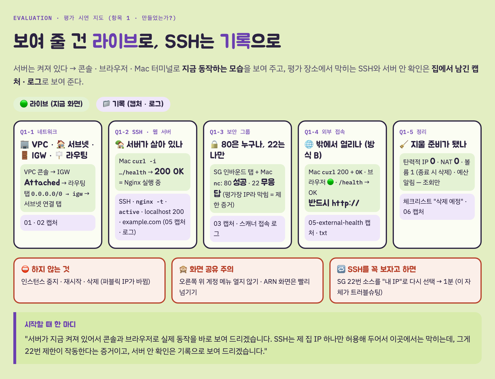

---

# Ⅰ. 서론 — 무엇을 왜 하는가

## 1-1. 한눈에 보기

| ❓ 왜? | ➡️ 무엇을? | 🛠️ 어떻게? |
|---|---|---|
| 내 PC의 웹사이트는 **나만** 본다. 서버에 올려야 하지만, 열어 둔 문 하나로 **해킹**될 수 있다 | AWS에 나만의 네트워크(VPC)와 서버(EC2)를 만들고, **필요한 문만** 열어 공개한다 | 권한 → 네트워크 → 보안 → 서버 → 검증 → 문제 해결 → 정리 |

| 항목 | 내용 |
|---|---|
| **목적** | 클라우드는 "빠른 컴퓨터"가 아니라 **네트워크 + 보안 + 권한이 묶인 환경**임을 직접 만들며 이해한다 |
| **환경** | AWS 서울 리전 `ap-northeast-2` · 프리 티어 |
| **결과** | 누구나 접속하는 웹 서버 1대 + 이를 증명하는 결과물 4종 |
| **과제 정보** | AI/SW 기초 (필수) · 클라우드와 AI API · 40시간 |

## 1-2. 왜 하는가

현실에서 자주 생기는 사고 네 가지를 이 미션에서 직접 막아 본다.

| 현실의 사고 | 원인 | 이 미션의 해결 |
|---|---|---|
| "서버에 올렸는데 밖에서 안 들어와요" | 길(라우팅)이나 문(포트)이 없다 | 요청이 서버까지 가는 길을 **직접 설계** → [2-5](#2-5-요청-흐름) |
| "포트 하나 열어 놨다가 해킹당했어요" | 문을 필요 이상으로 열었다 | **필요한 문만** 연다 → [2-3](#2-3-보안-그룹) |
| "실수로 다른 서비스까지 건드렸어요" | 권한을 너무 많이 줬다 | **필요한 권한만** 준다 → [2-1](#2-1-권한-준비-iam) |
| "안 쓰는데 요금이 나왔어요" | 실습 후 안 지웠다 | **순서대로 정리**한다 → [2-8](#2-8-비용과-정리) |

> **핵심 한 줄**: 공개는 하되 **최소한만 열고, 최소한만 주고, 끝나면 정리**한다.

## 1-3. 무엇을 만드는가

AWS 구성 요소를 **아파트 단지**에 비유하면 이렇다.


| AWS 서비스 | 비유 | 하는 일 | 없으면? |
|---|---|---|---|
| **VPC** *Virtual Private Cloud* | 아파트 단지 | 나만 쓰는 네트워크 | 서버를 둘 곳이 없다 |
| **Subnet** | 동 | VPC를 나눈 구역. 정문 길이 이어지면 **Public** | 서버를 배치할 수 없다 |
| **Internet Gateway** | 정문 | VPC ↔ 인터넷 출입구 | 인터넷과 단절 |
| **Route Table** | 안내 표지판 | 데이터가 갈 길을 정함 | 정문이 있어도 길을 못 찾음 |
| **Security Group** | 도어락 | 어떤 문(포트)을 누구에게 열지 정함 | 외부 접속이 모두 막힘 |
| **EC2** *Elastic Compute Cloud* | 집 | 빌린 가상 서버 | 웹사이트를 돌릴 곳이 없다 |
| **퍼블릭 IP** | 집 주소 | 인터넷에서 서버를 찾는 주소 | 손님이 집을 못 찾는다 |
| **Nginx** | 손님 맞는 직원 | 요청에 웹페이지로 응답 | 와도 아무도 응답 안 함 |
| **IAM** *Identity and Access Management* | 관리사무소 출입증 | AWS에서 누가 무엇을 할 수 있는지 정함 | 마스터키(루트)로 모든 작업 → 실수 하나가 계정 사고 |

> 💡 **IAM은 단지 밖**에 있다. 서버로 오는 통신이 아니라 **AWS 콘솔에서 사람이 하는 작업**을 막기 때문이다.

## 1-4. 어떻게 하는가

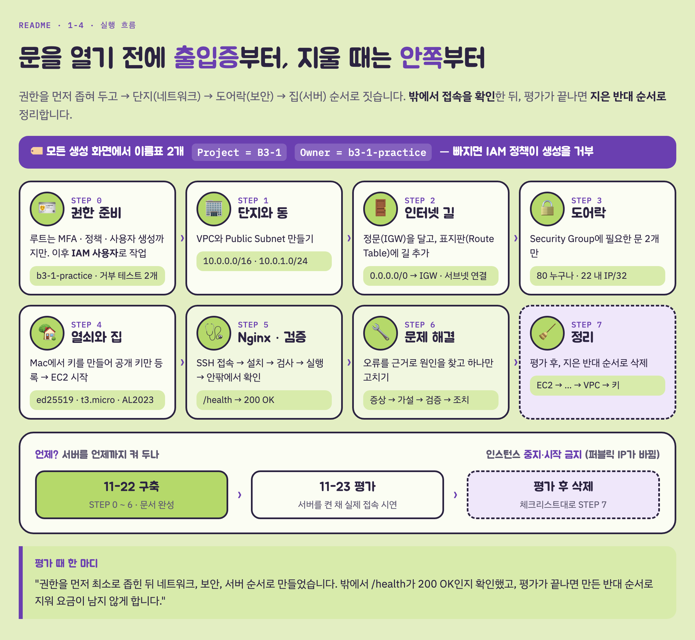

| STEP | 할 일 | 결과 | 설명 |
|---|---|---|---|
| 0 | IAM 정책 · 사용자 생성, 거부 테스트 | 실습 전용 계정 | [2-1](#2-1-권한-준비-iam) |
| 1–2 | VPC · Subnet · IGW · Route Table 생성 · 연결 | 인터넷과 통하는 네트워크 | [2-2](#2-2-네트워크-구성) |
| 3 | Security Group: 80 누구나, 22 나만 | 필요한 문만 열림 | [2-3](#2-3-보안-그룹) |
| 4–5 | 키 등록 → EC2 → SSH → Nginx 설치 · 검증 | `/health` → 200 `OK` | [2-4](#2-4-서버-구성) · [2-6](#2-6-동작-검증) |
| 6 | 오류를 근거로 분석 · 해결 | 트러블슈팅 보고서 | [2-7](#2-7-트러블슈팅) |
| 7 | 평가 후 순서대로 삭제 | 과금 리소스 0개 | [2-8](#2-8-비용과-정리) |

## 1-5. 성공 기준

**① 반드시 지킬 규칙**

| ✅ 반드시 | ❌ 금지 |
|---|---|
| 서울 리전(`ap-northeast-2`)에서만 생성 | 루트 계정으로 실습 |
| 프리 티어 (micro 1대, 디스크 8~10GiB) | 관리자 권한(`AdministratorAccess`) |
| 웹(80)은 누구나, SSH(22)는 **내 IP만** | 전체 포트를 `0.0.0.0/0`에 개방 |
| 실습 후 **모든 리소스 삭제** (평가 시연 후) | 쓰지 않는 리소스 방치 |

**② 끝나면 설명할 수 있어야 하는 것** (미션 원문 과제 목표) → 답: [3-2](#3-2-과제-목표-답변)

1. VPC · Subnet · Route Table · IGW의 역할과 트래픽 흐름
2. Security Group과 IAM의 차이, 최소 권한을 왜 · 어떻게 적용하는지
3. 외부 요청이 EC2 웹 서버에 닿기 위한 설정 (라우팅 · 퍼블릭 IP · 보안 그룹)
4. 로그 · 증상을 근거로 가설 → 검증 → 조치하는 트러블슈팅 과정
5. 과금 요인과 안전한 정리 순서 · 이유

---

# Ⅱ. 본론 — 어떻게 만들고 검증했는가

> 각 절은 **📌 원문 요구 → 🛠️ 구성 → 🎤 평가 때 한 마디 → 📎 근거** 순서다.

## 2-1. 권한 준비 (IAM)

> 📌 **원문**: IAM 사용자 1개 사용 · EC2/VPC/Security Group 구성에 필요한 범위로 제한 · S3/RDS 등 무관한 권한 없음 · 관리자 권한 금지 · 루트 계정 미사용

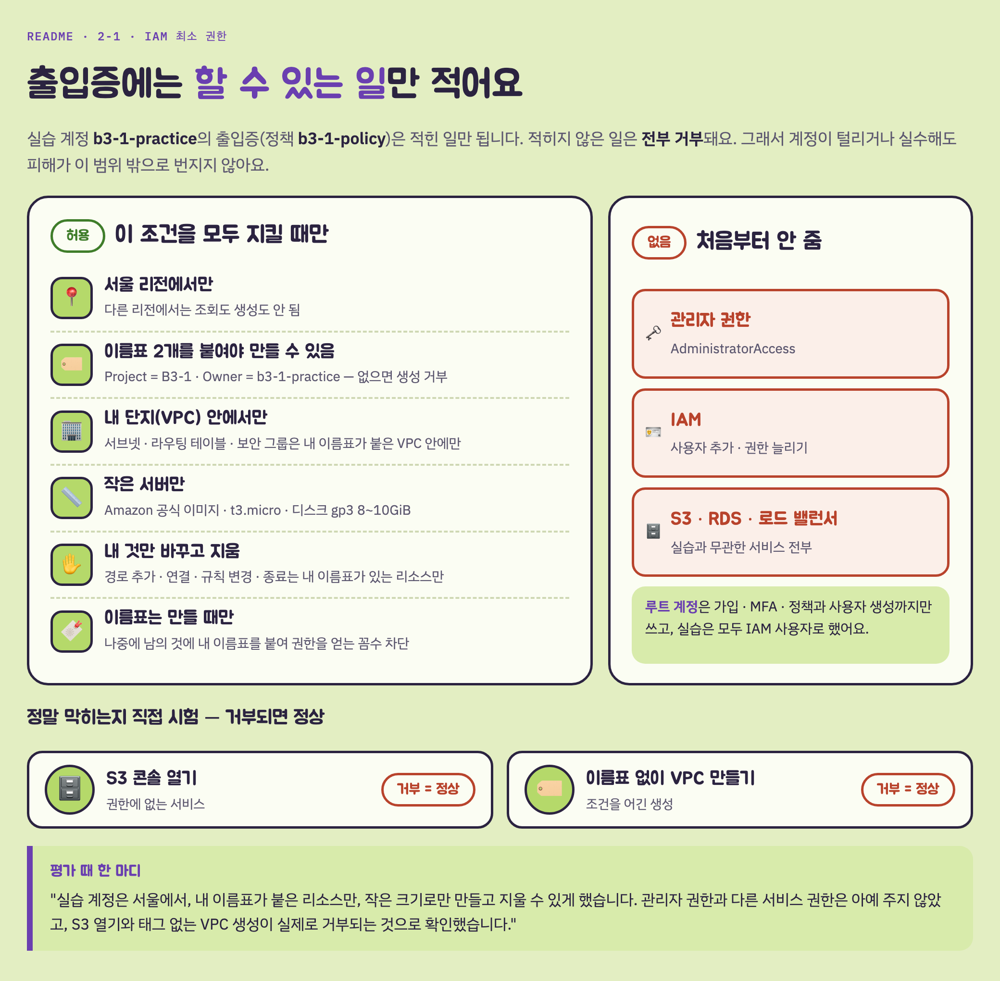

| 무엇을 | 어떻게 제한했나 | 왜 |
|---|---|---|
| 조회 | EC2 콘솔에 필요한 목록 보기만, 서울만 | 화면은 봐야 작업할 수 있다 |
| 만들기 | `Project=B3-1`, `Owner=b3-1-practice` 태그를 붙일 때만 | 누가 만든 무엇인지 항상 알 수 있다 |
| 어디에 | 서브넷 · 라우팅 테이블 · 보안 그룹은 내 태그가 있는 VPC 안에서만 | 남의 네트워크에 넣지 못하게 |
| 서버 시작 | Amazon 이미지 · `t3.micro` · gp3 8~10GiB만 | 큰 서버 · 큰 디스크로 요금 폭탄 방지 |
| 태그 붙이기 | 만들 때만, 키는 `Name` · `Project` · `Owner`만 | 남의 리소스에 내 태그를 붙이는 꼼수 차단 |
| 바꾸기 · 삭제 | 내 태그가 있는 리소스만 | 내 것만 고치고 지운다 |
| 없는 권한 | 관리자, IAM, S3, RDS, 로드 밸런서 등 전부 | 필요 없는 문은 만들지 않는다 |

**루트 계정 사용 범위**: 가입, 루트 MFA, 제로 지출 예산, IAM 정책 · 사용자 생성까지만. 이후 실습은 모두 IAM 사용자 `b3-1-practice`로 했다.

**거부 테스트** — 권한이 정말 막히는지 직접 확인했다.

| 시험 | 기대 | 결과 |
|---|---|---|
| S3 콘솔 열기 (버킷 목록) | 거부 | ✅ "버킷을 표시할 권한 없음" ([캡처](docs/screenshots/00-03-deny-s3.png)) |
| 태그 없이 VPC 생성 | 거부 | ✅ `not authorized … ec2:CreateVpc` ([캡처](docs/screenshots/00-03-deny-vpc.png)) |

기록: [docs/evidence/permission-tests.md](docs/evidence/permission-tests.md)

> 콘솔 일부 보조 화면(추천, 비용 정보 등)에 권한 오류가 보일 수 있다. 보조 화면의 조회 권한이 없어서이며, 생성 · 연결 작업의 성공은 따로 확인했다.

> 🎤 "실습 계정은 서울에서, 내 태그가 붙은 리소스만, 작은 크기로만 만들고 지울 수 있습니다. 관리자 권한과 다른 서비스 권한은 주지 않았고, 거부 테스트로 실제로 막히는 것을 확인했습니다."

📎 근거: 정책 [infra/iam-policy.json](infra/iam-policy.json) · 거부 테스트 [docs/evidence/permission-tests.md](docs/evidence/permission-tests.md)

## 2-2. 네트워크 구성

> 📌 **원문**: VPC 1개 · Public Subnet 1개 · IGW를 VPC에 연결 · Route Table에 `0.0.0.0/0 → IGW`

| 순서 | 구성 요소 | 이름 | ID | 설정 |
|---|---|---|---|---|
| 1 | VPC | `b3-1-vpc` | `vpc-0510d8b165db77c1c` | `10.0.0.0/16` |
| 2 | Public Subnet | `b3-1-subnet-public` | `subnet-006ec6df5bf1c7b2e` | `10.0.1.0/24`, `ap-northeast-2a` |
| 3 | Internet Gateway | `b3-1-igw` | `igw-0c1652057dab7b750` | `Detached` → VPC 연결 → `Attached` |
| 4 | Route Table | `b3-1-rtb-public` | `rtb-033c2174194a9bc48` | `local`에 `0.0.0.0/0 → igw` 추가 |
| 5 | 서브넷 연결 | — | — | Route Table을 Public Subnet에 **명시적 연결** |

```
🌐 인터넷
 │
🚪 IGW (b3-1-igw) ── Attached
 │
🏢 VPC (b3-1-vpc) 10.0.0.0/16
 ├─ 🪧 Route Table (b3-1-rtb-public)
 │    ├ 10.0.0.0/16 → local   단지 안은 안에서
 │    └ 0.0.0.0/0   → IGW     그 밖은 정문으로 ★
 └─ 🏠 Public Subnet (b3-1-subnet-public) 10.0.1.0/24 ← 이 표지판을 씀
```

> 💡 이름에 "public"이 붙는다고 퍼블릭이 아니다. **IGW 연결 + `0.0.0.0/0 → IGW` 경로 + 퍼블릭 IP**가 있어야 퍼블릭 서브넷이다.

> 🎤 "VPC 안에 퍼블릭 서브넷을 만들고, IGW를 VPC에 붙였습니다. 라우팅 테이블에 0.0.0.0/0 → IGW 경로를 넣고 이 테이블을 서브넷에 명시적으로 연결했습니다."

📎 근거: 리소스 ID [docs/evidence/resources.md](docs/evidence/resources.md) · 캡처 [VPC](docs/screenshots/01-vpc.png) · [서브넷](docs/screenshots/01-subnet.png) · [IGW Attached](docs/screenshots/02-igw-attached.png) · [라우팅](docs/screenshots/02-rtb-routes.png) · [서브넷 연결](docs/screenshots/02-rtb-subnet.png)

## 2-3. 보안 그룹

> 📌 **원문**: 필요한 포트만 허용 · HTTP(80)는 `0.0.0.0/0` · SSH(22)는 개인 IP만 · `0.0.0.0/0` 전체 포트 규칙 금지

| 방향 | 포트 | 허용 대상 | 이유 |
|---|---|---|---|
| 인바운드 | **80** (HTTP) | `0.0.0.0/0` | 웹은 누구나 봐야 한다 |
| 인바운드 | **22** (SSH) | **내 IP `/32`** | 관리는 나만 한다 |
| 아웃바운드 | 전체 | `0.0.0.0/0` (기본값) | 서버가 패키지를 받아야 한다 |

보안 그룹 `b3-1-web-sg` (`sg-00c3b629679064cd6`). 위 2개 외의 인바운드는 **규칙이 없으므로 자동 차단**이다.

**최소화 기준** — "지금 쓰는가?" + "누가 들어와야 하는가?"

| 열지 않은 포트 | 이유 |
|---|---|
| 443 (HTTPS) | 인증서를 쓰지 않음 (보너스 미수행) |
| 3306 · 5432 (DB) | DB를 쓰지 않음 |
| 0–65535 전체 | 열 이유가 없고 공격 통로만 늘어남 |

**22 · DB를 `0.0.0.0/0`로 열면 안 되는 이유** — 전 세계 자동 스캔 봇이 바로 찾아 비밀번호 대입 · 취약점 공격을 한다. 서버 장악, 데이터 유출, 채굴 악용으로 요금 폭탄이 난다.

| 포트 | 대안 |
|---|---|
| 22 | **내 IP `/32`만** (이번 미션) · 키 인증 · Session Manager로 22 닫기 · Bastion · VPN |
| DB | **프라이빗 서브넷**에 두고, DB 보안 그룹은 **웹 서버 SG에서 온 것만** 허용 |

**Security Group과 IAM은 무엇이 다른가**

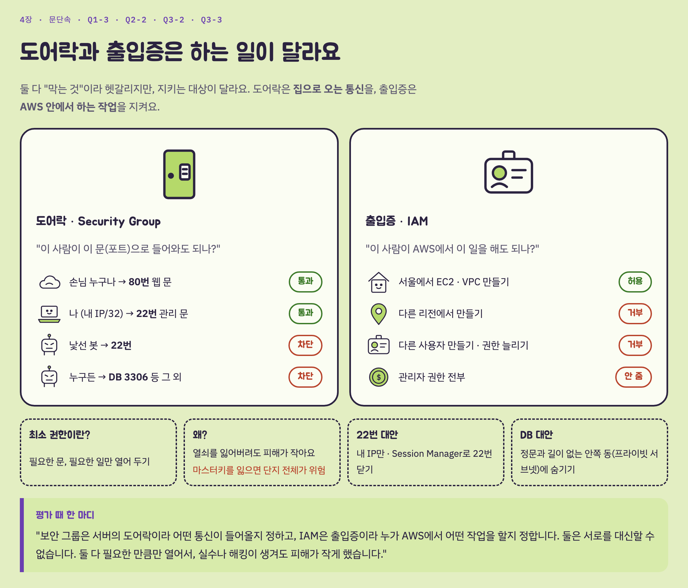

| 구분 | 🔒 Security Group | 🪪 IAM |
|---|---|---|
| 지키는 것 | 서버로 오가는 **네트워크 통신** (IP · 포트) | AWS 계정 안의 **작업** (생성 · 삭제) |
| 질문 | "이 IP가 80번으로 들어와도 되나?" | "이 사용자가 EC2를 지워도 되나?" |
| 이번 설정 | 80 누구나, 22 내 IP만 | 서울 · 내 태그 리소스 · 작은 크기만 |

둘은 서로를 대신하지 못한다. 권한을 늘려도 포트가 열리지 않고, 포트를 열어도 권한이 생기지 않는다. **최소 권한**은 둘 다에 적용해, 털리거나 실수해도 피해를 허용 범위 안으로 가둔다.

> 🎤 "보안 그룹은 서버로 오는 통신을, IAM은 AWS 작업을 지킵니다. 포트는 80과 22만 열고 22는 제 IP 하나로 좁혔습니다. 권한도 필요한 작업만 줬습니다."

📎 근거: 인바운드 규칙 [03-sg-inbound.png](docs/screenshots/03-sg-inbound.png) · 아웃바운드 [03-sg-outbound.png](docs/screenshots/03-sg-outbound.png) · 공개 직후 해외 스캐너 접속 기록 [06-repro-https.log](docs/evidence/06-repro-https.log)

## 2-4. 서버 구성

> 📌 **원문**: Public Subnet에 EC2 1대 · SSH 접속 · Nginx 설치 · 실행 · micro 인스턴스 · EBS 8~10GiB · 키 페어 안전 보관(재발급 불가)

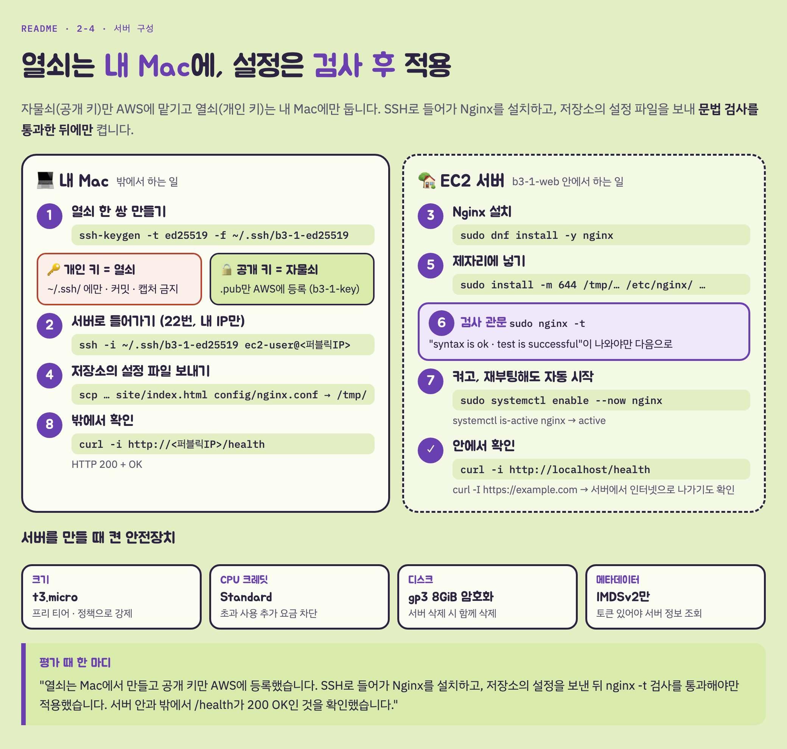

| 항목 | 설정 | 선택 이유 |
|---|---|---|
| 인스턴스 | `b3-1-web` (`i-0b2265faed73df750`), `t3.micro` | 프리 티어 대상 |
| OS | Amazon Linux 2023 (x86_64) | AWS 관리 기본 OS, `dnf`로 Nginx 설치 |
| CPU 크레딧 | **Standard** | 기본값 Unlimited는 초과 사용 시 추가 과금 |
| 디스크 | gp3 8GiB (3000 IOPS · 125MiB/s 기본값), **암호화**, **종료 시 삭제** | 서버를 지울 때 디스크가 남아 과금되는 것 방지. 크기·성능 상한은 IAM 정책으로 강제 |
| IP | 퍼블릭 `13.124.137.81` / 프라이빗 `10.0.1.122` | EC2 시작 시 퍼블릭 IP 활성화 (Elastic IP 불필요) |
| 메타데이터 | IMDSv2만 | 토큰 방식으로만 서버 정보 조회 |
| 키 페어 | `b3-1-key` (ed25519 **공개 키만** 등록) | 개인 키는 다시 받을 수 없으므로 `~/.ssh/b3-1-ed25519`에만 보관, 저장소 · 캡처 금지 |
| 웹 서버 | Nginx: `/` → [site/index.html](site/index.html) (화면이 `/health`를 불러와 정상 여부 표시), `/health` → `OK` | 설정은 저장소의 [config/nginx.conf](config/nginx.conf)를 `scp`로 배포 |

**실행한 명령**

```bash
# 내 Mac → 서버 접속
ssh -i ~/.ssh/b3-1-ed25519 ec2-user@13.124.137.81

# 서버: Nginx 설치
sudo dnf install -y nginx

# 내 Mac: 설정 파일 보내기 (저장소 폴더에서)
scp -i ~/.ssh/b3-1-ed25519 site/index.html config/nginx.conf ec2-user@13.124.137.81:/tmp/

# 서버: 제자리에 넣고 → 검사 → 실행
sudo install -m 644 /tmp/index.html /usr/share/nginx/html/index.html
sudo install -m 644 /tmp/nginx.conf /etc/nginx/nginx.conf
sudo nginx -t
sudo systemctl enable --now nginx
sudo systemctl reload nginx
systemctl is-active nginx
```

> 🎤 "키는 Mac에서 만들고 공개 키만 AWS에 등록했습니다. SSH로 들어가 Nginx를 설치하고, 저장소의 설정을 보낸 뒤 nginx -t 검사를 통과해야만 적용했습니다."

📎 근거: 설치 로그 [05-install.log](docs/evidence/05-install.log) · 배포 로그 [05-deploy.log](docs/evidence/05-deploy.log) · 캡처 [SSH · 설치](docs/screenshots/05-ssh-login.png) · [nginx -t · active](docs/screenshots/05-nginx-test.png)

## 2-5. 요청 흐름

> 📌 **원문**: 다이어그램에 VPC · Subnet · IGW · EC2 · Security Group과 외부 → 서비스 트래픽 흐름 표현

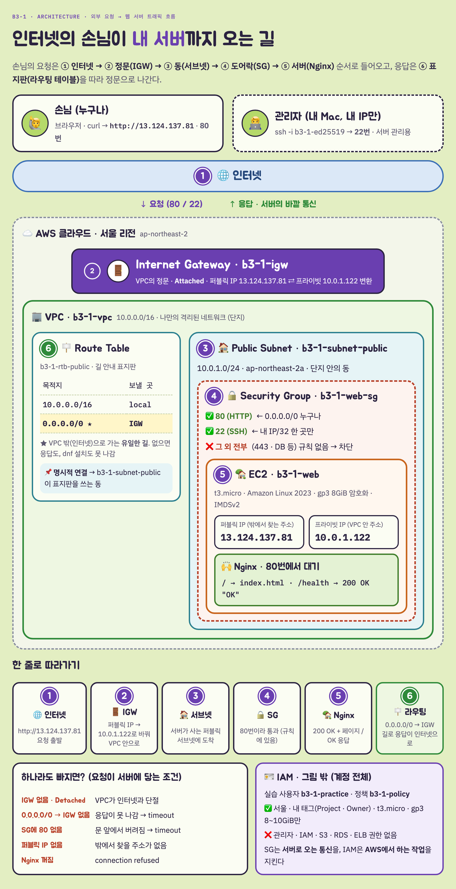

**요청이 서버에 닿는 다섯 가지 조건** — 하나라도 빠지면 접속이 안 된다.

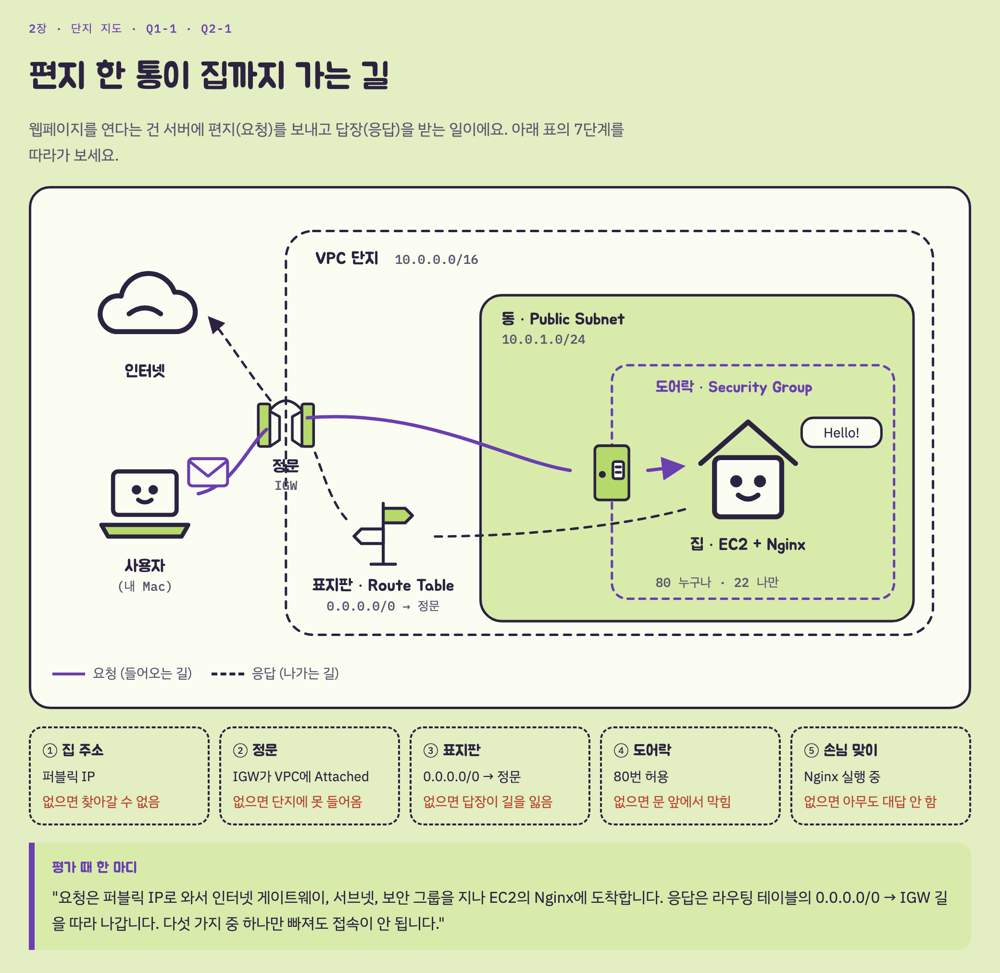

| # | 조건 | 하는 일 | 빠지면 |
|---|---|---|---|
| ① | **퍼블릭 IP** | 인터넷에서 서버를 찾는 주소 | 찾아갈 주소가 없음 |
| ② | **IGW** (VPC에 Attached) | 인터넷 ↔ VPC 출입구. 퍼블릭 IP ↔ 프라이빗 IP 연결 | 인터넷과 단절 |
| ③ | **Route Table** `0.0.0.0/0 → IGW` | 서버에서 **나가는** 트래픽(응답 포함)을 IGW로 안내 | 응답이 못 나감 → **타임아웃** |
| ④ | **Security Group** 80 허용 | **들어오는** 요청 중 허용된 포트만 통과 | 문 앞에서 막힘 → **타임아웃** |
| ⑤ | **Nginx 실행** | 요청에 웹페이지로 응답 | **Connection refused** |

**`0.0.0.0/0 → IGW`가 왜 필요한가** — `0.0.0.0/0`은 "다른 경로에 없는 나머지 모든 주소", 즉 인터넷이다. 이 경로가 VPC 밖으로 나가는 **유일한 길**이라, 없으면 요청이 와도 응답이 나가지 못하고 서버의 `dnf install`도 실패한다.

> 💡 Security Group은 **상태 저장(stateful)** 이라, 들어온 요청의 응답은 아웃바운드 규칙과 상관없이 나간다.

> 🎤 "요청은 퍼블릭 IP로 와서 IGW, 서브넷, 보안 그룹을 지나 EC2의 Nginx에 닿습니다. 응답은 라우팅 테이블의 0.0.0.0/0 → IGW 길로 나갑니다. 다섯 조건 중 하나만 빠져도 접속이 안 됩니다."

## 2-6. 동작 검증

> 📌 **원문**: 외부 접속 (A) 브라우저 또는 (B) `GET /health` 중 택 1, 방식과 접속 정보를 README에 기재 + 스크린샷 1장 이상 · 서버 안 `curl http://localhost` 200 · 서버에서 인터넷으로 나가기 (`curl https://example.com`)

**외부 접속 — 방식 B 선택**

| 항목 | 내용 |
|---|---|
| 선택 방식 | **(B) 헬스체크** `GET http://13.124.137.81/health` (방식 A 브라우저 화면도 첨부) |
| 접속 주소 | 웹페이지 `http://13.124.137.81/` · 상태 확인 `http://13.124.137.81/health` |
| 검증 시각 | 2026-11-24 10:58 KST (내 Mac, 서버 밖) |
| 결과 | **HTTP 200**, `Content-Type: text/plain`, 본문 `OK` |

**왜 B인가** — 결과가 숫자(200)와 고정 문구(`OK`)라 **누가 봐도 같은 판정**이 나오고, 명령 한 줄로 반복 확인할 수 있다. 로드 밸런서 헬스체크와 같은 방식이라 확장할 때도 그대로 쓴다 ([3-3](#3-3-응용-질문-대비)).

**어떻게 구성했나** — Nginx에 `/health` 주소를 만들고(`config/nginx.conf`), 2-5의 다섯 조건을 갖췄다.

```bash
# 내 Mac (서버 밖 = 진짜 외부)에서 실행
$ curl -i http://13.124.137.81/health
HTTP/1.1 200 OK
Server: nginx
Date: Tue, 24 Nov 2026 01:58:54 GMT
Content-Type: text/plain
Content-Length: 3
Connection: keep-alive
Cache-Control: no-store

OK
```

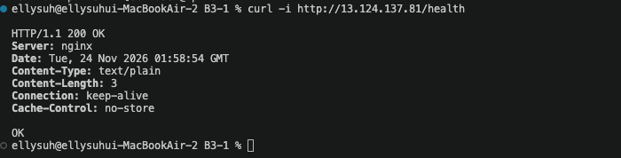

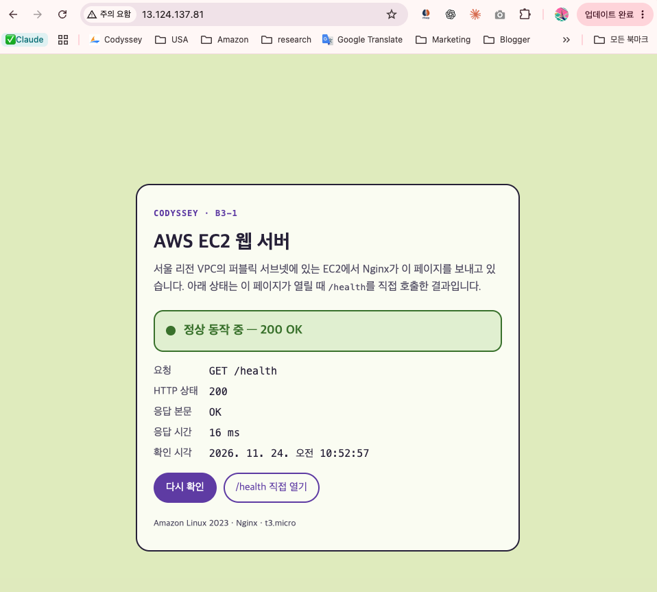

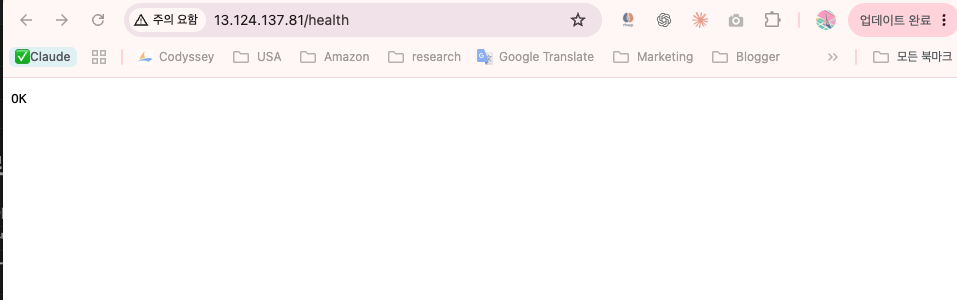

📄 원본 응답: [05-external-health.txt](docs/evidence/05-external-health.txt) · [05-external-home-headers.txt](docs/evidence/05-external-home-headers.txt)

> ⚠️ 퍼블릭 IP는 자동 할당이라 인스턴스를 종료하면 쓸 수 없다. 평가 후 정리하면 위 주소로 접속되지 않는다.

**서버 내부**

| 요구사항 | 확인 명령 | 기대 결과 | 결과 |
|---|---|---|---|
| SSH 접속 | `ssh -i ~/.ssh/b3-1-ed25519 ec2-user@13.124.137.81` (내 Mac) | 로그인 성공 | ✅ `[ec2-user@ip-10-0-1-122 ~]$` |
| 설정 검사 | `sudo nginx -t` | `syntax is ok`, `test is successful` | ✅ (경고 0개) |
| Nginx 실행 | `systemctl is-active nginx` | `active` | ✅ |
| 로컬 응답 | `curl -i http://localhost/` | `200 OK` | ✅ `text/html` 5398 bytes |
| 헬스체크 | `curl -i http://localhost/health` | `200 OK`, `OK` | ✅ |
| 아웃바운드 | `curl -I https://example.com` | `200` | ✅ `HTTP/2 200` ([캡처](docs/screenshots/05-example-com.png)) |

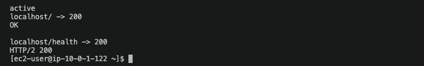

> 🎤 "B 방식을 골랐습니다. 서버 밖인 제 Mac에서 /health를 호출해 200과 OK를 받았고, 서버 안에서도 localhost 200과 example.com 접속을 확인했습니다."

📎 근거: 원본 로그 [05-deploy.log](docs/evidence/05-deploy.log) · [05-external-health.txt](docs/evidence/05-external-health.txt) · 리소스 ID [docs/evidence/resources.md](docs/evidence/resources.md)

## 2-7. 트러블슈팅

> 📌 **원문**: 최소 1건 이상 **증상 → 가설 → 검증 → 조치 → 결과 → 재발 방지** 기록 · `docs/troubleshooting.md`

실제로 생긴 **권한 오류**와, 아무 설정도 바꾸지 않고 재현한 **통신 오류**를 근거로 분석했다. 전체 6건은 [보고서](docs/troubleshooting.md)에 있다.

**사례 1 · [재현 실험] 통신 오류 — `https://`로 들어가면 안 열린다** (아무 설정도 바꾸지 않아 평가 때 **라이브로 재현**)

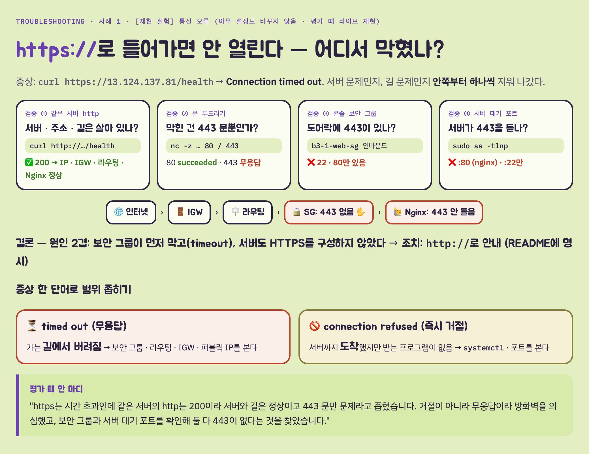

| 단계 | 요약 |
|---|---|
| 재현 방법 | Mac 터미널 `curl -v --max-time 5 https://13.124.137.81/health` (또는 브라우저 `https://13.124.137.81`) |
| 증상 | `Connection timed out after 5006 milliseconds` |
| 가설 | 서버 다운 / 길 끊김 / SG가 443 차단 / 서버가 443을 안 들음 |
| 검증 | http는 **200**(서버 · 길 정상) → `nc` 80 성공 · 443 **무응답**(방화벽 의심) → SG에 **443 없음** → 서버 `ss -tlnp`는 **:80만** |
| 조치 | 접속 주소를 `http://`로 안내 (이 README 맨 위) |
| 결과 | `http://13.124.137.81/health` → 200 OK |
| 재발 방지 | 실서비스라면 도메인 + 인증서 + SG 443 (보너스 과제, 미수행) |

> 🎬 평가 때 1분 재현 대본: [troubleshooting.md 사례 1](docs/troubleshooting.md#-평가-때-라이브-재현-1분-아무것도-바꾸지-않음)

**사례 2 · [실제 발생] 권한 오류 — 서버 시작이 거부됐다**

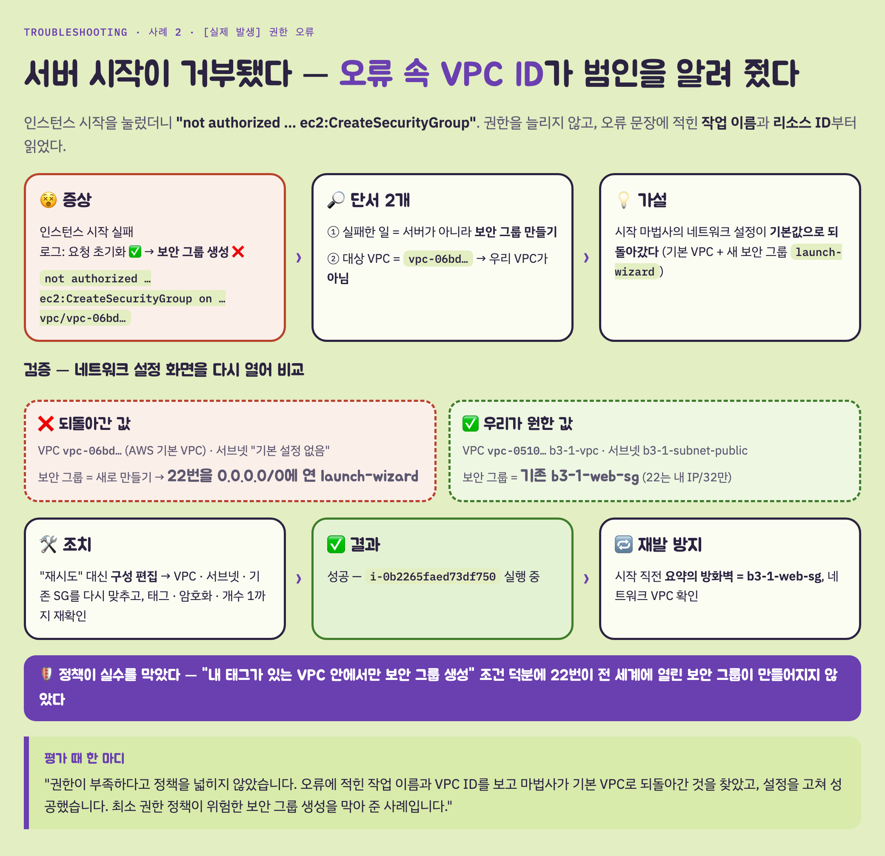

| 단계 | 요약 |
|---|---|
| 증상 | 인스턴스 시작 실패 — `not authorized … ec2:CreateSecurityGroup on … vpc/vpc-06bd…` |
| 가설 | 실패한 일은 **보안 그룹 생성**, 대상은 **기본 VPC** → 시작 마법사 네트워크 설정이 기본값으로 되돌아감 |
| 검증 | 구성 편집 화면: VPC `vpc-06bd…`(기본), 서브넷 "기본 설정 없음", SG는 다른 VPC 소속 |
| 조치 | 권한을 넓히지 않고 VPC · 서브넷 · **기존 SG**를 다시 맞춤 |
| 결과 | `i-0b2265faed73df750` 시작 성공. 정책이 22번 전체 개방 SG 생성을 **막아 준** 사례 |
| 재발 방지 | 시작 직전 요약의 방화벽 = `b3-1-web-sg`, 오류 속 작업 이름 · 리소스 ID부터 읽기 |

**외부 접속 장애 점검 순서**

| 순서 | 확인 | 방법 |
|---|---|---|
| 0 | 서버 문제인가, 네트워크 문제인가 | 서버 안 `curl http://localhost` → 실패면 4번, 성공이면 1번부터 |
| 1 | 라우팅 | `0.0.0.0/0 → IGW` · 서브넷 연결 · IGW `Attached` |
| 2 | 보안 그룹 | 인바운드 80 ← `0.0.0.0/0` |
| 3 | 퍼블릭 IP / DNS | IP가 있는가, 중지 · 시작으로 바뀌지 않았나 |
| 4 | 서버 프로세스 · 로그 | `systemctl status nginx` · `sudo ss -tlnp` · `/var/log/nginx/error.log` · `sudo nginx -t` |

증상으로 지름길을 찾는다: `timed out` → 1~3번(길에서 막힘), `Connection refused` → 4번(서버 프로그램).

> 🎤 **왜 라우팅부터인가** — "라우팅은 모든 포트와 들어오고 나가는 통신 전체에 영향을 주는 가장 바깥의 길이라 먼저 봅니다. 길이 정상이면 특정 포트를 막는 보안 그룹, 그다음 이 서버의 주소인 퍼블릭 IP, 마지막으로 서버 안 프로그램과 로그 순서로 범위를 좁힙니다. 다만 http는 되는데 https만 안 되는 것처럼 근거가 있으면, 이미 정상인 단계는 건너뛰고 바로 의심되는 곳으로 갑니다."

**왜 가설 → 검증 순서를 지키나** — 한꺼번에 바꾸면 원인을 모르고, "일단 다 열기" 같은 보안 구멍이 남는다. 근거(명령 출력 · 로그)로 범위를 좁혀 **한 번에 하나만** 고친다.

> 🎤 "먼저 서버 안에서 localhost를 호출해 서버 문제인지 네트워크 문제인지 나눴습니다. 그다음 라우팅, 보안 그룹, 퍼블릭 IP 순서로 하나씩 확인하고 근거를 남겼습니다."

📎 근거: [docs/troubleshooting.md](docs/troubleshooting.md) · [issues-log.md](docs/evidence/issues-log.md) · [06-repro-https.log](docs/evidence/06-repro-https.log)

## 2-8. 비용과 정리

> 📌 **원문**: 실습 후 리소스 정리 · 체크리스트에 "종료/삭제 완료" 근거 · 최소 EC2 · EBS · Elastic IP · IGW · VPC 확인 · EIP · NAT · ELB · RDS · EBS는 생성 시점부터 추적 · Billing 확인 권장

**유지 기간**: 평가(2026-11-24 ~ 25, 3회) 때 실제 접속을 시연하기 위해 서버를 켜 둔다. **모든 평가가 끝나고 정리를 결정한 뒤** 아래 순서로 삭제하고, 삭제 시각과 화면을 [체크리스트](docs/cleanup-checklist.md)에 남긴다. 그 전에는 중지 · 재시작도 하지 않는다(퍼블릭 IP가 바뀐다).

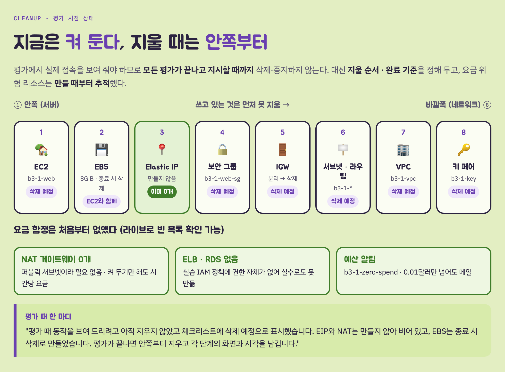

**정리 순서** (안쪽 → 바깥쪽. 사용 중인 리소스는 삭제되지 않기 때문이다)

```
 EC2 종료 → EBS 확인 → EIP 확인 → 보안 그룹 → IGW 분리·삭제 → Subnet·Route Table → VPC → 키 페어 → (루트) IAM 정리 · Billing 확인
```

**일부러 만들지 않은 리소스** (요금 위험을 처음부터 없앰)

| 리소스 | 만들지 않은 이유 |
|---|---|
| NAT Gateway | 프라이빗 서브넷이 없어 필요 없음. 시간당 요금 → **0개 확인** ([캡처](docs/screenshots/06-nat-empty.png)) |
| Elastic IP | 자동 할당 IP로 충분. 안 쓰고 두면 요금 → **0개 확인** ([캡처](docs/screenshots/06-eip-empty.png)) |
| Load Balancer (ALB) | 서버가 1대라 분산할 대상이 없음 |
| RDS | 정적 웹페이지라 DB가 필요 없음 |

**추적 · 정리 기준**

| 기준 | 내용 | 효과 |
|---|---|---|
| 이름 규칙 | 모든 리소스를 `b3-1-`로 시작 | 콘솔에서 "b3-1" 검색으로 바로 찾음 |
| 태그 | `Project=B3-1`, `Owner=b3-1-practice` (인스턴스 · 볼륨 · 네트워크 인터페이스까지) | 태그 필터로 실습 리소스만 골라냄. **IAM 정책이 태그 없는 생성을 거부**해 빠질 수 없음 |
| 리소스 목록 | 만들 때마다 ID 기록 → [resources.md](docs/evidence/resources.md) | 지울 때 하나씩 대조 |
| 체크리스트 | 삭제 순서 · 완료 기준 · 시각 · 캡처 → [cleanup-checklist.md](docs/cleanup-checklist.md) | 정리 완료를 증명 |

| 항목 | 내용 |
|---|---|
| 필수 정리 확인 | EC2 · EBS(`vol-0761089ffdc87b3bf`, 종료 시 삭제) · Elastic IP(0개) · Internet Gateway · VPC |
| 과금 기준 | 프리 티어는 **AWS 계정 전체** 기준이다 (IAM 사용자마다 따로 주어지지 않음) |
| 과금 감시 | **Free plan**(청구 없음) + 루트에서 **제로 지출 예산** `b3-1-zero-spend`(US$0.01 초과 시 메일, 인증 완료). 실습 IAM 사용자에는 결제 조회 권한이 없어 Billing 확인은 정리 후 루트로 한다 |
| 현재 상태 | **삭제 예정** (모든 평가 후 삭제) |
| 정리 완료 시각 | 평가 후 체크리스트에 기록 |

> 🎤 "요금이 나오는 NAT, EIP, ALB, RDS는 처음부터 만들지 않았습니다. 이름 규칙과 태그로 실습 리소스를 추적했고, 평가가 끝나면 서버부터 네트워크 순으로 지우고 체크리스트에 시각과 화면을 남깁니다."

📎 근거: [docs/cleanup-checklist.md](docs/cleanup-checklist.md) · [resources.md](docs/evidence/resources.md) · [06-ebs-volume.png](docs/screenshots/06-ebs-volume.png)

---

# Ⅲ. 결론 — 무엇을 달성했는가

## 3-1. 요구사항 충족표

미션 원문의 요구사항을 한 줄씩 대조한다.

| 영역 | 원문 요구사항 | 결과 | 근거 |
|---|---|---|---|
| 네트워크 | VPC 1개 | ✅ | [2-2](#2-2-네트워크-구성) |
| | Public Subnet 1개 | ✅ | [2-2](#2-2-네트워크-구성) |
| | IGW를 VPC에 연결 | ✅ | [2-2](#2-2-네트워크-구성) |
| | Route Table에 `0.0.0.0/0 → IGW` | ✅ | [2-2](#2-2-네트워크-구성) |
| | 인스턴스의 인터넷 아웃바운드 (`curl https://example.com`) | ✅ | [2-6](#2-6-동작-검증) |
| 컴퓨트 | Public Subnet에 EC2 1대 | ✅ | [2-4](#2-4-서버-구성) |
| | SSH 접속 | ✅ | [2-6](#2-6-동작-검증) |
| | 웹 서버 설치 · 실행 | ✅ | [2-4](#2-4-서버-구성) · [2-6](#2-6-동작-검증) |
| | `curl http://localhost` → 200 | ✅ | [2-6](#2-6-동작-검증) |
| 보안 그룹 | 필요한 포트만 허용 | ✅ | [2-3](#2-3-보안-그룹) |
| | HTTP 80 ← `0.0.0.0/0` | ✅ | [2-3](#2-3-보안-그룹) |
| | SSH 22 ← 개인 IP만 | ✅ | [2-3](#2-3-보안-그룹) |
| | `0.0.0.0/0` 전체 포트 규칙 없음 | ✅ | [2-3](#2-3-보안-그룹) |
| IAM | IAM 사용자 1개 사용 | ✅ | [2-1](#2-1-권한-준비-iam) |
| | EC2 · VPC · SG 범위로 제한, S3 · RDS 권한 없음 | ✅ | [2-1](#2-1-권한-준비-iam) · [정책](infra/iam-policy.json) |
| | 관리자 권한 없음 | ✅ | [2-1](#2-1-권한-준비-iam) |
| 외부 접속 | A/B 중 택 1, README에 방식 명시 | ✅ (B) | [2-6](#2-6-동작-검증) |
| 정리 | 체크리스트에 종료 · 삭제 근거 | 🕒 평가 후 (삭제 예정 · 순서 · 기준 준비 완료) | [2-8](#2-8-비용과-정리) |
| | EC2 · EBS · EIP · IGW · VPC 정리 확인 | 🕒 평가 후 (EIP · NAT 0개 확인) | [체크리스트](docs/cleanup-checklist.md) |
| 제약 | 프리 티어 범위 | ✅ | [2-4](#2-4-서버-구성) |
| | 루트 계정 미사용 (IAM 사용자로만 실습) | ✅ | [2-1](#2-1-권한-준비-iam) |
| | 서울 리전 | ✅ | [2-1](#2-1-권한-준비-iam) · [2-2](#2-2-네트워크-구성) |
| | micro 1대 · Amazon Linux · EBS 8~10GiB · 키 페어 안전 보관 | ✅ | [2-4](#2-4-서버-구성) |
| | 과금 리소스 생성 시점부터 추적 | ✅ | [2-8](#2-8-비용과-정리) |
| 보너스 | HTTPS / Docker (선택) | **미수행** | — |

## 3-2. 과제 목표 답변

| # | 과제 목표 (원문) | 평가 때 답 | 근거 |
|---|---|---|---|
| 1 | VPC · Subnet · Route Table · IGW의 역할과 트래픽 흐름 | VPC는 나만의 네트워크, Subnet은 그 구역, IGW는 인터넷 출입구, Route Table은 길 안내표입니다. 요청은 **IGW → Subnet → SG → EC2**로 들어오고, 응답은 **Route Table `0.0.0.0/0 → IGW`** 를 따라 나갑니다. | [2-2](#2-2-네트워크-구성) · [2-5](#2-5-요청-흐름) |
| 2 | Security Group과 IAM의 차이, 최소 권한을 왜 · 어떻게 | SG는 **네트워크 통신**을, IAM은 **AWS 작업**을 통제합니다. 털리거나 실수해도 피해를 줄이려고, 포트는 80 · 22만, 권한은 서울 · 내 태그 · 작은 크기로만 줬습니다. | [2-1](#2-1-권한-준비-iam) · [2-3](#2-3-보안-그룹) |
| 3 | 외부 요청이 웹 서버에 닿기 위한 설정 | **퍼블릭 IP, VPC에 붙은 IGW, `0.0.0.0/0 → IGW` 경로, SG 80 허용, Nginx 실행** 다섯 가지가 모두 있어야 합니다. | [2-5](#2-5-요청-흐름) |
| 4 | 로그 · 증상 근거의 트러블슈팅 | `localhost`로 서버 · 네트워크 문제를 먼저 나누고, `timed out`이면 길, `refused`면 서버 프로그램을 봅니다. 가설을 하나씩 검증하고 하나만 고칩니다. | [2-7](#2-7-트러블슈팅) |
| 5 | 과금 요인과 안전한 정리 순서 · 이유 | 켜진 서버, 남은 디스크, 안 쓰는 IP, NAT가 요금을 만듭니다. 쓰고 있는 리소스는 지울 수 없어 **서버 → 네트워크** 순서로 지웁니다. | [2-8](#2-8-비용과-정리) |

## 3-3. 응용 질문 대비

**권한이 부족해 작업이 실패하면?** — 오류 메시지에서 막힌 Action과 리소스를 찾아, 그 작업 하나만 리전 · 리소스 조건을 붙여 추가합니다. 관리자 권한은 주지 않습니다. 계정이 털려도 피해를 그 범위 안에 가두기 위해서입니다.

```
오류 읽기 (not authorized to perform: ec2:CreateRoute)
 → 막힌 Action 하나만 추가 → 서울 · 내 태그 조건으로 범위 제한 → 다시 시도
```

이번 실습에서도 **태그를 빠뜨리면 생성이 거부**되도록 설계했다. 권한을 늘리는 대신 태그를 넣어 해결한다.

**서버를 2대로 늘려야 하면?**

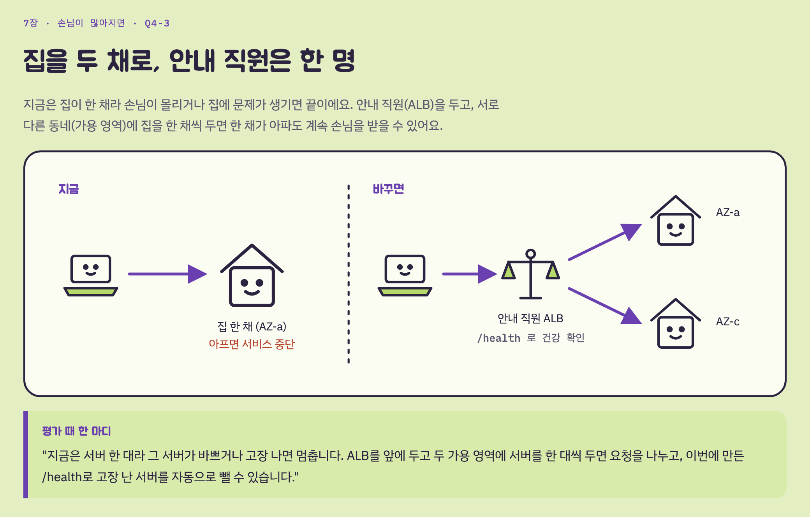

| 지금의 병목 | 해결 |
|---|---|
| EC2 1대 (고장 나면 전체 중단) | EC2 2대 이상 (Auto Scaling Group) |
| 가용 영역 1곳 | 서로 다른 AZ에 서브넷을 하나씩 |
| 퍼블릭 IP가 서버 1대에 묶임 | **ALB**가 하나의 주소로 받아 나눔. ALB가 `/health`로 고장 난 서버를 뺌 |

**예상치 못한 비용이 나오면?** — Cost Explorer에서 서비스 · 리전을 먼저 보고, **EC2 → EBS(남은 볼륨 · 스냅샷) → EIP → NAT → CPU 크레딧** 순으로 의심한다. 태그 `Project=B3-1`로 찾아 체크리스트대로 지우고, **다른 리전**도 확인한다.

## 3-4. 정리하며

| 배운 점 | 내용 |
|---|---|
| 클라우드는 환경이다 | 서버 하나를 공개하는 데도 네트워크 · 보안 · 권한이 **모두 맞물려야** 한다 |
| 보안은 "최소"가 기본이다 | 포트도, 권한도 **필요한 만큼만** 열면 실수해도 피해가 작다 |
| 정리까지가 운영이다 | 만드는 것만큼 **지우는 순서와 확인**이 중요하다 |


---

# 부록

## A. 용어 정리

| 용어 | 쉬운 설명 | 이 미션에서 |
|---|---|---|
| **리전** | AWS 데이터센터가 있는 **지역** | 서울 `ap-northeast-2` |
| **프리 티어** | 신규 계정에 주는 **무료 사용량** | micro 서버 1대 범위 |
| **포트** | 한 컴퓨터 안의 **문 번호** | 80 = 웹, 22 = 원격 접속 |
| **HTTP** | 웹페이지를 주고받는 규칙 | 브라우저 → 서버 80번 |
| **SSH** | 다른 컴퓨터에 **원격 접속**하는 방법 | 내 Mac → 서버 22번 |
| **키 페어** | SSH용 **자물쇠(공개 키) + 열쇠(개인 키)** | AWS에 공개 키 `b3-1-key`, Mac에 개인 키 `~/.ssh/b3-1-ed25519` |
| **CIDR** | IP 주소 **범위** 표기법 | `10.0.0.0/16` ≈ 6.5만 개 |
| **`0.0.0.0/0`** | **모든** IP 주소 | 웹(80) 허용 대상, 인터넷 경로 |
| **`/32`** | IP 주소 **딱 1개** | SSH(22) 허용 대상 (내 IP) |
| **태그** | 리소스에 붙이는 **"키 = 값" 이름표** | `Project=B3-1`, `Owner=b3-1-practice` |
| **최소 권한 원칙** | 꼭 **필요한 만큼만** 허락 | 포트와 권한 모두에 적용 |

## B. 다시 만들 때

1. IAM 사용자로 로그인 → 리전 **서울** 확인 (모든 생성 화면에 태그 `Project=B3-1`, `Owner=b3-1-practice`)
2. VPC → Subnet → IGW 생성 후 **VPC에 연결**
3. Route Table에 `0.0.0.0/0 → IGW` 추가 → **Subnet에 연결**
4. Security Group: HTTP 80 ← `0.0.0.0/0`, SSH 22 ← **현재** 내 IP `/32`
5. 키 페어 가져오기 (ed25519 공개 키) → EC2: Amazon Linux 2023 · t3.micro · 퍼블릭 IP 활성화 · 기존 보안 그룹 · gp3 8GiB 암호화 · 크레딧 Standard · IMDSv2만
6. SSH 접속 → Nginx 설치 → `config/nginx.conf` · `site/index.html` 배포 ([2-4](#2-4-서버-구성) 명령)
7. 검증 → 증빙 저장 → (평가 후) 리소스 정리

## C. 파일 구성

| 경로 | 설명 |
|---|---|
| [infra/iam-policy.json](infra/iam-policy.json) | IAM 최소 권한 정책 |
| [config/nginx.conf](config/nginx.conf) | Nginx 설정 (`/health` → `OK`) |
| [site/index.html](site/index.html) | 웹페이지 |
| [docs/architecture.png](docs/architecture.png) | 아키텍처 다이어그램 |
| [docs/troubleshooting.md](docs/troubleshooting.md) | 트러블슈팅 보고서 |
| [docs/cleanup-checklist.md](docs/cleanup-checklist.md) | 리소스 정리 체크리스트 |
| [docs/walkthrough.md](docs/walkthrough.md) | 장면별 진행 기록 (캡처) |
| `docs/screenshots/` | 화면 캡처 |
| [docs/evidence/resources.md](docs/evidence/resources.md) | 만든 리소스 ID · 상태 · 정리 순서 (과금 추적) |
| [docs/evidence/permission-tests.md](docs/evidence/permission-tests.md) | IAM 거부 테스트 기록 |
| [docs/evidence/issues-log.md](docs/evidence/issues-log.md) | 실습 중 실제로 생긴 오류 메모 |
| [docs/evidence/05-deploy.log](docs/evidence/05-deploy.log) · [05-install.log](docs/evidence/05-install.log) | SSH · 설치 · 배포 · 서버 안 확인 로그 |
| [docs/evidence/05-external-health.txt](docs/evidence/05-external-health.txt) | 외부(내 Mac) `/health` 응답 원문 |
| [docs/evidence/06-repro-https.log](docs/evidence/06-repro-https.log) | [재현 실험] HTTPS 443 로그 |
| `docs/readme/` · `docs/study/` | README 설명 그림 |
