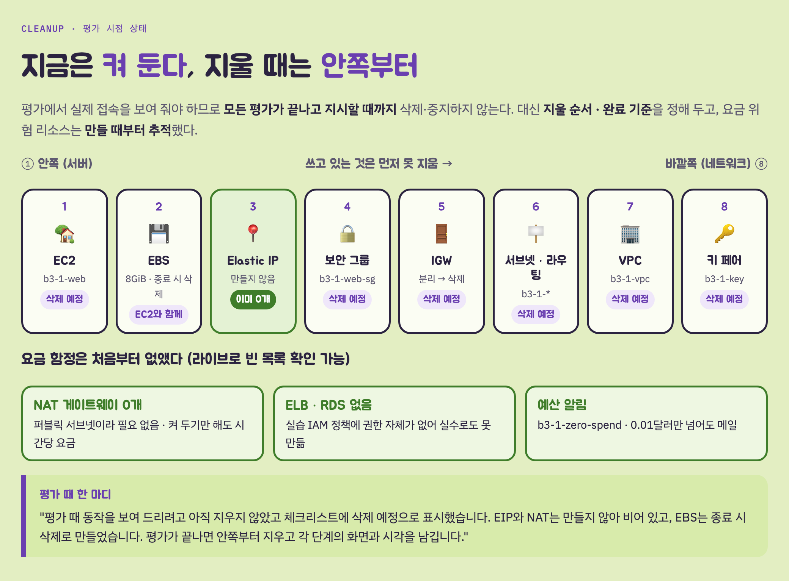

# 리소스 정리 체크리스트

> **현재 상태: 삭제 예정** (2026-11-24 ~ 25 평가 진행 중)
> 평가에서 실제 접속을 시연하기 위해 서버를 켜 둔다. **모든 평가가 끝난 뒤 정리를 지시할 때** 아래 순서대로 삭제하고, `[ ]`를 `[x]`로 바꾸며 확인 시각과 캡처를 남긴다.
> 그 전까지는 **삭제 · 중지 · 재시작을 하지 않는다** (중지했다 켜면 퍼블릭 IP가 바뀐다).



## 삭제 순서: 안쪽(서버)부터 바깥쪽(네트워크)으로

다른 리소스가 쓰고 있는 리소스는 지워지지 않는다. 그래서 서버를 먼저 지우고, 그다음 서버를 감싸던 네트워크를 지운다.

```
 EC2 ─→ EBS 확인 ─→ EIP 확인 ─→ 보안 그룹 ─→ IGW 분리·삭제 ─→ 서브넷·라우팅 테이블 ─→ VPC ─→ 키 페어 ─→ (루트) IAM · Billing
 서버     디스크      고정 주소     문단속        정문              동·표지판                단지     열쇠          출입증·요금
```

시작 전에 콘솔 오른쪽 위 리전이 **서울(`ap-northeast-2`)** 인지 확인한다. 아래 ID는 [evidence/resources.md](evidence/resources.md)와 하나씩 대조한다.

## 미션 필수 5종 + 실습 리소스

**굵게** 표시한 5종(EC2 · EBS · Elastic IP · Internet Gateway · VPC)은 미션 필수 확인 항목이다.

| # | 리소스 | 이름 / ID | 평가 시점 상태 | 삭제 방법 | 완료 기준 | 완료 | 확인 시각 · 캡처 |
|---|---|---|---|---|---|---|---|
| 1 | **EC2** | `b3-1-web` · `i-0b2265faed73df750` | 실행 중 · 삭제 예정 | EC2 → 인스턴스 → 인스턴스 상태 → **종료(Terminate)** | 상태 `Terminated` | [ ] | |
| 2 | **EBS 볼륨** | `vol-0761089ffdc87b3bf` (8GiB gp3) | 사용 중 · "종료 시 삭제 = 예" | 1번과 함께 자동 삭제 → EC2 → 볼륨에서 **남은 것 없음** 확인 | 볼륨 목록 비어 있음 | [ ] | |
| 3 | **Elastic IP** | — | ✅ **만들지 않음 (0개 확인)** | 할 일 없음. EC2 → 탄력적 IP 목록만 다시 확인 | 목록 비어 있음 | [ ] | 평가 전: [06-eip-empty.png](screenshots/06-eip-empty.png) |
| 4 | 보안 그룹 | `b3-1-web-sg` · `sg-00c3b629679064cd6` | 사용 중 · 삭제 예정 | EC2 → 보안 그룹 → 삭제 | `default`만 남음 | [ ] | |
| 5 | **Internet Gateway** | `b3-1-igw` · `igw-0c1652057dab7b750` | Attached · 삭제 예정 | VPC → 인터넷 게이트웨이 → 작업 → **VPC에서 분리(Detach)** → 삭제 | 목록에서 사라짐 | [ ] | |
| 6 | 서브넷 · 라우팅 테이블 | `subnet-006ec6df5bf1c7b2e` · `rtb-033c2174194a9bc48` | 사용 중 · 삭제 예정 | 서브넷 삭제 → 라우팅 테이블(명시적 연결 해제 후) 삭제 | 목록에서 사라짐 | [ ] | |
| 7 | **VPC** | `b3-1-vpc` · `vpc-0510d8b165db77c1c` | Available · 삭제 예정 | VPC → `b3-1-vpc` → 삭제 (기본 SG · 기본 라우팅 · ACL 함께 삭제) | 실습 VPC 없음 | [ ] | |
| 8 | 키 페어 | `b3-1-key` · `key-05d49e6b084800e6e` | 등록됨 · 삭제 예정 | EC2 → 키 페어 → 삭제 (Mac의 개인 키 `~/.ssh/b3-1-ed25519`는 따로 보관 또는 삭제) | 목록에서 사라짐 | [ ] | |
| 9 | IAM 사용자 · 정책 | `b3-1-practice` · `b3-1-policy` | 사용 중 | **루트로 로그인해** 삭제 여부 결정 (사용자 → 정책 순) | 결정 내용 기록 | [ ] | |
| 10 | Billing 확인 (권장) | — | 예산 `b3-1-zero-spend` 정상 · US$0.00 | **루트로** Billing 홈 · 청구서에서 요금 항목 없음 확인 | 이번 달 요금 0 | [ ] | |

## 요금이 나오는데 만들지 않은 리소스

| 리소스 | 상태 | 확인 방법 | 근거 |
|---|---|---|---|
| NAT Gateway | ✅ **만들지 않음 (0개 확인)** | VPC → NAT 게이트웨이 목록 | [06-nat-empty.png](screenshots/06-nat-empty.png) |
| ELB / ALB | ✅ **만들지 않음** | 실습 IAM 사용자에게 로드 밸런서 권한 자체가 없음 | [IAM 정책](../infra/iam-policy.json) |
| RDS | ✅ **만들지 않음** | 실습 IAM 사용자에게 RDS 권한 자체가 없음 | [IAM 정책](../infra/iam-policy.json) |
| 미사용 EBS | ✅ **없음** | 볼륨은 EC2 루트 1개뿐 | [06-ebs-volume.png](screenshots/06-ebs-volume.png) |

## 과금 확인

| 항목 | 내용 |
|---|---|
| 계정 플랜 | **Free plan** — 크레딧 범위 안에서만 사용, 요금 청구 없음 ([00-01-free-plan.png](screenshots/00-01-free-plan.png)) |
| 예산 알림 | 루트 계정에서 **제로 지출 예산** `b3-1-zero-spend` 생성 · 메일 인증 1/1 — 실제 비용이 US$0.01을 넘으면 메일 ([00-02-budget.png](screenshots/00-02-budget.png)) |
| Billing 화면 | 실습 IAM 사용자에게는 결제 조회 권한이 없다. 정리 후 **루트 계정으로** 10번에서 확인한다 (원문 권장 항목) |

## 증빙 캡처

| 시점 | 화면 | 파일 |
|---|---|---|
| 평가 전 ✅ | 탄력적 IP 목록 비어 있음 | [screenshots/06-eip-empty.png](screenshots/06-eip-empty.png) |
| 평가 전 ✅ | NAT 게이트웨이 목록 비어 있음 | [screenshots/06-nat-empty.png](screenshots/06-nat-empty.png) |
| 평가 전 ✅ | 볼륨 1개 (EC2 루트) | [screenshots/06-ebs-volume.png](screenshots/06-ebs-volume.png) |
| 평가 전 ✅ | 제로 지출 예산 | [screenshots/00-02-budget.png](screenshots/00-02-budget.png) |
| 평가 후 | EC2 `Terminated` | `screenshots/07-ec2-terminated.png` |
| 평가 후 | 볼륨 목록 비어 있음 | `screenshots/07-ebs-empty.png` |
| 평가 후 | 탄력적 IP 목록 비어 있음 (재확인) | `screenshots/07-eip-empty.png` |
| 평가 후 | 인터넷 게이트웨이 목록에서 사라짐 | `screenshots/07-igw-deleted.png` |
| 평가 후 | VPC 목록에 `b3-1-vpc` 없음 | `screenshots/07-vpc-deleted.png` |
| 평가 후 (권장) | Billing 요금 0 | `screenshots/07-billing.png` |
