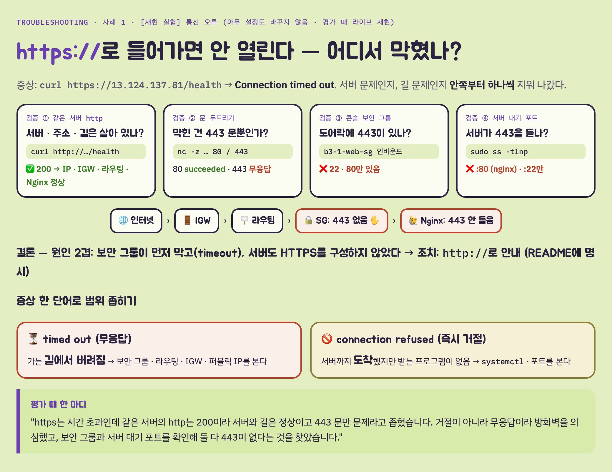
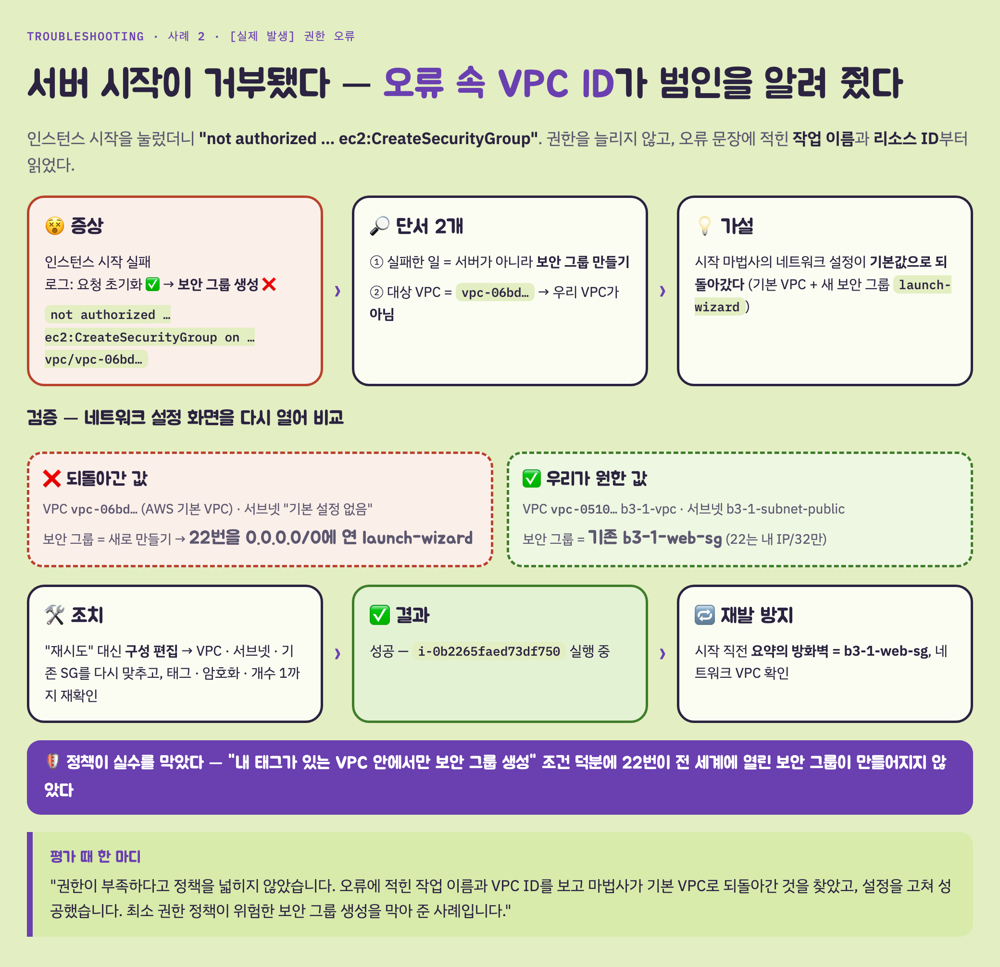

# 트러블슈팅 보고서

## 이 보고서를 읽는 법

미션 원문은 이 보고서에서 **오류 재현 · 분석 · 해결 과정**을 확인하고, 최소 1건 이상이 **증상 → 가설 → 검증 → 조치 → 결과 → 재발방지** 순서로 기록되어 있어야 한다고 요구한다. 각 사례는 아래처럼 대응한다.

| 원문 요구 | 이 보고서의 칸 | 무엇을 쓰나 |
|---|---|---|
| **재현** | **재현 방법** · **증상** | 오류를 다시 일으키는 명령(또는 조작)과, 그때 나온 오류 문장 원문 |
| **분석** | **가설** · **검증** | 원인 후보를 세우고, 명령 출력 · 콘솔 화면으로 **하나씩 확인해 지워 나간** 과정 |
| **해결** | **조치** · **결과** · **재발 방지** | 딱 하나 바꾼 것 → 다시 확인한 결과 → 다음에 같은 일이 없게 정한 규칙 |

**기록 원칙**
- 실습 중 **실제로 생긴 오류**는 `[실제 발생]`, 일부러 다시 일으킨 오류는 `[재현 실험]`으로 표시한다. 지어낸 사례나 로그는 쓰지 않는다.
- 권한을 "일단 다 열기"로 풀지 않는다. 오류 문장에서 **작업 이름 · 리소스 ID**를 먼저 읽고, **한 번에 하나만** 바꾼다.
- 계정 ID와 내 공인 IP는 `<ACCOUNT_ID>`, `<MY_IP>`로 가렸다.

## 한눈에 보기

| # | 구분 | 종류 | 증상 (한 줄) | 원인 | 조치 | 평가 때 |
|---|---|---|---|---|---|---|
| **1** | **[재현 실험]** | **통신** | `https://` 접속 → `Connection timed out` | SG에 443 없음 + 서버도 443 안 들음 | `http://`로 안내 | 🟢 **라이브 재현** |
| **2** | **[실제 발생]** | **권한** | 인스턴스 시작 → `ec2:CreateSecurityGroup` 거부 | 시작 마법사가 **기본 VPC**로 되돌아감 | 우리 VPC · 기존 SG로 다시 맞춤 | 📁 캡처 · 로그 |
| 3 | [실제 발생] | 권한 | VPC 생성 `ec2:CreateVpc` 거부 | 태그 키 오타 `Projec` | `Project`로 수정 | 📁 |
| 4 | [실제 발생] | 설정 | `nginx -t` 경고 + `inactive` | `types_hash_max_size` 누락 · 시작 명령 누락 | 한 줄 추가 · `enable --now` | 📁 |
| 5 | [실제 발생] | 권한 | SG 생성 중 "아웃바운드 규칙 설명 업데이트" 실패 | 정책에 없는 부가 작업(설명 메모) | 권한 추가 안 함 · 규칙만 확인 | 📁 |
| 6 | [실제 발생] | 입력 | IAM 정책 생성 "잘못된 문자" | 설명 칸의 허용되지 않는 문자 | 설명 문구 수정 | 📁 |

미션 소개의 "**통신/권한 오류**"에 맞춰 통신 1건(사례 1)과 권한 1건(사례 2)을 자세히 쓰고, 나머지는 요약했다. 원본 메모: [evidence/issues-log.md](evidence/issues-log.md)

---

## 사례 1. [재현 실험] HTTPS(443)로 접속하면 시간 초과



> **아무 설정도 바꾸지 않는 실험**이다. 사용자가(또는 브라우저가 자동으로) 주소를 `https://`로 바꿔 접속하는 실제 상황을 재현했다. 언제든 같은 결과가 나오므로 **평가 자리에서 그대로 다시 보여 줄 수 있다.**

### 6단계 기록

| 단계 | 내용 |
|---|---|
| 일시 · 위치 | 2026-11-24 (KST) · 서버 밖(내 Mac) → `13.124.137.81` |
| **재현 방법** | Mac 터미널에서 `curl -v --max-time 5 https://13.124.137.81/health` (또는 브라우저 주소창에 `https://13.124.137.81`) |
| **① 증상** | `* Trying 13.124.137.81:443...` → **`Connection timed out after 5006 milliseconds`** · `curl: (28)`. 브라우저에서는 "사이트에 연결할 수 없음" |
| **② 가설** | 원인 후보를 **안쪽(서버)부터** 세운다 — (가) Nginx가 꺼졌다 (나) 퍼블릭 IP · IGW · 라우팅 길이 끊겼다 (다) **보안 그룹이 443을 막는다** (라) **서버가 443을 듣지 않는다** |
| **③ 검증** | 아래 검증 표 ①~④. (가)(나)는 **http 200**으로 제외, "거절이 아닌 **무응답**"이라 방화벽으로 좁힘, 콘솔에서 **SG에 443 없음**, 서버 `ss`에서 **443 대기 없음** 확인 |
| **④ 조치** | 설정은 바꾸지 않고 **접속 주소를 `http://`로 안내** (README 맨 위 "반드시 `http://`" 명시). HTTPS는 보너스 과제로 이번에 구성하지 않음 |
| **⑤ 결과** | `curl -i http://13.124.137.81/health` → **`HTTP/1.1 200 OK`**, `Content-Type: text/plain`, 본문 `OK` · 브라우저 🟢 "정상 동작 중" |
| **⑥ 재발 방지** | ① README · 평가 안내에 **`http://` 주소를 명시** ② 접속 장애는 **"서버 안 → 길 → 문 → 서버 포트" 순서**로 점검하고, `timed out`이면 길 · 방화벽, `refused`면 서버 프로세스부터 본다 ③ 실서비스라면 도메인 + 인증서(Let's Encrypt) + SG 443 추가 |

### 검증 과정 (분석)

| # | 가설 | 확인한 것 | 명령 · 화면 | 결과 | 판단 |
|---|---|---|---|---|---|
| ① | (가)(나) | 같은 서버를 **http**로 | `curl -s -o /dev/null -w "http -> %{http_code}\n" http://13.124.137.81/health` | **`http -> 200`** | 서버 · 퍼블릭 IP · IGW · 라우팅 **정상** → (가)(나) 제외. 문제는 "443 문"에 한정 |
| ② | (다) | 포트별 **문 두드리기** | `nc -z -G 5 13.124.137.81 80` / `443` | 80 **succeeded** · 443 **무응답** | "즉시 거절"이 아니라 "무응답" = 길에서 **버려짐** → 방화벽(SG) 의심 |
| ③ | (다) | **보안 그룹** 인바운드 | 콘솔 → `b3-1-web-sg` → 인바운드 규칙 | SSH 22 ← `<MY_IP>/32` · HTTP 80 ← `0.0.0.0/0` | **443 규칙 없음** → (다) 확인 |
| ④ | (라) | 서버가 **듣는 포트** | `sudo ss -tlnp` · `grep listen /etc/nginx/nginx.conf` | `:80`(nginx) · `:22`(sshd)만 · `listen 80` | **443 대기 없음** → (라)도 해당 (원인 2겹) |

**결론** — 원인은 2겹이다. 보안 그룹이 443을 **먼저** 버리고(그래서 `timed out`), 설령 열어도 서버가 443(HTTPS)을 듣지 않는다. 서버와 네트워크 경로는 정상이다.

### 근거 로그

```text
# ① 증상 (재현)
$ curl -v --max-time 5 https://13.124.137.81/health
*   Trying 13.124.137.81:443...
* Connection timed out after 5006 milliseconds
curl: (28) Connection timed out after 5006 milliseconds

# ③ 검증 ①
$ curl -s -o /dev/null -w "http -> %{http_code}\n" --max-time 5 http://13.124.137.81/health
http -> 200

# ③ 검증 ②
$ nc -z -G 5 13.124.137.81 80
Connection to 13.124.137.81 port 80 [tcp/http] succeeded!
$ nc -z -G 5 13.124.137.81 443
(응답 없음 — 5초 후 종료)

# ③ 검증 ④ (서버)
$ sudo ss -tlnp
LISTEN 0 128 0.0.0.0:22  users:(("sshd",...))
LISTEN 0 511 0.0.0.0:80  users:(("nginx",...))
$ sudo grep -E "listen" /etc/nginx/nginx.conf
        listen      80 default_server;

# ⑤ 결과
$ curl -i http://13.124.137.81/health
HTTP/1.1 200 OK
Content-Type: text/plain

OK
```

📎 캡처: [06-repro-https.png](screenshots/06-repro-https.png) · [03-sg-inbound.png](screenshots/03-sg-inbound.png) · [05-external-health.png](screenshots/05-external-health.png) · 원본 로그: [evidence/06-repro-https.log](evidence/06-repro-https.log)

### 🎬 평가 때 라이브 재현 (1분, 아무것도 바꾸지 않음)

Mac 터미널(줄 앞 `ellysuh@…`)과 AWS 콘솔(IAM 사용자 `b3-1-practice`, 서울)을 열어 둔다.

| 순서 | 6단계 | 보여 줄 것 | 말할 것 |
|---|---|---|---|
| 1 | **증상 (재현)** | `curl -v --max-time 5 https://13.124.137.81/health` → `Connection timed out` | "https로 들어오면 응답이 없습니다" |
| 2 | **가설** | (말로) | "서버가 꺼졌나, 길이 끊겼나, 443 문이 막혔나, 서버가 443을 안 듣나 — 안쪽부터 지워 보겠습니다" |
| 3 | **검증 ①** | `curl -i http://13.124.137.81/health` → `200 OK` | "같은 서버가 http로는 정상이니 서버와 길은 문제없습니다" |
| 4 | **검증 ②** | `nc -z -G 5 13.124.137.81 443` → 무응답 | "거절이 아니라 무응답이라 길에서 버려진 것, 즉 방화벽입니다" |
| 5 | **검증 ③** | 콘솔 → 보안 그룹 `b3-1-web-sg` → 인바운드 규칙 | "22번과 80번만 있고 443은 없습니다. 서버도 80만 듣습니다(기록)" |
| 6 | **조치 · 결과** | 브라우저 `http://13.124.137.81/` → 🟢 | "http로 안내하면 정상입니다" |
| 7 | **재발 방지** | README 맨 위 "반드시 `http://`" | "주소를 명시했고, 실서비스라면 인증서와 443을 엽니다" |

> 터미널 없이 브라우저만으로도 된다: `https://13.124.137.81` → 연결할 수 없음 / `http://13.124.137.81` → 🟢. 다만 브라우저는 시간 초과까지 20~30초 걸릴 수 있어 `curl`(5초)이 빠르다.

**덤으로 얻은 근거** — 같은 시각 서버 `access.log`에, 공개 몇 분 만에 해외 스캐너가 80번에 접속한 기록이 있었다(`"research-scan"`). 열린 포트는 곧바로 탐색된다 → **22번 · DB 포트를 `0.0.0.0/0`에 열면 안 되는 실제 이유.**

---

## 사례 2. [실제 발생] EC2 시작 실패 — 기본 VPC에 보안 그룹을 만들려다 거부됨



### 6단계 기록

| 단계 | 내용 |
|---|---|
| 일시 · 위치 | 2026-11-24 오전 (KST) · STEP 4 · 콘솔 (IAM 사용자 `b3-1-practice`) |
| **재현 방법** | EC2 인스턴스 시작 마법사에서 네트워크 설정을 **기본값(기본 VPC + "보안 그룹 생성")** 으로 둔 채 "인스턴스 시작" (실제로는 키 페어 확인 창을 거치며 설정이 기본값으로 되돌아가 발생) |
| **① 증상** | "인스턴스 시작 실패". 로그: 요청 초기화 ✅ → **보안 그룹 생성 ❌**. 오류: `You are not authorized to perform this operation. User: …:user/b3-1-practice is not authorized to perform: ec2:CreateSecurityGroup on resource: arn:aws:ec2:ap-northeast-2:<ACCOUNT_ID>:vpc/vpc-06bd8039727c75e6b because no identity-based policy allows the ec2:CreateSecurityGroup action` |
| **② 가설** | (가) 서버를 만들 권한이 없다 (나) **실패한 작업은 서버가 아니라 보안 그룹 생성**이고, 대상 VPC가 우리 것이 아니다 → 시작 마법사의 네트워크 설정이 **기본값으로 되돌아갔다** |
| **③ 검증** | ① 오류 문장의 작업 이름 = `ec2:CreateSecurityGroup` (RunInstances 아님) → (가) 제외 ② 대상 `vpc-06bd…` ≠ 우리 `vpc-0510…` ③ "인스턴스 구성 편집"으로 돌아가 보니 VPC `vpc-06bd…`(기본값), 서브넷 "기본 설정 없음", 보안 그룹 칩만 `b3-1-web-sg`(다른 VPC 소속) → (나) 확인 |
| **④ 조치** | 권한을 넓히지 않고, "실패한 작업 재시도" 대신 구성 편집 → VPC `b3-1-vpc`, 서브넷 `b3-1-subnet-public`, 퍼블릭 IP 활성화, **기존** 보안 그룹 `b3-1-web-sg`로 다시 맞춤 (초기화된 태그 3줄 · 암호화 · 개수 1도 재확인) |
| **⑤ 결과** | **성공** — `인스턴스를 시작했습니다. (i-0b2265faed73df750)` → 실행 중, 퍼블릭 IP `13.124.137.81` |
| **⑥ 재발 방지** | ① 시작 버튼 직전에 **요약의 방화벽 = `b3-1-web-sg`**, 네트워크 설정의 **VPC ID**를 한 번 더 본다 ② 권한 오류는 정책을 넓히기 전에 **오류 속 작업 이름 · 리소스 ID**부터 읽는다 |

**최소 권한이 막아 준 것** — 정책은 "**내 태그가 있는 VPC 안에서만** 보안 그룹 생성"을 허용한다. 덕분에 마법사가 만들려던 `launch-wizard` 보안 그룹(SSH 22를 `0.0.0.0/0`에 개방)이 **만들어지지 않았다.** 권한을 넓혀서 "해결"했다면 미션 위반인 보안 구멍이 생겼을 것이다.

> 🎤 **평가 때 한 마디** — "오류 메시지에서 막힌 Action과 리소스를 찾아, 그 작업 하나만 리전 · 리소스 조건을 붙여 추가합니다. 관리자 권한은 주지 않습니다. 계정이 털려도 피해를 그 범위 안에 가두기 위해서입니다."

📎 캡처: [실패](screenshots/04-ec2-error-default-vpc-sg.png) · [고친 설정 요약](screenshots/04-ec2-summary.png) · [성공](screenshots/04-ec2-launched.png) · 정책: [infra/iam-policy.json](../infra/iam-policy.json)

---

## 기타 [실제 발생] 사례 요약

| # | ① 증상 (오류 문장) | ② 가설 | ③ 검증 | ④ 조치 | ⑤ 결과 | ⑥ 재발 방지 | 근거 |
|---|---|---|---|---|---|---|---|
| 3 | VPC 생성 시 `not authorized … ec2:CreateVpc … no identity-based policy allows` | 권한은 있으므로 **요청 태그가 정책 조건과 다르다** (거부 테스트와 같은 메시지) | 같은 화면 태그 칸: **`Projec`**=B3-1 (끝의 `t` 누락) | 키를 `Project`로 수정 | `vpc-0510d8b165db77c1c` 생성, Available | 태그 키는 목록에서 선택 · 생성 전 3줄 철자 확인 | [오류](screenshots/01-vpc-error-tag-typo.png) · [수정](screenshots/01-vpc-tag-fixed.png) · [결과](screenshots/01-vpc.png) |
| 4 | `nginx -t` → `[warn] could not build optimal types_hash…` / `is-active` → `inactive` / `reload` → `not active, cannot reload` | ① 설정에 `types_hash_max_size` 누락 ② 시작(`enable --now`)을 건너뜀 | 경고가 해당 지시어를 지목 · 입력한 명령 순서 확인 | 한 줄 추가 → 재배포 · `nginx -t` 재검사 → `systemctl enable --now nginx` | 경고 0개 · `active` · `localhost/health` 200 | `nginx -t`는 **경고 0개**까지. 처음 켤 땐 `enable --now`, 설정 바꿀 때만 `reload` | [05-deploy.log](evidence/05-deploy.log) · [05-nginx-test.png](screenshots/05-nginx-test.png) |
| 5 | SG 생성: 생성 ✅ · 인바운드 2개 ✅ · **아웃바운드 규칙 설명 업데이트 ❌** (`UpdateSecurityGroupRuleDescriptionsEgress`) | 아웃바운드 규칙에 **설명을 적어서** 콘솔이 부가 작업을 호출, 그 권한이 정책에 없다 | 입력 화면의 설명 `all outbound` · 상세 화면에서 규칙은 정상(설명만 `–`) | **권한 추가 안 함** (메모일 뿐 통신과 무관) | `b3-1-web-sg` 정상 (인바운드 2 · 아웃바운드 기본 1) | 정책에 없는 부가 입력은 하지 않음 · 실패한 **작업 이름**과 **실제로 만들어진 것**을 구분 | [오류](screenshots/03-sg-error-egress-desc.png) · [입력](screenshots/03-sg-form-outbound-desc.png) · [결과](screenshots/03-sg-outbound.png) |
| 6 | IAM 정책 생성: "잘못된 문자가 있습니다. 영숫자 및 '+=,.@-' 문자를 사용하세요" | JSON이 아니라 **설명 칸** 문제 (빨간 표시가 설명 칸에만) | 설명 문구의 `:` · 공백이 허용 목록에 없음 | 설명 문구 수정 후 재생성 | `b3-1-policy` 생성 (허용 서비스 EC2 1개) | 입력 칸 아래 허용 문자 안내를 먼저 확인 | [오류](screenshots/00-03-policy-error.png) · [결과](screenshots/00-03-policy.png) |

---

## 접속이 안 될 때 점검 순서

| 순서 | 확인 | 방법 | 이번 실습에서 |
|---|---|---|---|
| 0 | 서버 문제인가, 길 문제인가 | 서버 안 `curl http://localhost/health` / 같은 서버의 다른 포트 | 사례 1: http는 200 → 서버는 정상 |
| 1 | 라우팅 · IGW | `0.0.0.0/0 → IGW` · 서브넷 명시적 연결 · IGW `Attached` | ✅ |
| 2 | 보안 그룹 | 인바운드에 해당 포트 · 소스가 있나 | 사례 1: 443 없음 |
| 3 | 퍼블릭 IP | IP가 있나, 중지 · 시작으로 바뀌지 않았나 | ✅ `13.124.137.81` (중지 금지) |
| 4 | 서버 프로세스 · 로그 | `systemctl is-active nginx` · `sudo ss -tlnp` · `/var/log/nginx/error.log` · `sudo nginx -t` | 사례 4: `inactive` → `enable --now` |

**증상 한 단어로 범위 좁히기**

| 증상 | 뜻 | 먼저 볼 곳 |
|---|---|---|
| `timed out` (무응답) | 요청이 **가는 길에서 버려짐** | 보안 그룹 → 라우팅 · IGW → 퍼블릭 IP |
| `Connection refused` (즉시 거절) | 서버까지 갔지만 그 포트에서 **받는 프로그램이 없음** | `systemctl is-active nginx` · `ss -tlnp` |
| `Permission denied (publickey)` | 길은 정상, **열쇠가 안 맞음** | 키 경로 · 사용자 `ec2-user` |
| `You are not authorized to perform` | AWS **권한(IAM)** 부족 | 오류 속 작업 이름 · 리소스 ID · 태그 · 정책 |

**왜 가설 → 검증 순서를 지키나** — 한꺼번에 여러 개를 바꾸면 무엇이 원인이었는지 알 수 없고, "일단 다 열기" 같은 보안 구멍이 남는다. 근거(명령 출력 · 오류 문장 · 로그)로 범위를 좁혀 **한 번에 하나만** 고친다. 사례 2에서 권한을 넓혔다면 22번이 전 세계에 열린 보안 그룹이 생겼을 것이다.
