# 평가 항목과 답변 정리 (pass.md)

> 평가 때 **질문을 받으면 바로 설명할 수 있도록** 정리한 답변 노트다.
> 모든 질문은 같은 순서로 되어 있다.
>
> **① 한 줄 답(질문 해석 + 답 + 표) → ② 구성 그림 → ③ 용어 설명 → ④ 확인 포인트 → 📎 근거**
>
> 아키텍처 그림: [docs/architecture.png](docs/architecture.png) · 결과 정리: [README.md](README.md)

---

## 평가 구조 한눈에 보기

| 항목 | 성격 | 평가자가 확인하는 것 | 질문 수 |
|---|---|---|---|
| **항목 1** | 구현 확인 | **만들었는가?** (화면·증빙으로 보여 주기) | 5 |
| **항목 2** | 구성 설명 | **왜 그렇게 만들었는가?** (내 설계 설명) | 4 |
| **항목 3** | 원리 이해 | **원리를 아는가?** (개념 설명) | 4 |
| **항목 4** | 응용 · 대응 | **문제가 생기면 어떻게 하는가?** (상황 대처) | 4 |

```
항목 1 만들었다 → 항목 2 왜 그렇게 → 항목 3 원리는 → 항목 4 문제가 생기면
```

### 모든 답의 기준이 되는 그림

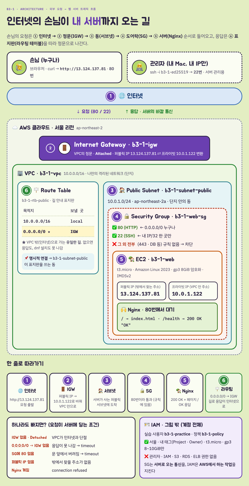

**그림 설명: 손님이 내 서버까지 오는 길**

| 순서 | 구성 요소 | 비유 | 하는 일 |
|---|---|---|---|
| 1 | **인터넷** | 손님 | `http://13.124.137.81`로 요청 |
| 2 | **IGW** | 정문 | 인터넷에서 VPC로 들어오는 유일한 문 |
| 3 | **서브넷** | 동 | VPC 안에서 서버가 놓인 구역 |
| 4 | **보안 그룹** | 도어락 | 80번만 통과, 나머지 차단 |
| 5 | **EC2 · Nginx** | 집 · 직원 | 요청을 받아 웹페이지로 대답 |
| ↩ | **라우팅 테이블** | 표지판 | `0.0.0.0/0 → IGW`를 보고 응답이 정문으로 나감 |
| — | **IAM** | 출입증 | 통신이 아니라 AWS를 조작하는 사람을 막음 |

> 하나라도 빠지면 접속 안 됨

### 먼저 외울 것: 아파트 비유 한 장

| AWS 구성 요소 | 아파트 비유 | 한 줄 뜻 |
|---|---|---|
| **AWS**<br>*Amazon Web Services* | 아파트 건설·임대 회사 | 서버와 네트워크를 빌려주는 회사 |
| **리전 (서울)** | 아파트가 있는 도시 | AWS 데이터센터가 있는 지역 |
| **VPC**<br>*Virtual Private Cloud* | 아파트 단지 | 나만 쓰는 울타리 쳐진 네트워크 |
| **Subnet**<br>*Subnetwork* | 단지 안의 동 | VPC를 나눈 작은 구역 |
| **Internet Gateway** | 단지 정문 | VPC와 인터넷을 잇는 출입구 |
| **Route Table** | 길 안내 표지판 | "어디로 가려면 어느 길로" 적힌 표 |
| **EC2**<br>*Elastic Compute Cloud* | 집 (내 서버) | 빌려 쓰는 컴퓨터 |
| **퍼블릭 IP**<br>*Public IP (Internet Protocol) address* | 집 주소 | 인터넷에서 서버를 찾는 주소 |
| **Security Group** | 집 현관 도어락 | 들어올 수 있는 통신만 통과 |
| **IAM**<br>*Identity and Access Management* | 관리사무소 출입증 | AWS 안에서 누가 무엇을 할 수 있는지 |
| **Nginx** | 손님 맞이하는 사람 | 요청이 오면 웹페이지를 내주는 프로그램 |

---

# 항목 1 — 구현 확인 (만들었는가?)

> 💡 항목 1은 **말보다 증빙**이다. 질문마다 "어디를 보면 되는지"를 바로 가리킨다.

### 🔗 라이브 시연 바로가기 (클릭하면 AWS 콘솔로 이동)

> 먼저 **IAM 사용자 `b3-1-practice`로 로그인**해 두어야 열린다. GitHub에서는 **Cmd + 클릭**하면 새 탭으로 열려 README를 띄워 둔 채로 시연할 수 있다. 모두 **조회만** 하는 화면이다.

| 질문 | 순서 | 바로가기 | 보여 줄 값 |
|---|---|---|---|
| Q1-1 | 1 | [VPC `b3-1-vpc`](https://ap-northeast-2.console.aws.amazon.com/vpcconsole/home?region=ap-northeast-2#VpcDetails:VpcId=vpc-0510d8b165db77c1c) | `10.0.0.0/16` · Available |
| Q1-1 | 2 | [서브넷 `b3-1-subnet-public`](https://ap-northeast-2.console.aws.amazon.com/vpcconsole/home?region=ap-northeast-2#SubnetDetails:subnetId=subnet-006ec6df5bf1c7b2e) | `10.0.1.0/24` · `ap-northeast-2a` |
| Q1-1 | 3 | [인터넷 게이트웨이 `b3-1-igw`](https://ap-northeast-2.console.aws.amazon.com/vpcconsole/home?region=ap-northeast-2#InternetGatewayDetails:internetGatewayId=igw-0c1652057dab7b750) | Attached |
| Q1-1 | 4 | [라우팅 테이블 `b3-1-rtb-public`](https://ap-northeast-2.console.aws.amazon.com/vpcconsole/home?region=ap-northeast-2#RouteTableDetails:RouteTableId=rtb-033c2174194a9bc48) | 라우팅 탭 `0.0.0.0/0 → igw` · 서브넷 연결 탭 |
| Q1-2 | 5 | [EC2 `b3-1-web`](https://ap-northeast-2.console.aws.amazon.com/ec2/home?region=ap-northeast-2#InstanceDetails:instanceId=i-0b2265faed73df750) | 실행 중 · t3.micro · `13.124.137.81` · 스토리지 탭 |
| Q1-3 | 6 | [보안 그룹 `b3-1-web-sg`](https://ap-northeast-2.console.aws.amazon.com/ec2/home?region=ap-northeast-2#SecurityGroup:groupId=sg-00c3b629679064cd6) | 인바운드 80 ← `0.0.0.0/0`, 22 ← `/32` (2개뿐) |
| Q1-4 | 7 | [브라우저 홈 `http://13.124.137.81/`](http://13.124.137.81/) | 🟢 정상 동작 중 — 200 OK |
| Q1-4 | 8 | [브라우저 `/health`](http://13.124.137.81/health) | `OK` |
| Q1-5 | 9 | [탄력적 IP 목록](https://ap-northeast-2.console.aws.amazon.com/ec2/home?region=ap-northeast-2#Addresses:) | 빈 목록 |
| Q1-5 | 10 | [NAT 게이트웨이 목록](https://ap-northeast-2.console.aws.amazon.com/vpcconsole/home?region=ap-northeast-2#NatGateways:) | 빈 목록 |
| Q1-5 | 11 | [볼륨 목록](https://ap-northeast-2.console.aws.amazon.com/ec2/home?region=ap-northeast-2#Volumes:) | 1개뿐 · gp3 8GiB · 암호화 · 사용 중 (상세 화면의 상태 검사 탭은 권한 밖이라 빨간 오류가 뜨므로 목록으로 보여 준다) |
| Q1-5 | 12 | [정리 체크리스트](docs/cleanup-checklist.md) · 예산 캡처 [00-02-budget](docs/screenshots/00-02-budget.png) | 삭제 예정 · `b3-1-zero-spend` (예산은 IAM 사용자 권한 밖이라 캡처로) |

터미널에서 직접 실행할 것 (Q1-3 · Q1-4):

```bash
curl -i http://13.124.137.81/health     # → HTTP/1.1 200 OK · OK
nc -z -G 5 13.124.137.81 80             # → succeeded (웹: 누구나)
nc -z -G 5 13.124.137.81 22             # → 응답 없음 (SSH: 집 IP만 허용)
```

## Q1-1. VPC, Public Subnet, Internet Gateway, Route Table(0.0.0.0/0 → IGW)이 구성되어 있는가?

**① 한 줄 답**

🔎 **질문 해석**: **① 4가지를 만들었나** + **② 서로 연결됐나** (특히 `0.0.0.0/0 → IGW` 경로)

네. **4가지를 모두 만들고 서로 연결**했습니다. 라우팅 테이블에 `0.0.0.0/0 → IGW` 경로가 있고, 이 테이블이 퍼블릭 서브넷에 연결되어 있습니다.

| 설명 순서 | 묻는 것 | 답 |
|---|---|---|
| **1. VPC** | 나만의 네트워크가 있나? | `b3-1-vpc` (`vpc-0510d8b165db77c1c`) · `10.0.0.0/16` · 상태 `Available` |
| **2. Public Subnet** | VPC 안에 서버 구역이 있나? | `b3-1-subnet-public` (`subnet-006ec6df5bf1c7b2e`) · `10.0.1.0/24` · `ap-northeast-2a` · 사용 가능 IP 251 |
| **3. Internet Gateway** | 인터넷 출입구가 VPC에 붙어 있나? | `b3-1-igw` (`igw-0c1652057dab7b750`) · 상태 **`Attached`** |
| **4. Route Table** | `0.0.0.0/0 → IGW` 경로가 있고 서브넷에 연결됐나? | `b3-1-rtb-public` (`rtb-033c2174194a9bc48`) · `0.0.0.0/0 → igw-0c16…` 활성 · 서브넷 **명시적 연결** |

> 💡 "구성되어 있다" = **만들었다 + 연결했다**. 넷 중 하나라도 연결이 빠지면 외부 접속이 되지 않습니다.

**② 구성 그림**

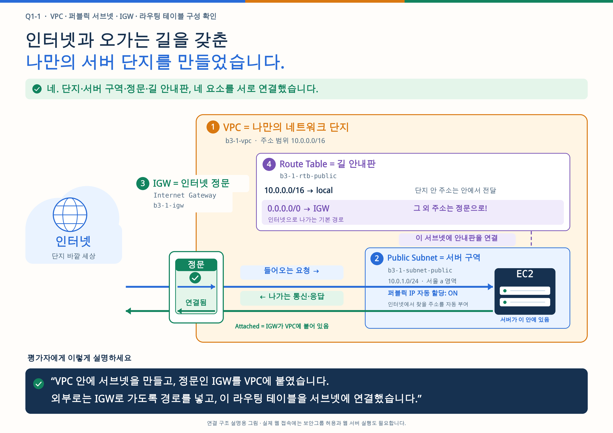

```
🌐 인터넷
 │
🚪 Internet Gateway (b3-1-igw)
 │   └ 상태: Attached ← VPC에 붙어 있음
 │
🏢 VPC (b3-1-vpc) · 10.0.0.0/16
 │
 ├─ 🪧 Route Table (b3-1-rtb-public)
 │    ├ 10.0.0.0/16 → local   (VPC 안은 안에서 해결)
 │    ├ 0.0.0.0/0  → IGW     (그 밖은 모두 정문으로) ★
 │    └ 연결된 서브넷: b3-1-subnet-public
 │
 └─ 🏠 Public Subnet (b3-1-subnet-public) · 10.0.1.0/24 · 서울 a 영역
      └ 🏡 EC2가 이 안에 놓임 (퍼블릭 IP는 EC2 시작 화면에서 활성화 → 13.124.137.81)
```

4개가 **서로 연결되어야** 의미가 있다. 연결 관계를 표로 보면 이렇다.

| 무엇을 | 어디에 연결했나 | 연결하지 않으면 |
|---|---|---|
| Internet Gateway | → VPC | 정문이 단지에 붙어 있지 않아 인터넷과 단절 |
| `0.0.0.0/0` 경로 | → Route Table 안에서 IGW를 가리킴 | 밖으로 나갈 길이 없음 |
| Route Table | → Public Subnet | 서브넷이 이 표지판을 쓰지 않음 |
| Public Subnet | → VPC 안에 생성 | 서버를 놓을 구역이 없음 |

**③ 용어 설명**

| 용어 | 쉬운 뜻 | 비유 | 이번 미션에서 |
|---|---|---|---|
| **VPC** (Virtual Private Cloud) | AWS 안에 만든 **나만의 사설 네트워크** | 아파트 단지 | `b3-1-vpc`, `10.0.0.0/16` |
| **CIDR** (`10.0.0.0/16`)<br>*Classless Inter-Domain Routing* | 네트워크가 쓸 **주소 범위**를 적는 방법. 뒤 숫자가 작을수록 범위가 넓음 | 단지 전체 호수 범위 | VPC는 `/16`(약 6.5만 개), 서브넷은 `/24`(256개) |
| **Subnet**<br>*Subnetwork* | VPC를 잘게 나눈 **구역** | 단지 안의 동 | `10.0.1.0/24` |
| **Public Subnet**<br>*Public Subnetwork* | 인터넷으로 나가는 길(`0.0.0.0/0 → IGW`)이 연결된 서브넷 | 정문과 바로 이어진 동 | 웹 서버를 두는 곳 |
| **가용 영역 (AZ)**<br>*Availability Zone* | 한 리전 안의 **독립된 데이터센터** | 도시 안의 구 | `ap-northeast-2a` |
| **퍼블릭 IP 자동 할당**<br>*Public IP (Internet Protocol) address* | 서버를 만들 때 **인터넷 주소를 자동으로 붙여 주는** 설정 | 입주하면 자동으로 주소 부여 | **EC2 시작 화면(네트워크 설정)에서 활성화** → `13.124.137.81`. 서브넷 설정은 바꾸지 않음(정책에 권한 없음) |
| **Internet Gateway (IGW)** | VPC와 인터넷을 잇는 **출입구** | 단지 정문 | `b3-1-igw` |
| **Attached** | IGW가 VPC에 **붙어 있는 상태**. 처음 만들면 `Detached` | 정문이 단지 담장에 설치됨 | 증빙 화면에서 확인할 상태 |
| **Route Table** | 목적지별로 **어느 길로 보낼지** 적은 표 | 길 안내 표지판 | `b3-1-rtb-public` |
| **`0.0.0.0/0`** | **"모든 주소"**라는 뜻. 다른 경로에 해당하지 않는 나머지 전부 | "그 밖의 모든 곳" | IGW로 보냄 |
| **local** | VPC 안끼리는 **안에서 바로** 통신 | 단지 안 이동은 정문 안 거침 | 자동으로 생기는 경로 |
| **명시적 연결** | 라우팅 테이블을 특정 서브넷에 **직접 지정**하는 것 | 이 동에 이 표지판을 세움 | 연결 안 하면 기본 표지판(밖으로 가는 길 없음)을 씀 |

**④ 확인 포인트 (증빙 화면)**

| 구성 요소 | 콘솔 위치 | 보여 줄 값 |
|---|---|---|
| VPC | VPC → VPC | `10.0.0.0/16`, 상태 `Available` |
| Subnet | VPC → 서브넷 | `10.0.1.0/24`, `ap-northeast-2a`, VPC `b3-1-vpc` |
| IGW | VPC → 인터넷 게이트웨이 | 상태 **`Attached`**, VPC ID 일치 |
| Route Table | VPC → 라우팅 테이블 → 라우팅 탭 / 서브넷 연결 탭 | `0.0.0.0/0 → igw-…`, 서브넷 연결됨 |

📎 근거: [README 2-2](README.md) · [resources.md](docs/evidence/resources.md) · 캡처 [01-vpc](docs/screenshots/01-vpc.png) · [01-subnet](docs/screenshots/01-subnet.png) · [02-igw-attached](docs/screenshots/02-igw-attached.png) · [02-rtb-routes](docs/screenshots/02-rtb-routes.png) · [02-rtb-subnet](docs/screenshots/02-rtb-subnet.png)

> 🎬 **평가 때 라이브**: VPC 콘솔 → VPC → 서브넷 → 인터넷 게이트웨이(Attached) → 라우팅 테이블 `b3-1-rtb-public`의 **라우팅 탭**과 **서브넷 연결 탭**

---

## Q1-2. EC2에 SSH로 접속 가능하며, 웹 서버가 실행 중인가?

**① 한 줄 답**

🔎 **질문 해석**: **① SSH로 들어갈 수 있나** + **② 웹 서버가 실제로 돌고 있나**

네. **Mac에서 만든 개인 키로 SSH 접속에 성공**했고, 서버 안에서 **Nginx가 실행 중(`active`)이며 `/health`에 200 OK로 응답**합니다.

🎬 **평가 때 바로 보여 주기** — 질문의 두 부분을 나눠서 답한다

**① SSH로 접속 가능한가?** → 📸 캡처 (SSH 22번은 집 IP만 허용 → 평가 장소에서는 접속 안 됨)

[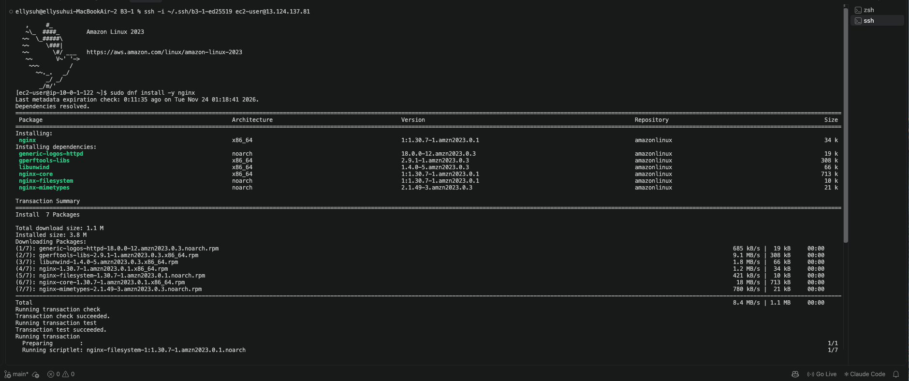](docs/screenshots/05-ssh-login.png)

| # | 보여 줄 것 | 캡처에서 가리킬 곳 | 말할 것 |
|---|---|---|---|
| 1 | [05-ssh-login](docs/screenshots/05-ssh-login.png) 맨 윗줄 | `ellysuh@...MacBookAir-2 B3-1 % ssh -i ~/.ssh/b3-1-ed25519 ec2-user@13.124.137.81` | "제 Mac에서 개인 키로 접속했습니다" |
| 2 | 그 아래 | `Amazon Linux 2023` 환영 화면 | "서버가 로그인을 받아 줬습니다" |
| 3 | 그 아래 프롬프트 | `[ec2-user@ip-10-0-1-122 ~]$` | "앞부분이 제 Mac에서 `ec2-user@ip-10-0-1-122`로 바뀌었습니다. 10.0.1.122는 우리 서브넷 안 주소라서, 우리 서버 안으로 들어간 것입니다" |

🎤 "SSH는 제 집 IP 하나만 허용해 두어서 여기서는 안 들어가집니다. 그래서 접속 화면은 캡처로 보여 드립니다. 이것 자체가 22번이 제한되어 있다는 증거입니다(Q1-3)."

**② 웹 서버가 실행 중인가?** → 🔴 라이브 (어느 컴퓨터에서든 가능)

| # | 보여 줄 것 | 확인할 값 | 말할 것 |
|---|---|---|---|
| 1 | [EC2 `b3-1-web` 상세 화면](https://ap-northeast-2.console.aws.amazon.com/ec2/home?region=ap-northeast-2#InstanceDetails:instanceId=i-0b2265faed73df750) | 인스턴스 상태 **실행 중**, t3.micro, 퍼블릭 IP `13.124.137.81` | "서버 컴퓨터(EC2) 전원이 켜져 있고, 이 주소로 찾아올 수 있습니다. 다만 이것은 **컴퓨터가 켜진 것**이지 웹 서버 프로그램이 켜진 것은 아니라서, 다음 `curl`로 확인합니다" |
| 2 | 터미널 `curl -i http://13.124.137.81/health`<br>(Windows: `curl.exe -i http://13.124.137.81/health`) | `HTTP/1.1 200 OK` · 본문 `OK` | "지금 응답한다는 것 자체가 웹 서버(Nginx)가 실행 중이라는 증거입니다" |
| 3 | (보충) 캡처 [05-server-checks](docs/screenshots/05-server-checks.png) | `active` · 서버 안 `200 OK` | "서버 안에서도 Nginx가 `active`였고 200을 받았습니다" |

[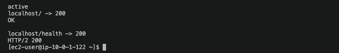](docs/screenshots/05-server-checks.png)

🎤 "서버는 실행 중이고, 지금 외부에서 `/health`를 부르면 200과 OK가 돌아옵니다. Nginx가 켜져 있어야만 나오는 응답입니다."

| 설명 순서 | 묻는 것 | 답 |
|---|---|---|
| **1. SSH 접속** | 내 Mac에서 서버에 들어갈 수 있나? | `ssh -i ~/.ssh/b3-1-ed25519 ec2-user@13.124.137.81` → `[ec2-user@ip-10-0-1-122 ~]$` |
| **2. 웹 서버 실행** | 웹 서버 프로그램이 켜져 있나? | `systemctl is-active nginx` → `active` |
| **3. 실제 응답** | 켜져 있을 뿐 아니라 응답도 하나? | `curl -i http://localhost/health` → `200 OK`, 본문 `OK` |

> 💡 "실행 중"은 **켜져 있음(`active`)**과 **실제 응답(200)** 두 가지로 증명합니다.

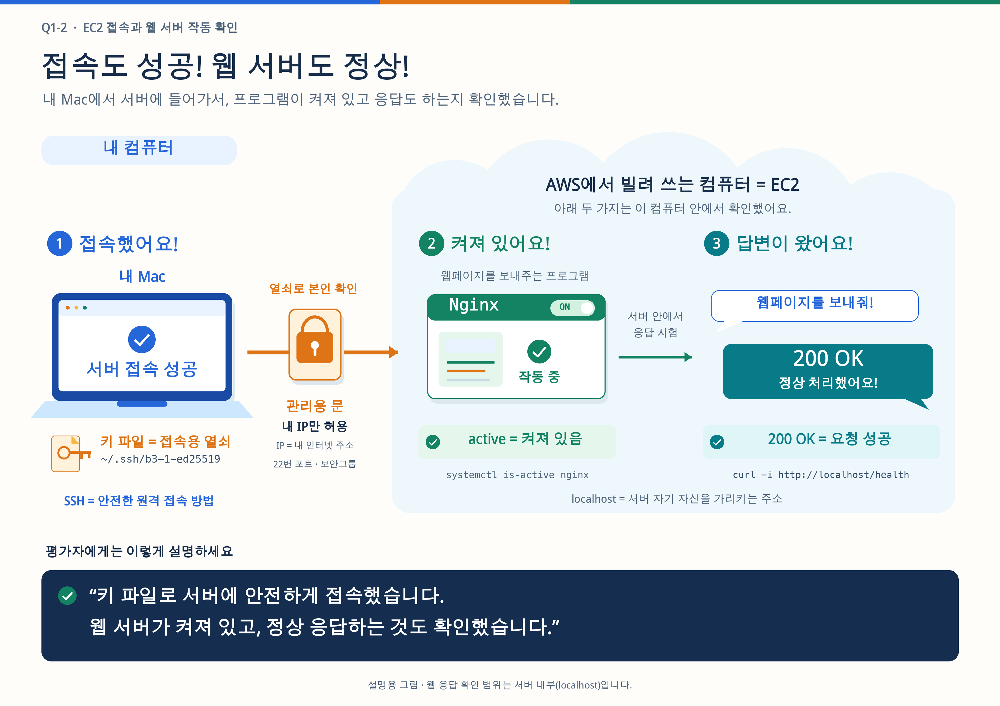

**② 구성 그림**

```
💻 내 Mac
 │  ssh -i ~/.ssh/b3-1-ed25519 ec2-user@13.124.137.81
 │  (22번 포트 + 개인 키)
 ▼
🔒 Security Group b3-1-web-sg: 22번은 내 IP/32만 통과
 ▼
🏡 EC2 (b3-1-web · t3.micro · Amazon Linux 2023)
 │
 ├─ 서버 안에서 확인 ①  sudo nginx -t
 │     → syntax is ok · test is successful   ✅ 설정 파일 문법 정상
 ├─ 서버 안에서 확인 ②  systemctl is-active nginx
 │     → active        ✅ 웹 서버 프로그램 실행 중
 ├─ 서버 안에서 확인 ③  curl -i http://localhost/health
 │     → 200 OK · OK   ✅ 웹 응답 정상
 └─ 서버 안에서 확인 ④  curl -I https://example.com
       → 200           ✅ 서버에서 인터넷으로 나가기 가능
```

**③ 용어 설명**

| 용어 | 쉬운 뜻 | 비유 | 이번 미션에서 |
|---|---|---|---|
| **EC2**<br>*Elastic Compute Cloud* | AWS에서 빌려 쓰는 **가상 컴퓨터(서버)** | 단지 안의 집 | `b3-1-web` |
| **t3.micro** | EC2의 크기(사양). 작고 프리 티어 대상 | 원룸 | vCPU 2개, 메모리 1GiB |
| **Amazon Linux 2023** | AWS가 만든 리눅스 **운영체제**. 기본 사용자는 `ec2-user`, 설치 명령은 `dnf` | 집의 기본 구조 | AL2023 (x86_64) |
| **SSH**<br>*Secure Shell* | 멀리 있는 서버에 **안전하게 원격 접속**하는 방법 (22번 포트) | 관리인 전용 뒷문 | 서버에 명령 입력 |
| **키 페어 (ed25519)** | SSH 접속용 **자물쇠(공개 키) + 열쇠(개인 키)**. 비밀번호 대신 사용 | 뒷문 자물쇠와 열쇠 | Mac에서 `ssh-keygen`으로 만들고 **공개 키만** AWS에 등록(`b3-1-key`). 개인 키 `~/.ssh/b3-1-ed25519`는 Mac에만 보관 |
| **Nginx** | 요청이 오면 웹페이지를 돌려주는 **웹 서버 프로그램** | 손님 맞이하는 사람 | `/`와 `/health` 응답 |
| **dnf** | Amazon Linux의 **프로그램 설치 명령** | 가구 배달 주문 | `sudo dnf install -y nginx` |
| **nginx -t** | Nginx 설정 파일의 **문법 검사** | 입주 전 점검 | 통과해야만 적용 |
| **systemctl** | 리눅스에서 **프로그램을 켜고 끄고 상태를 보는** 명령 | 전원 관리판 | `active` = 켜져 있음 |
| **curl** | 명령어로 **웹 주소에 요청을 보내는** 도구 | 주소로 편지 보내 보기 | 응답 코드 확인 |
| **localhost** | **자기 자신**을 가리키는 주소 | 내 집 안에서 초인종 누르기 | 네트워크를 거치지 않고 서버만 시험 |
| **200 OK** | "요청 성공"이라는 **응답 번호** | "네, 여기 있어요" | 정상 판정 기준 |

📎 근거: [README 2-4 서버 구성](README.md#2-4-서버-구성) · [README 2-6 동작 검증](README.md#2-6-동작-검증) · 캡처 [05-ssh-login](docs/screenshots/05-ssh-login.png) · [05-nginx-test](docs/screenshots/05-nginx-test.png) · [05-server-checks](docs/screenshots/05-server-checks.png) · [05-example-com](docs/screenshots/05-example-com.png) · 로그 [05-install.log](docs/evidence/05-install.log) · [05-deploy.log](docs/evidence/05-deploy.log)

---

## Q1-3. 보안 그룹 인바운드가 필요 포트만 허용하며, SSH(22)가 특정 IP로 제한되어 있는가?

**① 한 줄 답**

🔎 **질문 해석**: **① 필요한 포트만 열었나** + **② SSH(22)는 특정 IP로만 제한했나**

네. 인바운드(밖 → 서버로 들어오는 통신) 규칙은 **포트(한 서버 안에서 서비스를 구분하는 문 번호 — 출입문) 80과 22 두 개뿐**이고, **22번은 내 IP(집 주소) 하나(`/32`)로만 제한**했습니다.

🎬 **평가 때 바로 보여 주기** — 질문의 두 부분을 나눠서 답한다 (코디세이 · 다른 컴퓨터에서)

**① 인바운드가 필요 포트만 허용하는가?** → 🔴 라이브 (콘솔)

| # | 보여 줄 것 | 확인할 값 | 말할 것 |
|---|---|---|---|
| 1 | [보안 그룹 `b3-1-web-sg`](https://ap-northeast-2.console.aws.amazon.com/ec2/home?region=ap-northeast-2#SecurityGroup:groupId=sg-00c3b629679064cd6) → **인바운드 규칙** 탭 | 규칙 **2개뿐**: HTTP 80 ← `0.0.0.0/0`, SSH 22 ← `…/32` | "웹 80번과 관리 22번, 필요한 두 개만 열었습니다. 나머지 포트는 규칙이 없어 막힙니다" |

**② SSH(22)가 특정 IP로 제한되어 있는가?** → 🔴 라이브 (다른 Mac의 터미널에서 순서대로)

**1) 콘솔에서 허용한 IP 보여 주기** — ① 화면 그대로, SSH 22 줄의 **소스**를 가리킨다

| 확인할 값 | 말할 것 |
|---|---|
| 소스가 `0.0.0.0/0`이 **아니라** IP 하나(`…/32`) | "22번은 제 집 IP 하나만 허용했습니다. 이 컴퓨터는 그 IP가 아닙니다" |

**2) 터미널에서 80번 두드리기 → 열림**

```bash
nc -vz -G 5 13.124.137.81 80
```

이렇게 나오면 정상:

```text
Connection to 13.124.137.81 port 80 [tcp/http] succeeded!
```

🎤 "웹 80번은 누구에게나 열려 있어서 이 자리에서도 열립니다."

**3) 터미널에서 22번 두드리기 → 막힘** (5초 기다림)

```bash
nc -vz -G 5 13.124.137.81 22
```

이렇게 나오면 정상:

```text
nc: connectx to 13.124.137.81 port 22 (tcp) failed: Operation timed out
```

🎤 "같은 서버인데 22번은 막힙니다. 이 컴퓨터가 허용한 IP가 아니기 때문입니다. SSH가 특정 IP로 제한되어 있다는 증거입니다."

> 💡 `nc -vz`는 접속이 아니라 **문이 열렸는지 두드려만 보는** 명령이라 키 · 비밀번호가 필요 없다. 80은 `succeeded`, 22는 `timed out`이 나오면 끝.

| 포트 | 이름 | 용도 | 우리 규칙 |
|---|---|---|---|
| **80** | HTTP | 웹페이지 보기 | `0.0.0.0/0` (누구나) |
| **22** | SSH | 서버 원격 접속 | 내 IP `/32` (나 한 명만) |
| 443 | HTTPS | 암호화된 웹 | 규칙 없음 → 차단 |
| 3306 등 | DB | 데이터베이스 | 규칙 없음 → 차단 |

> 💡 보안 그룹은 **기본이 차단**이라, 규칙을 적지 않은 포트는 자동으로 막힙니다.

**② 구성 그림**

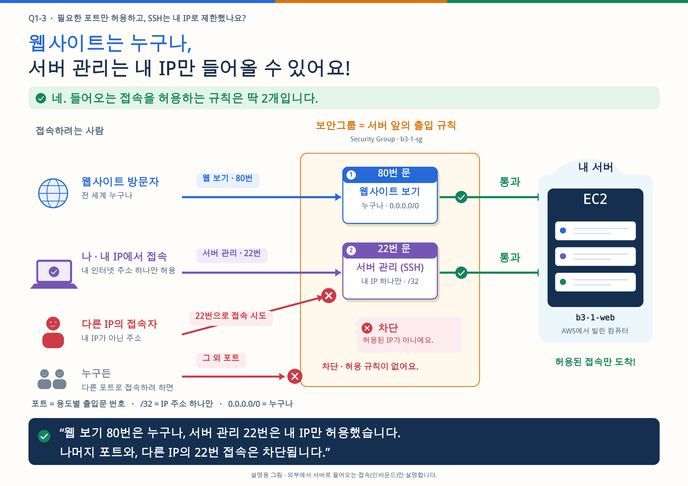

```
🌐 손님 (전 세계 누구나) ──80──▶ ✅ 통과
🧑‍💻 나 (내 IP/32) ─────────22──▶ ✅ 통과
🤖 낯선 사람 ────────────22──▶ ❌ 차단 (내 IP가 아님)
🤖 누구든 ───────── 그 외 포트 ▶ ❌ 차단 (규칙 없음)
                                   │
                        🔒 Security Group (b3-1-web-sg)
                                   │
                              🏡 EC2 (b3-1-web)
```

**③ 용어 설명**

| 용어 | 쉬운 뜻 | 비유 | 이번 미션에서 |
|---|---|---|---|
| **Security Group (SG)** | 서버 앞에서 **들어오고 나가는 통신을 거르는 방화벽** | 현관 도어락 | `b3-1-web-sg` (`sg-00c3b629679064cd6`) |
| **인바운드** | 밖에서 서버로 **들어오는** 통신 | 들어오는 손님 | 규칙 2개만 허용 |
| **아웃바운드** | 서버에서 밖으로 **나가는** 통신 | 나가는 사람 | 기본값(전체 허용) |
| **포트** | 한 서버 안에서 **서비스를 구분하는 번호** | 집의 출입문 번호 | 80, 22 |
| **80 (HTTP)**<br>*HyperText Transfer Protocol* | 웹페이지를 주고받는 문 | 손님용 정문 | 누구나 |
| **22 (SSH)**<br>*Secure Shell* | 원격 관리용 문 | 관리인용 뒷문 | 나만 |
| **`0.0.0.0/0`** | **모든 IP 주소** | 누구나 | 80번에만 사용 |
| **`/32`** | **IP 주소 딱 하나**만 지정 | 특정 한 사람 | 내 공인 IP |
| **내 IP**<br>*My IP (Internet Protocol) address* | 내 PC가 인터넷에 나갈 때 쓰는 주소 | 내 얼굴 | 콘솔 "내 IP" 선택 시 자동 입력 |
| **상태 저장 (stateful)** | 들어온 요청의 **응답은 자동으로 나가게** 해 줌 | 들어온 손님은 나갈 때 검사 안 함 | 아웃바운드 규칙을 따로 안 열어도 됨 |

📎 근거: [README 2-3](README.md) · 캡처 [03-sg-inbound](docs/screenshots/03-sg-inbound.png) · [03-sg-outbound](docs/screenshots/03-sg-outbound.png)

---

## Q1-4. 외부 접속이 다음 중 한 가지 방식으로 검증되는가? (A) 브라우저 http://<퍼블릭IP> 접속 시 페이지 정상 로딩 / (B) GET /health 호출 시 200 및 고정 응답 확인

**① 한 줄 답**

🔎 **질문 해석**: **① A·B 중 어느 방식인가** + **② 진짜 외부에서 했나** + **③ 성공 증거가 있나**

네. **B 방식(`GET /health`)**으로, **서버 밖인 내 Mac에서** 호출해 **HTTP 200 + `OK`**를 받았습니다.

🎬 **B 방식 증명 — Mac 터미널**

```bash
curl -i http://13.124.137.81/health
```

```text
HTTP/1.1 200 OK              ← ① 상태 코드 200 = 성공
Server: nginx                ← ② Nginx가 대답함
Content-Type: text/plain
Content-Length: 3
Cache-Control: no-store

OK                           ← ③ 고정 응답 OK
```

| 질문이 요구하는 것 | 결과에서 확인할 곳 |
|---|---|
| **외부**에서 호출 | 서버가 아닌 **Mac**에서 실행 |
| `GET /health` 호출 | 명령 주소가 `…/health` |
| **200** | 첫 줄 `HTTP/1.1 200 OK` |
| **고정 응답** | 마지막 줄 `OK` |

🎤 "서버 밖인 이 Mac에서 `/health`를 호출하니 200과 OK가 왔습니다. B 방식 외부 접속 검증 완료입니다."

> 💡 외부에서 성공했다 = **인터넷 → IGW → 서브넷 → 보안 그룹 → EC2** 모든 길이 열려 있다는 증거입니다.

**② 구성 그림**

```
💻 내 Mac (서버 밖 = 진짜 외부)
 │  curl -i http://13.124.137.81/health
 ▼
🌐 인터넷 → 🚪 IGW → 🏠 Subnet → 🔒 SG(80 통과) → 🏡 EC2 · Nginx
                                                         │
 ◀────────────────── 응답 ───────────────────────────────┘
 HTTP/1.1 200 OK    ← 상태 코드: 성공
 Content-Type: text/plain

 OK                 ← 고정 응답 문구
```

**③ 용어 설명**

| 용어 | 쉬운 뜻 | 비유 | 이번 미션에서 |
|---|---|---|---|
| **외부 접속** | 서버 **밖**의 컴퓨터에서 접속하는 것 | 단지 밖에서 초인종 누르기 | 내 Mac에서 시험 |
| **퍼블릭 IP**<br>*Public IP (Internet Protocol) address* | 인터넷에서 서버를 찾는 **공개 주소** | 집 주소 | EC2 상세 화면에서 확인 |
| **HTTP**<br>*HyperText Transfer Protocol* | 웹에서 요청과 응답을 주고받는 **약속(규칙)** | 편지 양식 | 80번 포트 사용 |
| **GET** | "이 주소의 내용을 **달라**"는 요청 종류 | "주세요" | `GET /health` |
| **`/health`** | 서버가 **살아 있는지** 확인하는 전용 주소 | 건강 검진 창구 | `OK`라고 답하게 설정 |
| **상태 코드** | 응답 결과를 나타내는 **세 자리 숫자** | 결과 통지 번호 | 200 = 성공, 404 = 없음, 5xx = 서버 오류 |
| **고정 응답** | 언제 호출해도 **항상 같은 글자**로 답함 | 정해진 대답 | `OK` |

**④ 확인 포인트**

| 증빙 | 위치 |
|---|---|
| 방식과 주소 기재 | README 2-6 (방식 B, `http://13.124.137.81/health`) |
| 결과 캡처 | [05-external-health.png](docs/screenshots/05-external-health.png) (Mac 터미널) · [05-browser-health.png](docs/screenshots/05-browser-health.png) · [05-browser.png](docs/screenshots/05-browser.png) |
| 결과 원본 | [05-external-health.txt](docs/evidence/05-external-health.txt) · [05-external-home-headers.txt](docs/evidence/05-external-home-headers.txt) |

📎 근거: [README 2-6](README.md) · [05-external-health.png](docs/screenshots/05-external-health.png) · [05-external-health.txt](docs/evidence/05-external-health.txt)

---

## Q1-5. 리소스 정리 체크리스트에서 최소 5종(EC2/EBS/EIP/IGW/VPC) 정리 완료를 확인할 수 있는가?

**① 한 줄 답**

🔎 **질문 해석**: **① 체크리스트가 있나** + **② 5종을 어떻게 지울지 정했나** + **③ 완료를 무엇으로 확인하나**

**평가 시점에는 실제 동작을 보여 드리려고 아직 삭제하지 않았고, 체크리스트에 "삭제 예정"으로 표시했습니다.** 5종(EC2 · EBS · EIP · IGW · VPC)마다 **삭제 순서 · 완료 기준 · 확인 방법**을 정해 두었고, 과금 위험 리소스는 **만들 때부터 추적**해 지금 상태를 확인했습니다. 모든 평가가 끝나면 이 순서대로 지우고 완료 시각과 캡처를 기록합니다.

🎬 **평가 시연** (조회만, 아무것도 지우지 않음)

| # | 보여 줄 것 | 확인할 값 |
|---|---|---|
| 1 | 👉 [정리 체크리스트](docs/cleanup-checklist.md) | 상태 **삭제 예정** · 5종(EC2 · EBS · EIP · IGW · VPC) |
| 2 | 👉 [탄력적 IP](https://ap-northeast-2.console.aws.amazon.com/ec2/home?region=ap-northeast-2#Addresses:) | **빈 목록** |
| 3 | 👉 [NAT 게이트웨이](https://ap-northeast-2.console.aws.amazon.com/vpcconsole/home?region=ap-northeast-2#NatGateways:) | **빈 목록** |
| 4 | 👉 [볼륨](https://ap-northeast-2.console.aws.amazon.com/ec2/home?region=ap-northeast-2#Volumes:) | **1개** (EC2 루트 · 종료 시 함께 삭제) |
| 5 | 📸 [예산 캡처](docs/screenshots/00-02-budget.png) | `b3-1-zero-spend` (IAM 권한 밖이라 캡처) |

🎤 "평가 때 동작을 보여 드리려고 아직 지우지 않았습니다. 요금 나는 EIP · NAT는 처음부터 만들지 않았고, 평가가 끝나면 안쪽부터 지우고 시각을 기록합니다."

| 설명 순서 | 묻는 것 | 답 |
|---|---|---|
| **1. 체크리스트** | 어디에 기록했나? | `docs/cleanup-checklist.md` (삭제 순서 · 완료 기준 · 시각 칸). 현재 상태 **삭제 예정** |
| **2. 지금 상태 (추적)** | 과금 위험이 남아 있나? | **EIP 0개 · NAT 0개** (라이브 확인), EBS 1개(`vol-0761089ffdc87b3bf`, EC2 루트, **종료 시 삭제 = 예**), ELB·RDS는 **권한조차 없어 만들 수 없음** |
| **3. 완료 기준** | 지운 뒤 무엇으로 증명하나? | EC2 `Terminated` · 볼륨 목록 비어 있음 · EIP 목록 비어 있음 · IGW 목록에 없음 · 실습 VPC 없음 → 각각 캡처 + 시각 |
| **4. 순서** | 왜 그 순서로 지우나? | 다른 것이 쓰고 있으면 못 지움 → **안쪽(EC2)부터 바깥(VPC)으로** |
| **5. 언제** | 왜 아직 안 지웠나? | 평가에서 실제 접속을 보여 줘야 하므로. 모든 평가가 끝난 뒤 삭제 (중지·재시작도 하지 않음: 퍼블릭 IP가 바뀜) |

**② 구성 그림 (삭제 순서)**

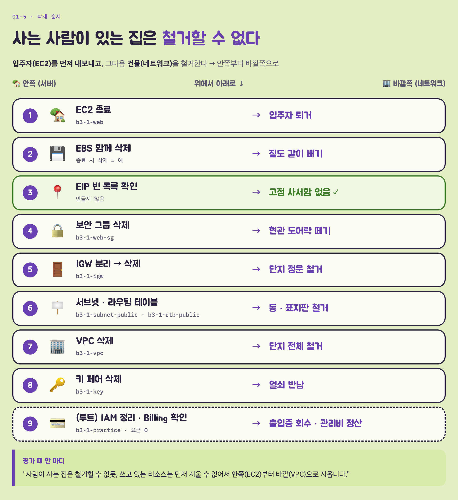

**③ 용어 설명**

| 용어 | 쉬운 뜻 | 비유 | 이번 미션에서 |
|---|---|---|---|
| **리소스** | AWS에서 만든 **모든 것** (서버, 디스크, 네트워크 등) | 빌린 물건 | `b3-1-*` 이름으로 생성 |
| **과금** | 리소스를 쓰는 동안 **요금이 쌓이는 것** | 월세 | 지우지 않으면 계속 발생 |
| **Terminate (종료)** | EC2를 **완전히 삭제**. 중지(Stop)와 다름 | 퇴거 | 상태가 `Terminated`로 바뀜 |
| **EBS**<br>*Elastic Block Store* | EC2에 붙은 **저장 디스크** | 집 안 창고 | 8GB, 종료 시 자동 삭제 |
| **EIP (탄력적 IP)**<br>*Elastic IP (Internet Protocol) address* | 서버를 껐다 켜도 **바뀌지 않는 고정 주소**. 안 쓰고 잡아만 둬도 요금 | 고정 주소 사서함 | 만들지 않음 |
| **Detach (분리)** | IGW를 VPC에서 **떼어 내는 것**. 떼야 삭제 가능 | 정문 철거 전 해체 | IGW 삭제 전 단계 |
| **의존 관계** | A가 B를 쓰고 있으면 **B를 먼저 못 지움** | 사람이 살면 건물 철거 불가 | 삭제 순서의 이유 |
| **Billing** | AWS **요금 청구** 화면 | 관리비 고지서 | 마지막 확인용 |

📎 근거: [docs/cleanup-checklist.md](docs/cleanup-checklist.md) · [resources.md](docs/evidence/resources.md) · 캡처 [06-eip-empty](docs/screenshots/06-eip-empty.png) · [06-nat-empty](docs/screenshots/06-nat-empty.png) · [06-ebs-volume](docs/screenshots/06-ebs-volume.png) · [00-02-budget](docs/screenshots/00-02-budget.png)

---

# 항목 2 — 구성 설명 (왜 그렇게 만들었는가?)

## Q2-1. 외부 → IGW → Subnet → EC2로 이어지는 네트워크 흐름을 다이어그램 기준으로 설명할 수 있는가?

**① 한 줄 답**

🔎 **질문 해석**: **① 요청이 들어오는 순서** + **② 각 단계에서 일어나는 일** + **③ 응답이 나가는 길**을 그림을 가리키며 설명

요청은 **퍼블릭 IP → IGW → 퍼블릭 서브넷 → 보안 그룹 → EC2(Nginx)** 순서로 들어오고, 응답은 **라우팅 테이블 `0.0.0.0/0 → IGW`**를 따라 나갑니다.

| 설명 순서 | 묻는 것 | 답 |
|---|---|---|
| **1. 외부** | 어디서 출발하나? | 사용자가 `http://퍼블릭IP`로 요청 |
| **2. IGW** | 정문에서 무슨 일이? | 퍼블릭 IP를 서버의 프라이빗 IP(`10.0.1.x`)로 바꿔 VPC 안으로 전달 |
| **3. Subnet** | 어디로 가나? | 서버가 있는 퍼블릭 서브넷(`10.0.1.0/24`) |
| **4. EC2** | 도착하면? | 보안 그룹이 80 허용 확인 → Nginx가 응답 생성 |
| **5. 응답** | 어떻게 나가나? | Route Table `0.0.0.0/0 → IGW` → IGW → 사용자 |

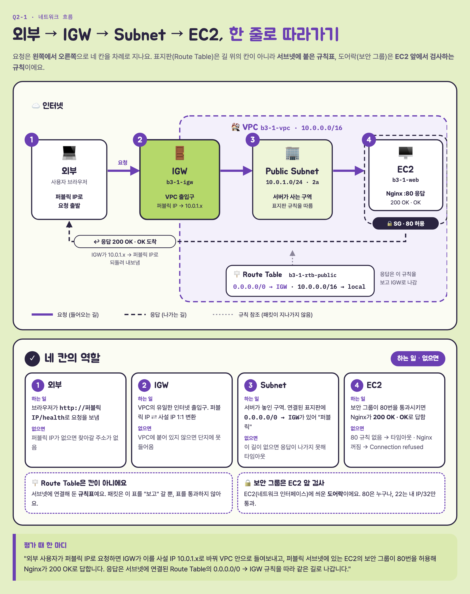

**② 구성 그림**

**③ 용어 설명**

| 용어 | 쉬운 뜻 | 비유 | 이 흐름에서 하는 일 |
|---|---|---|---|
| **요청 (Request)** | 사용자가 서버에 **무언가 달라고** 보내는 것 | 초인종 누르기 | ①~⑤ 방향 |
| **응답 (Response)** | 서버가 **돌려주는** 결과 | 문 열고 물건 건네기 | ↩ 방향 |
| **퍼블릭 IP**<br>*Public IP (Internet Protocol) address* | 바깥에서 쓰는 주소 | 집 주소 | ① 목적지 |
| **프라이빗 IP** (`10.0.1.x`)<br>*Private IP (Internet Protocol) address* | VPC **안에서만** 쓰는 주소 | 단지 내 호수 | ② IGW가 바꿔 줌 |
| **Internet Gateway** | 인터넷과 VPC의 출입구 | 정문 | ② 주소 변환 후 통과 |
| **Subnet**<br>*Subnetwork* | 서버가 놓인 구역 | 동 | ③ |
| **Security Group** | 허용된 포트만 통과 | 도어락 | ④ |
| **EC2 · Nginx**<br>*Elastic Compute Cloud* | 서버와 웹 프로그램 | 집 · 손님 맞이 | ⑤ |
| **Route Table** | 나가는 길을 알려 주는 표 | 표지판 | ↩ 응답을 IGW로 안내 |

**④ 확인 포인트: 접속에 필요한 5가지 조건**

하나라도 빠지면 외부 접속이 안 된다.

| # | 조건 | 없으면 |
|---|---|---|
| 1 | EC2에 **퍼블릭 IP**가 있음 | 찾아갈 주소가 없음 |
| 2 | **IGW**가 VPC에 붙어 있음 | 출입구가 없음 |
| 3 | Route Table에 **`0.0.0.0/0 → IGW`** | 응답이 나갈 길이 없음 |
| 4 | SG에 **80 허용** | 도어락에서 막힘 |
| 5 | **Nginx 실행 중** | 도착해도 대답할 사람이 없음 |

📎 근거: [흐름 그림](docs/pass/q2-1-network-flow.png) · [docs/architecture.png](docs/architecture.png) · [README 2-5](README.md#2-5-요청-흐름)

---

## Q2-2. 보안 그룹 규칙을 어떤 기준으로 최소화했는지(허용/미허용 포트) 설명할 수 있는가?

**① 한 줄 답**

🔎 **질문 해석**: **① 기준이 무엇인가** + **② 어떻게 줄였나** + **③ 허용한 포트** + **④ 허용하지 않은 포트**

기준은 **"꼭 필요한가, 누구에게 필요한가"** 두 가지입니다. 그래서 **80(웹)은 누구나, 22(SSH)는 내 IP만** 허용했고, **443 · DB 포트 · 전체 포트는 쓰지 않아 열지 않았습니다.**

| 설명 순서 | 묻는 것 | 답 |
|---|---|---|
| **1. 기준** | 무엇으로 판단했나? | ① **필요성**: 이 포트를 지금 쓰는가? ② **대상**: 누가 들어와야 하는가? |
| **2. 최소화 방법** | 어떻게 줄였나? | 쓰는 포트만 열고(**포트 수 최소**), 열어도 들어올 수 있는 사람을 좁힘(**범위 최소**: `0.0.0.0/0` → `내 IP/32`) |
| **3. 허용 포트** | 무엇을 열었나? | **80**: 서비스 목적 → 누구나 · **22**: 관리 목적 → 나만 |
| **4. 미허용 포트** | 무엇을 안 열었나? | **443**: 인증서 없음 · **3306/5432**: DB 안 씀 · **전체(0–65535)**: 공격 통로만 늘어남 |

> 💡 보안 그룹은 **기본이 전부 차단**이고, **허용 규칙만** 추가하는 방식입니다. 그래서 규칙 2개 외의 포트는 따로 막지 않아도 자동으로 막힙니다.

**② 구성 그림**

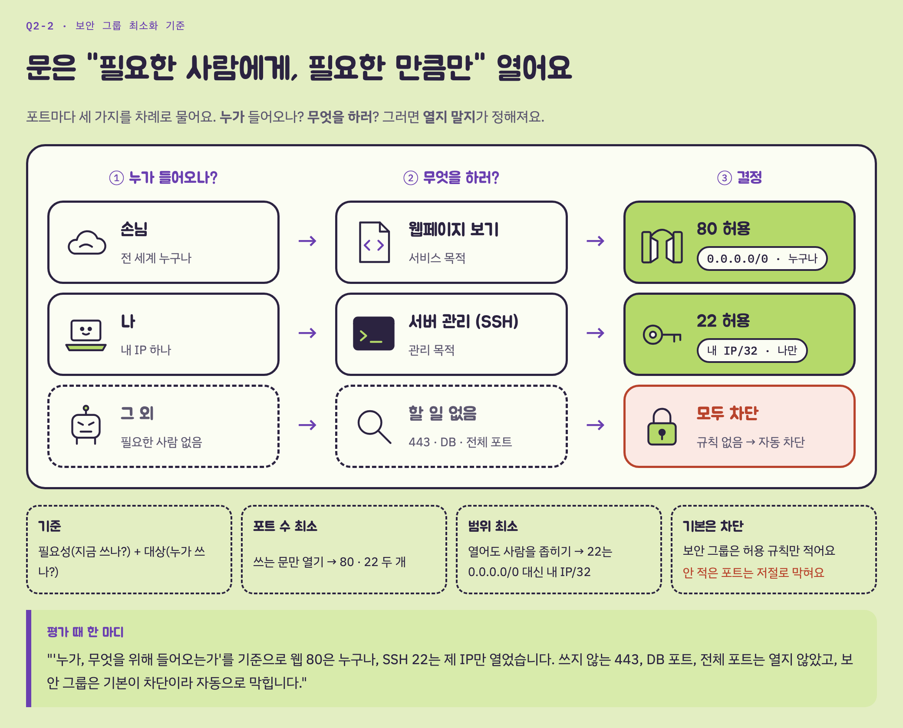

<details>
<summary>📖 글로 보기</summary>

```
질문: 누가 들어오나? → 무엇을 하러? → 결정

🌐 손님
 └ 전 세계 누구나 → 웹페이지 보기 → 80 허용 (0.0.0.0/0)

🧑‍💻 나
 └ 내 IP 하나 → 서버 관리 → 22 허용 (내 IP/32)

❓ 그 외
 └ 필요한 사람 없음 → — → 모두 차단
```

</details>

**③ 용어 설명**

| 용어 | 쉬운 뜻 | 비유 | 이번 미션에서 |
|---|---|---|---|
| **최소화** | **꼭 필요한 것만** 허용하고 나머지는 닫기 | 쓰는 문만 열어 두기 | 규칙 2개 |
| **80 (HTTP)**<br>*HyperText Transfer Protocol* | 웹페이지용 문 | 손님용 정문 | 허용 |
| **22 (SSH)**<br>*Secure Shell* | 원격 관리용 문 | 관리인 뒷문 | 내 IP만 |
| **443 (HTTPS)**<br>*HyperText Transfer Protocol Secure* | 암호화된 웹 문. **인증서**가 있어야 씀 | 보안 정문 | 인증서 없어서 안 엶 |
| **3306 / 5432** | MySQL / PostgreSQL **데이터베이스** 문 | 금고 문 | DB를 안 써서 안 엶 |
| **0–65535** | **모든 포트** 번호 범위 | 모든 문 | 절대 안 엶 |
| **공격 표면** | 공격자가 노릴 수 있는 **열린 곳의 수** | 열린 창문 수 | 줄일수록 안전 |

**④ 확인 포인트**

| 구분 | 포트 | 이유 |
|---|---|---|
| ✅ 허용 | 80 (HTTP) | 서비스 목적: 누구나 웹페이지를 봐야 함 |
| ✅ 제한 허용 | 22 (SSH) | 관리 목적: 나만 필요 → 내 IP만 |
| ❌ 미허용 | 443 (HTTPS) | 인증서를 쓰지 않아 필요 없음 (보너스 수행 시 추가) |
| ❌ 미허용 | 3306 · 5432 (DB) | DB를 쓰지 않음 |
| ❌ 미허용 | 0–65535 전체 | 열 이유가 없고 공격 통로가 됨 |

📎 근거: [README 2-3](README.md)

---

## Q2-3. 외부 접속 검증을 A 또는 B 중 무엇으로 선택했고, 그 선택을 위해 무엇을 어떻게 구성했는지 설명할 수 있는가?

**① 한 줄 답**

🔎 **질문 해석**: **① A·B 중 무엇을 골랐나** + **② 왜 골랐나** + **③ 무엇을** + **④ 어떻게 구성했나**

"저는 **B 방식**을 골랐습니다. `/health`라는 주소를 **연결 확인용으로 직접 만들어서**, 밖에서 불렀을 때 **200과 OK가 돌아오면 연결된 것**으로 판정합니다. 숫자와 글자로 딱 나와서 판정이 분명하기 때문입니다."

**이를 위해 한 것**

| 한 일 | 쉽게 말하면 |
|---|---|
| **① Nginx 설치** | EC2에 **Nginx(웹 서버 프로그램)** 설치 — 밖에서 온 요청을 받아 대답<br>· `/health`로 오면 항상 `OK` 대답하도록 설정 |
| **② 밖에서 들어올 수 있게 설정** | · **보안 그룹 80번 허용**: 웹 요청 들어오는 문 열음<br>· **퍼블릭 IP**: 밖에서 찾아올 주소 붙임<br>· **라우팅 `0.0.0.0/0 → IGW`**: 대답이 인터넷으로 나갈 길 만듦 |

🎬 **B 시연 — Mac 터미널에 한 줄**

```bash
curl -i http://13.124.137.81/health
```

이렇게 나오면 성공:

```text
HTTP/1.1 200 OK          ← 200 = 성공
Server: nginx
Content-Type: text/plain

OK                       ← 고정 응답
```

| 부분 | 뜻 |
|---|---|
| `curl` | 주소로 요청을 보내는 명령 |
| `-i` | 응답 머리(`200 OK`)까지 보여 줌 (없으면 `OK`만 나옴) |
| `http://13.124.137.81/health` | 우리 서버의 `/health` 주소 (반드시 `http://`) |

🎤 "서버 밖인 이 Mac에서 `/health`를 호출하니 200과 OK가 왔습니다."

**③ 용어 설명**

| 용어 | 쉬운 뜻 | 비유 | 이번 미션에서 |
|---|---|---|---|
| **헬스체크** | 서버가 **정상인지 주기적으로 확인**하는 것 | 정기 건강검진 | `/health` 호출 |
| **nginx -t** | Nginx 설정 파일의 **문법 검사** | 입주 전 점검 | 통과해야만 실행 (실제로 경고를 찾아 고침) |
| **location** | Nginx에서 **주소별로 할 일을 정하는** 설정 | 창구 안내 | `/health` 창구 |
| **text/plain** | 꾸밈 없는 **그냥 글자** 형식 | 메모지 | `OK` |
| **자동화** | 사람 대신 **명령이 반복 확인** | 자동 체온계 | curl 한 줄 |
| **객관적 판정** | 사람마다 다르게 보지 않는 **명확한 기준** | 체온 36.5도 | 200이면 성공 |

**④ 확인 포인트: A와 B 비교**

| 비교 | A: 브라우저 접속 | **B: /health 호출 (선택)** |
|---|---|---|
| 결과 | 화면이 보이는지 눈으로 판단 | **200 + `OK`**로 명확함 |
| 자동화 | 어려움 | 명령 한 줄로 반복 가능 |
| 현업 활용 | — | 로드밸런서·모니터링의 **헬스체크**와 같은 방식 |

📎 근거: [config/nginx.conf](config/nginx.conf) · [site/index.html](site/index.html) · [05-deploy.log](docs/evidence/05-deploy.log) · [05-external-health.txt](docs/evidence/05-external-health.txt)

---

## Q2-4. 실습 리소스를 추적/정리하기 위해 어떤 기준(태그, 이름 규칙, 체크리스트)을 사용했는지 설명할 수 있는가?

**① 한 줄 답**

🔎 **질문 해석**: **① 추적(만들 때 표시)** + **② 정리(지울 때 찾기 · 확인)**에 쓴 기준 — 태그 · 이름 규칙 · 체크리스트

**이름 규칙(`b3-1-*`) + 태그 2개(`Project=B3-1`, `Owner=b3-1-practice`) + 체크리스트**를 기준으로 썼고, **리소스 ID 목록**을 더해 빠짐없이 대조했습니다. 태그는 **IAM 정책이 강제**해서 빠뜨리면 생성 자체가 거부됩니다.

| 설명 순서 | 기준 | 어떻게 | 왜 |
|---|---|---|---|
| **1. 태그(꼬리표)** | `Project = B3-1`<br>`Owner = b3-1-practice` | 모든 리소스에 붙임 · 없으면 **IAM이 생성 거부** | 깜빡해도 꼬리표 없는 리소스가 안 생김 → 빠짐없이 찾음 |
| **2. 이름 규칙** | 모두 `b3-1-`로 시작 | 콘솔에서 `b3-1` 검색 | 목록에서 한눈에 실습 리소스 구분 |
| **3. 체크리스트** | [cleanup-checklist.md](docs/cleanup-checklist.md) | 리소스 ID · 삭제 순서 · 완료 기준 작성 → 평가 후 시각 기록 | 하나도 안 남기고 지워 **요금 0** |

🎤 "태그로 꼬리표를 강제로 붙이고, 이름을 `b3-1-`로 통일해서 찾기 쉽게 했고, 체크리스트로 빠짐없이 지워 요금이 남지 않게 합니다."

**③ 용어 설명**

| 용어 | 쉬운 뜻 | 비유 | 이번 미션에서 |
|---|---|---|---|
| **이름 규칙** | 이름을 **정해진 형식**으로 짓는 것 | 이름표 형식 통일 | `b3-1-vpc`, `b3-1-web` … |
| **태그** | 리소스에 붙이는 **"키 = 값" 꼬리표** | 물건에 붙인 스티커 | `Project = B3-1`, `Owner = b3-1-practice` |
| **리소스 ID** | AWS가 자동으로 붙이는 **고유 번호** | 주민번호 | `vpc-…`, `i-…` |
| **리소스 목록** | 만든 리소스와 ID를 **적어 둔 기록** | 물품 대장 | `resources.md` |
| **체크리스트** | 할 일을 순서대로 적고 **☑ 표시**하는 표 | 이사 체크리스트 | 삭제 순서·시각 |
| **필터링** | 조건에 맞는 것만 **골라 보기** | 스티커 색으로 분류 | 태그로 검색 |

📎 근거: [docs/cleanup-checklist.md](docs/cleanup-checklist.md) · [docs/evidence/resources.md](docs/evidence/resources.md) · [infra/iam-policy.json](infra/iam-policy.json)

---

# 항목 3 — 원리 이해 (원리를 아는가?)

## Q3-1. Public Subnet Route Table의 기본 경로(0.0.0.0/0 → IGW)가 필요한 이유를 설명할 수 있는가?

**① 한 줄 답**

🔎 **질문 해석**: **① `0.0.0.0/0 → IGW`가 무슨 뜻인가** + **② 없으면 무슨 일이 생기나** → 그래서 필요한 이유

이 경로가 **VPC 밖(인터넷)으로 나가는 유일한 길**이기 때문입니다. 없으면 IGW가 있어도 **응답이 나가지 못해 접속이 타임아웃**됩니다.

| 설명 순서 | 묻는 것 | 답 |
|---|---|---|
| **1. 뜻** | `0.0.0.0/0`은 무엇인가? | 다른 경로에 맞지 않는 **나머지 모든 주소** = 인터넷 |
| **2. 대상** | 왜 IGW로 보내나? | IGW가 **인터넷으로 나가는 유일한 출입구**라서 |
| **3. 없으면** | 무슨 일이 생기나? | 요청은 와도 **응답이 갈 길이 없음** → `timed out` · 서버에서 `dnf install`도 실패 |
| **4. 퍼블릭의 조건** | 퍼블릭 서브넷과 무슨 관계인가? | 이 경로가 연결되어야 **퍼블릭 서브넷** (이름이 아니라 경로로 결정) |

**③ 용어 설명**

| 용어 | 쉬운 뜻 | 비유 | 이번 미션에서 |
|---|---|---|---|
| **Route Table** | 목적지별 **길 안내 표** | 표지판 | `b3-1-rtb-public` |
| **목적지 (Destination)** | 데이터가 **가려는 주소 범위** | 가려는 동네 | `10.0.0.0/16`, `0.0.0.0/0` |
| **대상 (Target)** | 그 목적지로 가려면 **거칠 곳** | 이용할 출구 | `local`, `igw-…` |
| **`0.0.0.0/0`** | 다른 경로에 없는 **나머지 모든 주소** = 인터넷 | "그 밖의 모든 곳" | IGW로 보냄 |
| **기본 경로** | 딱 맞는 경로가 없을 때 쓰는 **마지막 길** | "모르면 정문으로" | `0.0.0.0/0` |
| **타임아웃** | 응답을 기다리다 **시간 초과**로 실패 | 대답 없는 초인종 | 경로 없을 때 증상 |
| **Public Subnet의 정의**<br>*Public Subnetwork* | 이름이 아니라 **IGW 경로가 연결되어 있느냐**로 결정 | 정문과 길이 이어진 동 | 이 경로가 있어서 퍼블릭 |

📎 근거: [README 2-5](README.md) · 라우팅 테이블 캡처

---

## Q3-2. Security Group과 IAM의 책임 범위 차이를 설명하고, 최소 권한이 왜 필요한지 설명할 수 있는가?

**① 한 줄 답**

🔎 **질문 해석**: **① SG가 지키는 범위** + **② IAM이 지키는 범위** + **③ 최소 권한이 필요한 이유**

보안 그룹은 **서버로 들어오는 통신**, IAM은 **AWS를 조작하는 사람**을 막음. 최소 권한은 **필요한 작업만 허용** → 계정이 털리거나 실수해도 **허용한 작업밖에 못 해서 피해가 작음**.

**1. 책임 범위 차이**

| | 🔒 보안 그룹 (Security Group) **(도어락)** | 🪪 IAM (Identity and Access Management) **(출입증)** |
|---|---|---|
| ⭐ **책임 범위** | ⭐ **서버로 오가는 통신** 담당<br>(누가 AWS를 조작하는지는 모름) | ⭐ **AWS에서 하는 작업** 담당<br>(서버로 오는 통신은 안 봄) |
| **정의** | 서버 앞 **방화벽** — 들어오고 나가는 통신을 규칙대로 통과 · 차단 | AWS **사용자 · 권한 관리** — 누가 무슨 작업을 할지 정함 |
| **지키는 것** | **서버** | **AWS 계정** |
| **기본값** | 규칙 없으면 전부 차단 | 허용 안 한 작업은 전부 거부 |
| **막는 대상** | 서버로 접속하려는 컴퓨터 | AWS 콘솔에 로그인한 사람 |
| **판단 기준** | IP · 포트 | 사용자 · 작업 |
| **작동 위치** | 서버 바로 앞 | AWS 계정 입구 |
| **비유** | 현관 도어락 | 관리사무소 출입증 |
| **우리 예** | 22번 내 IP만 → 해커 접속 차단 | 서울 · t3.micro만 → 다른 작업 차단 |

- 보안 그룹: AWS 사용자 모름 → 콘솔에서 서버 지우는 사람 못 막음
- IAM: 통신 안 봄 → 22번 해커 못 막음
- → **둘 다 필요**

**2. 최소 권한이 필요한 이유**

| 상황 | 관리자 권한 | 최소 권한 (우리) |
|---|---|---|
| 비밀번호 털림 | 모든 서비스 조작 · 삭제 | 서울 실습 리소스만 |
| 실수로 큰 서버 생성 | 생성됨 → 요금 폭탄 | t3.micro만 → 거부 |
| 엉뚱한 서비스 사용 | S3 · RDS 다 열림 | 거부 (실제 테스트: S3 · 태그 없는 VPC 거부 — [permission-tests.md](docs/evidence/permission-tests.md)) |

🎤 "보안 그룹은 통신, IAM은 사람을 막음 → 서로 못 보는 영역이라 둘 다 필요. 최소 권한은 털리거나 실수해도 피해가 그 안에서 끝나게 함."

**③ 용어 설명**

| 용어 | 쉬운 뜻 | 비유 | 이번 미션에서 |
|---|---|---|---|
| **IAM**<br>*Identity and Access Management* | AWS의 **사용자와 권한 관리** 서비스 | 출입증 발급처 | 사용자 `b3-1-practice` + 정책 `b3-1-policy` |
| **루트 사용자** | 가입한 계정. **모든 권한**을 가짐 | 집주인 마스터키 | 사용자 생성 때만 사용 |
| **IAM 사용자**<br>*Identity and Access Management* | 루트가 만든 **개별 계정** | 직원 출입증 | 실습은 이 계정으로 |
| **정책 (Policy)** | 허용·거부할 작업을 적은 **JSON 문서** | 출입증의 허용 구역 목록 | `infra/iam-policy.json` |
| **Action** | AWS에서 하는 **작업 하나** | "3층 출입" | `ec2:RunInstances` 등 |
| **조건 (Condition)** | 권한이 적용되는 **추가 조건** | "평일만 출입" | 서울 리전에서만 허용 |
| **최소 권한** | **필요한 것만** 허용하는 원칙 | 필요한 층만 열리는 출입증 | 관리자 권한 안 줌 |
| **AdministratorAccess** | **모든 작업**을 허용하는 정책 | 마스터키 | 사용 안 함 |

📎 근거: [infra/iam-policy.json](infra/iam-policy.json) · [README 2-1, 2-3](README.md)

---

## Q3-3. SSH(22) 또는 DB 포트를 0.0.0.0/0로 열면 안 되는 이유와 대안을 설명할 수 있는가?

**① 한 줄 답**

🔎 **질문 해석**: **① 22 · DB 포트를 전체에 열면 왜 위험한가** + **② 그럼 어떻게 하나(대안)**

전 세계 **자동 스캔 봇이 열린 22 · DB 포트를 바로 찾아 공격**하기 때문입니다. 대안은 **22는 내 IP만(또는 Session Manager로 닫기), DB는 프라이빗 서브넷 + 웹 서버 SG에서 온 것만 허용**입니다.

| 설명 순서 | 묻는 것 | 답 |
|---|---|---|
| **1. 이유 · SSH** | 22를 열면? | 비밀번호 대입 · 취약점 공격 → **서버 장악**, 코인 채굴 악용 → 요금 폭탄 |
| **2. 이유 · DB** | 3306 · 5432를 열면? | **데이터 직접 유출 · 삭제** |
| **3. 대안 · SSH** | 어떻게 막나? | **내 IP `/32`** (이번 미션) · 키 인증만 · **Session Manager**로 22 닫기 · Bastion · VPN |
| **4. 대안 · DB** | 어떻게 막나? | **프라이빗 서브넷**에 두기 · DB SG는 **웹 서버 SG에서 온 것만** · 외부 접속은 VPN |

**② 구성 그림**

```
[위험] 22·3306을 0.0.0.0/0으로 열면

🤖 공격 봇 (전 세계 IP를 자동 스캔)
 └ "22번 열려 있네!"
    ├ 비밀번호 수천 번 대입
    ├ 알려진 취약점 공격
    └ 성공하면: 서버 장악 · 데이터 유출 · 코인 채굴 악용 → 요금 폭탄


[대안] 문은 필요한 사람에게만, DB는 안쪽에 숨기기

🌐 인터넷 ──80──▶ 🏡 웹 서버 (Public Subnet)
                   SG: 80 누구나 / 22 내 IP만
                    │
                    └──3306──▶ 🗄️ DB (Private Subnet)
                                 SG: 웹 서버 SG에서 온 것만 허용
```

**③ 용어 설명**

| 용어 | 쉬운 뜻 | 비유 | 이번 미션에서 |
|---|---|---|---|
| **포트 스캔** | 열린 포트를 **자동으로 찾는** 행위 | 집마다 문고리 돌려 보기 | 공격의 첫 단계 |
| **무차별 대입 공격** | 비밀번호를 **수천 번 넣어 보는** 공격 | 열쇠 꾸러미로 하나씩 시도 | 22번을 열면 바로 당함 |
| **DB 포트** (3306, 5432)<br>*Database* | **데이터베이스** 접속 문 | 금고 문 | 사용 안 함 |
| **프라이빗 서브넷** | 인터넷으로 가는 길이 **없는** 서브넷 | 정문과 연결 안 된 안쪽 동 | DB를 둘 곳 |
| **SG 참조**<br>*Security Group* | IP 대신 **"이 보안 그룹에서 온 것만"** 허용 | "우리 직원증 가진 사람만" | DB 보호 방법 |
| **SSM Session Manager**<br>*AWS Systems Manager* | 22번을 **닫은 채** 콘솔로 서버에 접속하는 AWS 기능 | 뒷문 없이 관리실 통로 이용 | SSH 대안 |
| **Bastion (점프 서버)** | 관리용 **중간 서버**를 거쳐 접속 | 경비실 거쳐 들어가기 | SSH 대안 |
| **VPN**<br>*Virtual Private Network* | 인터넷 위에 만든 **암호화된 전용 통로** | 비밀 지하 통로 | 관리·DB 접속 대안 |

**④ 확인 포인트: 위험과 대안**

| 포트 | 위험 | 대안 |
|---|---|---|
| **22 (SSH)** | 서버 전체 제어권 탈취 | ① **내 IP `/32`만 허용** (이번 미션) ② 키 인증만 사용 ③ **Session Manager**로 22번 닫기 ④ Bastion · VPN 경유 |
| **3306 · 5432 (DB)** | 데이터 직접 유출·삭제 | ① DB를 **프라이빗 서브넷**에 두기 ② DB 보안 그룹은 **웹 서버 SG에서 온 요청만** 허용 ③ 외부 접속은 VPN 경유 |

📎 근거: [README 2-3](README.md)

---

## Q3-4. 트러블슈팅에서 가설 → 검증 순서를 유지한 이유와, 로그/근거를 어떻게 활용했는지 설명할 수 있는가?

**① 한 줄 답**

🔎 **질문 해석**: **① 가설 → 검증 순서를 지킨 이유** + **② 로그 · 근거를 어떻게 썼나**

**① 순서를 지킨 이유**: 한꺼번에 바꾸면 원인을 모르고 보안 구멍이 남음 → 하나씩 확인해 원인 하나만 고침.
**② 로그 · 근거 활용**: 짐작하지 않고 **명령을 쳐서 나온 결과를 보고** 원인을 찾음 (`http`는 열림 → 서버 멀쩡 · 보안 그룹에 443 없음 → 원인). 그 결과는 **`docs/evidence/` 폴더에 파일로 저장**해 언제든 다시 보여 줄 수 있게 함.

**1. 순서를 지킨 이유**

| 이유 | 내용 |
|---|---|
| 원인 특정 | 하나씩 확인해야 무엇이 원인인지 알 수 있음 |
| 보안 구멍 방지 | "일단 포트 다 열기" 안 함 |
| 재발 방지 | 원인을 알아야 다음에 막을 규칙을 세움 |

**2. 근거 활용: 🎬 평가 자리에서 직접 재현** (아무 설정도 안 바꿈)

> 💡 **443** = `https`가 쓰는 문 번호. 우리 서버는 `http`(80)만 열어서 https로 오면 안 열림

| 단계 | 할 것 | 명령어 (터미널에 붙여 넣기) | 결과 → 알아낸 것 |
|---|---|---|---|
| **증상** | ① https로 접속 | `curl -sS --max-time 5 https://13.124.137.81/health` | `Connection timed out` → 안 열림 |
| **가설** | — | — | 서버 꺼짐? 문 막힘? |
| **검증** | ② http로 접속 | `curl -i http://13.124.137.81/health` | `200 OK` → 서버 멀쩡 |
| | ③ 443 문 두드리기 | `nc -vz -G 5 13.124.137.81 443` | `Operation timed out` → 443만 문제 |
| | ④ 보안 그룹 보기 | 👉 [보안 그룹 인바운드](https://ap-northeast-2.console.aws.amazon.com/ec2/home?region=ap-northeast-2#SecurityGroup:groupId=sg-00c3b629679064cd6) (콘솔) | 443 없음 → **원인** |
| **조치 · 결과** | ⑤ 브라우저 접속 | 주소창에 `http://13.124.137.81/` | 🟢 정상 |
| **재발 방지** | README 맨 위 | "반드시 `http://`" 안내 | — |

🎤 "https로 안 열리는 문제를 재현하고, http는 되는지 · 443 문이 막혔는지 · 보안 그룹에 443이 있는지를 차례로 확인해 원인을 찾았습니다."

📄 로그 원본: [06-repro-https.log](docs/evidence/06-repro-https.log) · 권한 오류 캡처: [04-ec2-error-default-vpc-sg.png](docs/screenshots/04-ec2-error-default-vpc-sg.png)

**③ 용어 설명**

| 용어 | 쉬운 뜻 | 비유 | 이번 미션에서 |
|---|---|---|---|
| **트러블슈팅** | 문제의 **원인을 찾아 해결**하는 과정 | 고장 수리 | `docs/troubleshooting.md` |
| **증상** | 겉으로 보이는 **문제 현상** | "기침이 나요" | `https://` 접속 시간 초과 |
| **가설** | "이것이 원인일 것이다"라는 **추측** | "감기일까?" | SG가 443을 막는다 |
| **검증** | 가설이 맞는지 **근거로 확인** | 검사해 보기 | 콘솔·명령으로 확인 |
| **조치** | 원인을 **고치는 것** (하나만) | 처방 | 주소를 `http://`로 안내 |
| **재발 방지** | 같은 문제가 **다시 안 생기게** 하는 방법 | 예방 접종 | 점검표 만들기 |
| **로그** | 프로그램이 남기는 **기록** | 블랙박스 영상 | Nginx access/error 로그 |
| **access.log** | **들어온 요청** 기록 | 방문자 명부 | 요청이 서버까지 왔는지 |
| **error.log** | **오류** 기록 | 사고 기록부 | 설정 문제 확인 |
| **timed out** | 응답이 **아예 안 옴** (중간에서 막힘) | 초인종 반응 없음 | 네트워크 문제 신호 |
| **Connection refused** | 도착은 했지만 **받는 프로그램이 없음** | 문 앞에 왔는데 집에 아무도 없음 | 서버 프로그램 문제 신호 |

📎 근거: [docs/troubleshooting.md](docs/troubleshooting.md)

---

# 항목 4 — 응용 · 대응 (문제가 생기면?)

## Q4-1. 외부 접속이 안 될 때, 어떤 순서로 라우팅 → SG → 퍼블릭 IP/DNS → 서버 프로세스/로그를 점검하는지 설명할 수 있는가?

**① 한 줄 답**

🔎 **질문 해석**: **① 어떤 순서로 점검하나** + **② 단계마다 무엇을 보나**

먼저 **서버 안 `curl localhost`로 서버 문제인지 네트워크 문제인지 나누고**, 네트워크 문제면 **라우팅 → SG → 퍼블릭 IP/DNS → 서버 프로세스/로그** 순서로 점검합니다.

| 설명 순서 | 묻는 것 | 답 |
|---|---|---|
| **0. 나누기** | 서버 문제인가, 네트워크 문제인가? | `curl localhost` 실패 → 4단계로 · 성공 → 1단계부터 |
| **1. 라우팅** | 나가는 길이 있나? | `0.0.0.0/0 → IGW` · 서브넷 연결 · IGW `Attached` |
| **2. SG** | 문이 열려 있나? | 인바운드 80 ← `0.0.0.0/0` (NACL도 확인) |
| **3. IP / DNS** | 주소가 맞나? | 퍼블릭 IP 있음 · 재시작으로 바뀌지 않았나 · 도메인이 이 IP를 가리키나(`nslookup`) |
| **4. 프로세스 / 로그** | 서버 프로그램이 받고 있나? | `systemctl status nginx` · `ss -tlnp` 로 `:80` 대기 · `error.log` |

> 💡 **증상으로 지름길 찾기**: `timed out`이면 1~3단계(네트워크)부터, `Connection refused`면 4단계(서버 프로그램)부터 봅니다.

| 오류 메시지 | 뜻 | 어디서 막혔나 | 그래서 |
|---|---|---|---|
| `timed out` | 대답이 **아예 안 옴** | 서버에 **도착도 못 함** (길 · 문 · 주소) | **① ② ③** (네트워크)부터 |
| `Connection refused` | 도착했는데 **거절당함** | 서버까지는 **도착함** → 길 · 문은 정상 | **④** (Nginx)부터 |

**② 구성 그림**

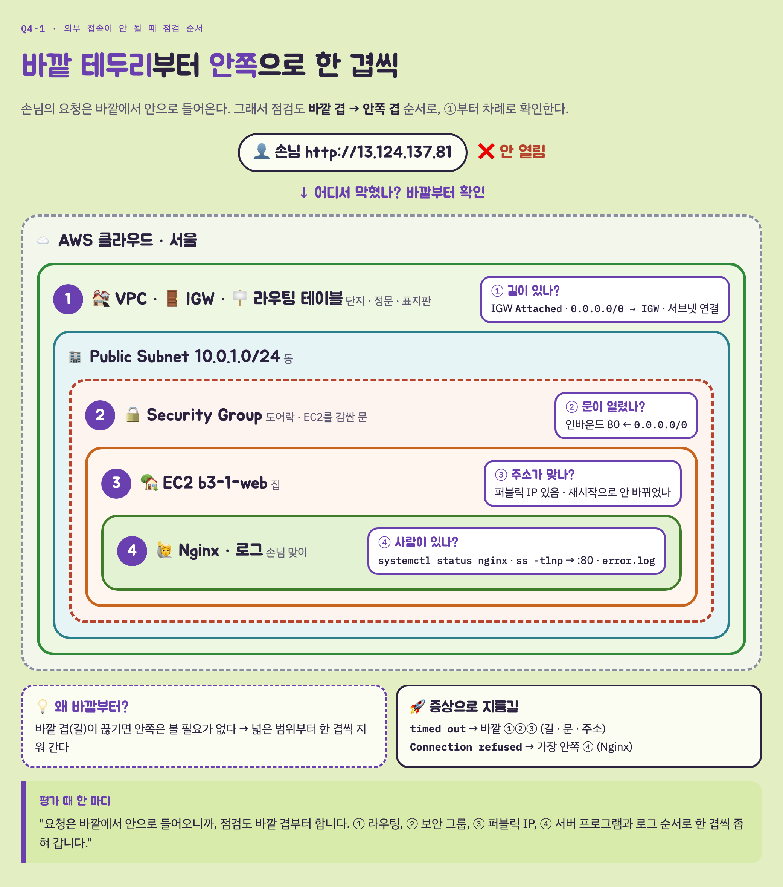

> 💡 **증상으로 지름길 찾기**: `timed out`이면 1~3단계(네트워크)부터, `Connection refused`면 4단계(서버 프로그램)부터 본다.

**③ 용어 설명**

| 용어 | 쉬운 뜻 | 비유 | 점검 단계 |
|---|---|---|---|
| **라우팅** | 데이터가 **어느 길로 갈지** 정하는 것 | 길 안내 | 1단계 |
| **NACL**<br>*Network Access Control List* | **서브넷 단위** 방화벽 (SG는 서버 단위) | 동 입구 경비 | 2단계 |
| **퍼블릭 IP 변경**<br>*Public IP (Internet Protocol) address* | EC2를 **중지 → 시작**하면 자동 IP가 **바뀜** | 이사 후 주소 변경 | 3단계 |
| **DNS**<br>*Domain Name System* | 도메인 이름을 **IP 주소로 바꿔 주는** 시스템 | 전화번호부 | 3단계 |
| **nslookup** | 도메인이 **어느 IP**를 가리키는지 확인하는 명령 | 전화번호부 찾기 | 3단계 |
| **프로세스** | 서버에서 **실행 중인 프로그램** | 근무 중인 직원 | 4단계 |
| **ss -tlnp** | 어떤 프로그램이 **어느 포트에서 기다리는지** 보는 명령 | 창구별 근무자 확인 | 4단계 |
| **nginx -t** | Nginx **설정 문법 검사** | 서류 오탈자 검사 | 4단계 |

📎 근거: [docs/troubleshooting.md](docs/troubleshooting.md)

---

## Q4-2. IAM 권한이 부족해 작업이 실패했다면, 권한을 무작정 올리지 않고 어떤 방식으로 필요한 최소 범위를 찾아갈지 설명할 수 있는가?

**① 한 줄 답**

🔎 **질문 해석**: **① 왜 무작정 올리면 안 되나** + **② 필요한 최소 범위를 어떻게 찾나**

**오류 메시지에서 막힌 Action과 리소스를 찾아, 그 작업 하나만 리전 · 리소스 조건을 붙여 추가**합니다. 관리자 권한은 주지 않습니다. **계정이 털려도 피해를 그 범위 안에 가두기 위해서입니다.**

| 설명 순서 | 묻는 것 | 답 |
|---|---|---|
| **1. 무작정 안 올리는 이유** | 관리자 권한을 주면? | 계정이 털리면 **계정 전체가 위험** (모든 서비스 삭제 · 큰 요금) |
| **2. 원인 찾기** | 무엇이 막혔나? | 오류 메시지 `not authorized to perform: ec2:CreateRoute` + ARN · CloudTrail의 `AccessDenied` 기록 |
| **3. 최소로 추가** | 얼마나 추가하나? | 막힌 **Action 하나만** |
| **4. 범위 좁히기** | 어디까지 허용하나? | **서울 리전 조건** · 특정 리소스로 제한 |
| **5. 검증 · 정리** | 맞는지 어떻게 확인하나? | 정책 시뮬레이터로 미리 시험 → 재시도 (또 막히면 반복) · Access Analyzer로 안 쓰는 권한 제거 |

**② 구성 그림**

```
❌ 잘못된 대응
"권한 오류? 관리자 권한 붙이면 되겠지"
 → 계정 전체가 위험해짐


✅ 최소 범위 찾기
① 오류 읽기   "not authorized to perform: ec2:CreateRoute"
      ▼
② 기록 확인   CloudTrail에서 거부(AccessDenied) 기록 확인
      ▼
③ 하나만 추가 ec2:CreateRoute 만 정책에 추가
      ▼
④ 범위 제한   서울 리전 조건 · 특정 리소스로 제한
      ▼
⑤ 다시 시도   성공하면 끝 / 또 막히면 ①부터 반복
      ▼
⑥ 정리       안 쓰는 권한은 나중에 제거
```

**③ 용어 설명**

| 용어 | 쉬운 뜻 | 비유 | 이번 미션에서 |
|---|---|---|---|
| **AccessDenied** | "**권한 없음**" 오류 | 출입증 인식 실패 | 권한 부족 신호 |
| **Action** | 막힌 **작업 이름** | "3층 출입" | `ec2:CreateRoute` 등 |
| **ARN**<br>*Amazon Resource Name* | AWS 리소스의 **전체 주소 이름** | 정확한 호수 | 오류 메시지에 표시 |
| **CloudTrail** | AWS에서 **누가 언제 무엇을 했는지** 남는 기록 | CCTV | 거부된 작업 확인 |
| **IAM 정책 시뮬레이터**<br>*Identity and Access Management* | 정책을 바꾸기 전에 **허용되는지 미리 시험** | 출입증 테스트기 | 추가 전 확인 |
| **IAM Access Analyzer**<br>*Identity and Access Management* | 실제 사용 기록으로 **필요한 권한만 담은 정책을 만들어 줌** | 실제 다닌 층만 추려 주는 비서 | 정책 다듬기 |
| **권한 상승** | 권한을 **크게 늘리는 것** | 마스터키 발급 | 하지 않음 |

**④ 확인 포인트**

| 도구 | 쓰임 |
|---|---|
| **오류 메시지** | 막힌 Action 이름과 리소스(ARN)를 바로 알려 줌 |
| **CloudTrail** | 언제, 누가, 어떤 작업에서 거부됐는지 확인 |
| **IAM 정책 시뮬레이터** | 바꾸기 전에 "이 작업이 허용되는지" 미리 시험 |
| **IAM Access Analyzer** | 실제 사용 기록으로 필요한 권한만 담은 정책 생성 |

> 🎤 **평가 때 한 마디** — "오류 메시지에서 막힌 Action과 리소스를 찾아, 그 작업 하나만 리전 · 리소스 조건을 붙여 추가합니다. 관리자 권한은 주지 않습니다. 계정이 털려도 피해를 그 범위 안에 가두기 위해서입니다."

📎 근거: [infra/iam-policy.json](infra/iam-policy.json)

---

## Q4-3. 트래픽이 늘어 인스턴스를 2대로 늘려야 한다면, 현재 구조에서 무엇이 병목이며 어떤 구성요소(ALB 등)를 추가할지 설명할 수 있는가?

**① 한 줄 답**

🔎 **질문 해석**: **① 지금 구조의 병목은 무엇인가** + **② 2대로 늘리려면 무엇을 추가하나**

**병목**: 손님이 들어오는 **주소(퍼블릭 IP)가 서버 1대에 묶여 있음** → 서버를 늘려도 나눠 보낼 수 없고, 그 1대가 멈추면 전체가 멈춤.
**추가**: 앞에 **ALB**(Application Load Balancer · 요청을 한 주소로 받아 여러 서버에 나눠 주는 AWS 서비스)를 두고, **Auto Scaling**(Auto Scaling Group · 트래픽에 맞춰 서버 수를 자동으로 늘리고 줄이는 기능)으로 **서로 다른 AZ 2곳에 EC2를 1대씩** 배치.

| 추가할 것 | 무엇인가 | 왜 | 비유 |
|---|---|---|---|
| **ALB**<br>*Application Load Balancer* | 손님 요청을 **한 주소로 받아 여러 서버에 나눠 주는** 서비스 | 2대에 일을 나눔 · 고장 난 서버는 자동으로 뺌 | 안내 데스크 |
| **Auto Scaling Group**<br>*자동 확장 그룹* | 정해 둔 기준(예: CPU 70%)에 따라 서버를 **자동으로 늘리고 줄이는** 기능 · 고장 난 서버는 **새로 만들어 교체** | 사람이 손으로 서버를 만들 필요 없음 · 항상 최소 대수 유지 | 손님 많으면 직원 더 부르기 |
| **두 번째 서브넷**<br>(다른 AZ · *Availability Zone*) | 다른 데이터센터에 만든 구역 | ALB는 **AZ 2곳 이상** 필요 · 한 곳 장애에도 버팀 | 다른 동 |
| **보안 그룹 변경** | EC2는 **ALB에서 오는 80만** 허용 | 손님이 서버로 바로 못 오고 ALB를 거치게 함 | 안내 데스크 거친 손님만 입장 |
| **`/health` 재사용** | ALB가 이 주소로 서버 상태 확인 | 이미 만든 건강 검진 창구를 그대로 씀 | 정기 건강 검진 |

```
[지금]  👤 → 퍼블릭 IP → 🏡 EC2 1대              하나 멈추면 전체 멈춤

[2대]   👤 → 🛎️ ALB ─┬→ 🏡 EC2 (AZ-a)          ALB가 나눠 줌
                      └→ 🏡 EC2 (AZ-c)          Auto Scaling이 대수 유지
                      ↑ /health로 상태 확인
```

🎤 "지금은 주소와 서버가 1개라 늘려도 나눠 줄 수 없고, 하나가 멈추면 다 멈춥니다. 앞에 ALB를 두고 Auto Scaling으로 다른 AZ에 서버를 하나씩 두면, ALB가 요청을 나눠 주고 `/health`로 고장 난 서버를 빼며, Auto Scaling이 새 서버로 채웁니다."

**② 구성 그림**

```
[현재] 하나가 멈추면 전체가 멈춤
👤 사용자 → 퍼블릭 IP → 🏡 EC2 1대 (AZ-a)
 ├ 주소가 서버 1대에 묶임
 ├ CPU·메모리 한계 = 병목
 └ 고장 = 서비스 중단


[개선] 나눠서 받고, 하나가 고장 나도 계속
👤 사용자 → ⚖️ ALB (하나의 주소)
             ├→ 🏡 EC2 #1 (AZ-a 서브넷) ← /health 로 상태 확인
             └→ 🏡 EC2 #2 (AZ-c 서브넷) ← 고장 나면 자동으로 제외
```

**③ 용어 설명**

| 용어 | 쉬운 뜻 | 비유 | 이번 상황에서 |
|---|---|---|---|
| **트래픽** | 서버로 오는 **요청의 양** | 손님 수 | 늘어난 상황 |
| **병목** | 전체 속도를 **가장 느리게 만드는 지점** | 좁은 병목 | 서버 1대 |
| **단일 장애점** | **하나만 고장 나도 전체가 멈추는** 곳 | 다리 하나뿐인 섬 | 서버 1대, AZ 1곳 |
| **ALB** (로드 밸런서)<br>*Application Load Balancer* | 요청을 **여러 서버에 나눠 주는** 장치 | 손님 안내 직원 | 앞단에 추가 |
| **가용 영역 (AZ)**<br>*Availability Zone* | 리전 안의 **독립 데이터센터** | 다른 구의 건물 | 2곳에 분산 |
| **Auto Scaling Group** | 부하에 따라 **서버 수를 자동으로 늘리고 줄임** | 손님 많으면 직원 추가 | 2대 이상 유지 |
| **헬스체크** | ALB가 서버의 **건강을 주기적으로 확인** | 직원 컨디션 체크 | `/health` 사용 |
| **수평 확장** | 서버를 **더 크게**가 아니라 **더 많이** | 직원을 늘리기 | 1대 → 2대 |

**④ 확인 포인트**

| 현재 병목 | 문제 | 해결 |
|---|---|---|
| EC2 1대 | CPU·메모리 한계, 고장 시 전체 중단 | EC2 2대 이상 (**Auto Scaling Group**으로 자동 증감) |
| 가용 영역 1곳 | 데이터센터 장애 시 중단 | 서브넷을 **2개 AZ**에 하나씩 |
| 퍼블릭 IP가 서버 1대에 직접 연결 | 트래픽을 나눌 수 없음 | **ALB**가 하나의 주소로 받아 분배 |
| 서버가 인터넷에 직접 노출 | 보안 | EC2 SG는 **ALB SG에서 오는 80만 허용** |

> 💡 이번에 만든 **`/health`가 여기서 그대로 쓰인다.** ALB는 각 서버의 `/health`를 주기적으로 호출해 200이 아니면 그 서버로 요청을 보내지 않는다.

📎 근거: [docs/architecture.png](docs/architecture.png) (현재 구조)

---

## Q4-4. Billing에 예상치 못한 비용이 찍혔다면, 어떤 리소스부터 의심하고 어떻게 추적/정리할지 설명할 수 있는가?

**① 한 줄 답**

🔎 **질문 해석**: **① 어떤 리소스부터 의심하나** + **② 어떻게 추적하나** + **③ 어떻게 정리하나**

**Cost Explorer**(서비스 · 리전별 요금을 보여 주는 화면)로 어디서 요금이 나왔는지 먼저 확인하고, 아래 순서로 의심합니다.

**EC2**(켜 둔 서버) → **EBS**(서버를 지워도 남은 디스크 · 스냅샷) → **EIP**(안 쓰고 잡아 둔 고정 IP) → **NAT**(켜 두기만 해도 시간당 요금이 나오는 인터넷 연결 장치)

태그(`Project=B3-1`)로 찾아 지우고, **Budgets**(정한 금액을 넘으면 메일로 알려 주는 예산 알림)로 재발을 막습니다.

| 순서 | 리소스 | 요금이 나오는 이유 | 비유 |
|---|---|---|---|
| 1 | **EC2** *Elastic Compute Cloud* | 켜져 있는 시간만큼 요금 | 켜 둔 전등 |
| 2 | **EBS** *Elastic Block Store* | 서버를 지워도 **디스크는 따로 남아** 요금 | 이사 가고 남긴 짐 보관료 |
| 3 | **EIP** *Elastic IP* | 할당해 두고 **안 쓰면** 요금 | 안 쓰는 사서함 월세 |
| 4 | **NAT** *Network Address Translation Gateway* | **켜 두기만 해도** 시간당 요금 (가장 비쌈) | 아무도 안 타는 셔틀버스 |

**② 구성 그림**

```
① 어디서?    Billing → Cost Explorer → 서비스별 · 리전별 비용
      ▼
② 무엇이?    의심 순서대로 확인 (EC2 → EBS → EIP → NAT → 크레딧)
      ▼
③ 누구 것?   태그(Project=B3-1) · 이름(b3-1-*)으로 실습 리소스인지 확인
      ▼
④ 정리       체크리스트 순서로 삭제 → 다음 날 비용이 멈췄는지 확인
      ▼
⑤ 재발 방지  AWS Budgets로 "요금 발생 시 메일" 알림 설정
```

**③ 용어 설명**

| 용어 | 쉬운 뜻 | 비유 | 이번 상황에서 |
|---|---|---|---|
| **Billing** | AWS **요금 청구** 화면 | 관리비 고지서 | 이상 비용 발견 |
| **Cost Explorer** | 요금을 **서비스·리전·기간별로 나눠 보는** 도구 | 고지서 항목별 내역 | 원인 찾기 1단계 |
| **AWS Budgets**<br>*Amazon Web Services* | 정한 금액을 넘으면 **알림 메일**을 보내는 기능 | 카드 사용 알림 | 재발 방지 |
| **프리 티어** | 일정 사용량까지 **무료** | 기본 제공량 | 넘으면 과금 |
| **EIP 요금**<br>*Elastic IP (Internet Protocol) address* | 서버에 **연결 안 한 고정 IP**도 시간당 요금 | 비워 둔 사서함 요금 | 의심 3순위 |
| **NAT Gateway**<br>*Network Address Translation Gateway* | 프라이빗 서브넷이 밖으로 나가는 장치. **시간당 + 데이터 요금** | 유료 셔틀버스 | 의심 4순위 |
| **t3 크레딧 Unlimited** | CPU를 기준보다 많이 쓰면 **추가 요금** | 데이터 무제한 요금제 초과분 | Standard로 설정해 예방 |
| **스냅샷** | 디스크의 **백업 사본**. 남아 있으면 요금 | 창고 사진 보관비 | 의심 2순위에 포함 |

**④ 확인 포인트: 의심 순서**

| 순서 | 리소스 | 흔한 원인 | 확인 위치 |
|---|---|---|---|
| 1 | **EC2** | 끄지 않은 서버, **다른 리전**에 실수로 만든 서버, 프리 티어 외 유형 | EC2 → 인스턴스 (리전 바꿔 가며) |
| 2 | **EBS** | 서버는 지웠지만 **남은 볼륨**, 스냅샷 | EC2 → 볼륨 (`available` 상태) · 스냅샷 |
| 3 | **Elastic IP · 퍼블릭 IPv4** | 연결 안 된 EIP, IP 시간당 요금 | EC2 → 탄력적 IP |
| 4 | **NAT Gateway** | 만들어 두고 잊음 | VPC → NAT 게이트웨이 |
| 5 | **t3 크레딧** | Unlimited 모드에서 CPU 초과 사용 | 인스턴스 → 크레딧 사양 |
| 6 | ALB · RDS · 데이터 전송 | 만들어 두고 잊음, 대용량 전송 | 각 서비스 콘솔 |

> 💡 **다른 리전을 꼭 확인한다.** 리전을 잘못 선택한 채 만든 리소스는 서울 리전 화면에 보이지 않아 놓치기 쉽다.

📎 근거: [docs/cleanup-checklist.md](docs/cleanup-checklist.md)

---

## 마지막 점검 — 평가 전 30초 요약

| 질문 유형 | 핵심 키워드 |
|---|---|
| 구성 확인 | **VPC 안에 서브넷**, **IGW는 VPC에 Attached**, **라우팅 테이블 `0.0.0.0/0 → IGW`를 서브넷에 연결** |
| 네트워크 흐름 | 요청: **IP → IGW → Subnet → SG → EC2** / 응답: **Route Table → IGW** |
| `0.0.0.0/0 → IGW` | **나가는 길**. 없으면 응답이 못 나가 타임아웃 |
| SG vs IAM | SG = **통신**(도어락), IAM = **작업 권한**(출입증) |
| 최소화 기준 | **누가, 왜** 필요한가 → 80 누구나, 22 나만, 나머지 차단 |
| 22·DB 전체 개방 금지 | 자동 스캔 공격 → **내 IP만 / 프라이빗 서브넷 / Session Manager** |
| 트러블슈팅 | **증상 → 가설 → 검증 → 조치 → 결과 → 재발 방지**, 한 번에 하나만 |
| 접속 장애 점검 | **localhost로 먼저 나누기** → 라우팅 → SG → IP/DNS → 서버 로그 |
| 권한 부족 | **오류의 Action만**, 범위를 좁혀 추가. 관리자 권한 금지 |
| 확장 | **ALB + 2개 AZ + `/health` 헬스체크** |
| 비용 이상 | **서비스·리전 확인 → EC2 → EBS → EIP → NAT**, Budgets 알림 |

---

## 부록 — 일반 서버 구조와 AWS 구조는 다른가?

**① 한 줄 답**

🔎 **질문 해석**: "회사에 서버를 직접 두는 방식(일반 서버)과 AWS는 **구조 자체가 다른가**, 아니면 **만드는 방법만 다른가**?"를 묻는다.

**원리(역할)는 같고, 만드는 방법이 다르다.** 일반 서버는 라우터·방화벽·서버 **장비를 사서** 꾸미고, AWS는 같은 역할을 **설정으로 빌려** 만든다.

| 설명 순서 | 묻는 것 | 답 |
|---|---|---|
| 1. 같은 점 | 구조가 다른가? | **아니다.** 네트워크 → 대문 → 길 안내 → 문지기 → 서버 → 웹 프로그램 순서는 똑같다 |
| 2. 다른 점 | 무엇이 다른가? | **장비 → 설정**, **소유 → 대여**, **몇 주 → 몇 분**, **고정비 → 쓴 만큼** |
| 3. 이번 미션 | 그래서 무엇을 했나? | 장비 대신 **VPC · IGW · Route Table · SG · EC2**를 설정으로 만들고, 다 쓰면 **정리**했다 |

**② 구성 그림**

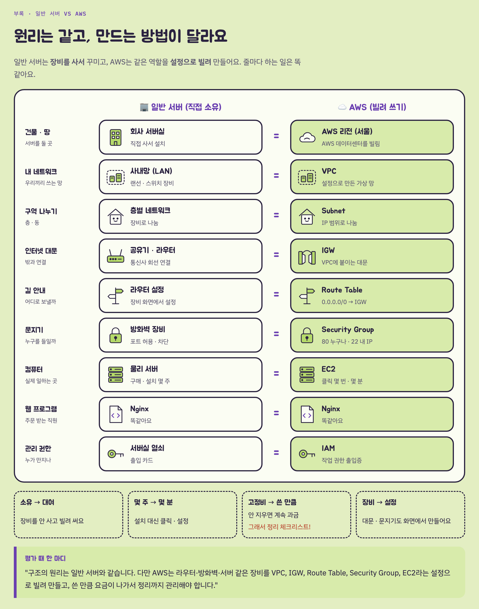

<details>
<summary>📖 글로 보기</summary>

```
            일반 서버 (직접 소유)          AWS (빌려 쓰기)
건물·땅     회사 서버실             =     AWS 리전 (서울)
내 네트워크  사내망 (LAN)            =     VPC
구역 나누기  층별 네트워크           =     Subnet
인터넷 대문  공유기 · 라우터         =     IGW
길 안내     라우터 설정             =     Route Table (0.0.0.0/0 → IGW)
문지기      방화벽 장비             =     Security Group
컴퓨터      물리 서버               =     EC2
웹 프로그램  Nginx                  =     Nginx (똑같음)
관리 권한    서버실 열쇠 · 출입 카드  =     IAM
```

</details>

**③ 용어 설명**

| 용어 | 쉬운 뜻 | 비유 |
|---|---|---|
| **온프레미스**<br>*On-premises* | 회사 건물 안에 서버를 **직접 사서 두는** 방식 (= 일반 서버) | 내 집 장만 |
| **클라우드**<br>*Cloud computing* | 남의 데이터센터 컴퓨터를 **인터넷으로 빌려 쓰는** 방식 | 월세 · 렌터카 |
| **LAN**<br>*Local Area Network* | 건물 안에서 **우리끼리 쓰는 네트워크** | 사내 전용 도로 |
| **라우터**<br>*Router* | 네트워크 사이에서 **길을 안내하는 장비** | 교차로 표지판 |
| **방화벽**<br>*Firewall* | 정한 포트·주소만 **들여보내는 장비/프로그램** | 경비실 |
| **공동 책임 모델**<br>*Shared Responsibility Model* | 건물·장비는 **AWS**가, 설정·데이터는 **내가** 책임진다는 약속 | 집주인은 건물, 세입자는 문단속 |

**④ 확인 포인트: 무엇이 실제로 달라지나**

| 비교 | 일반 서버 | AWS | 이번 미션에서 의미 |
|---|---|---|---|
| 준비 시간 | 장비 구매 · 설치 **몇 주** | 클릭 · 설정 **몇 분** | 실습을 바로 시작 |
| 비용 | 미리 사는 **고정비** | **쓴 만큼** (시간당) | 안 지우면 계속 과금 → **정리 체크리스트** |
| 문지기 | 방화벽 **장비** 구매 | **Security Group 설정** | 80 누구나, 22 내 IP만 |
| 늘리기 | 서버 추가 구매 | 인스턴스 추가 + ALB | Q4-3 확장 답과 연결 |
| 고장 · 관리 | 장비 수리도 **내 몫** | 장비는 **AWS 몫**, 설정은 **내 몫** | SG · IAM 실수는 내 책임 |

> 💡 **평가 때 한 마디**: "구조의 원리는 일반 서버와 같습니다. 다만 AWS는 라우터·방화벽·서버 같은 장비를 VPC, IGW, Route Table, Security Group, EC2라는 설정으로 빌려 만들고, 쓴 만큼 요금이 나가서 정리까지 관리해야 합니다."
