# 그림으로 보는 B3-1

> **용어를 하나도 몰라도 괜찮다.** 이 책은 "인터넷이 뭐지?"부터 시작해서, 이번 미션(AWS에 내 웹 서버 올리기)을 이해하고 평가에서 설명할 수 있을 때까지 **한 장씩 그림으로** 쌓아 올린다.

## 읽는 순서

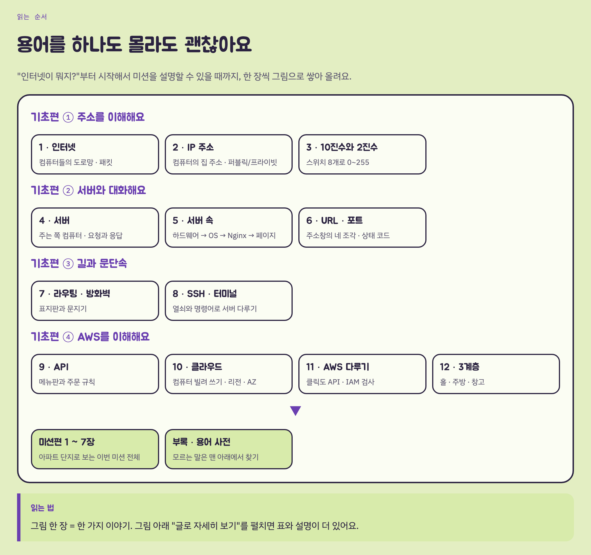

| 편 | 장 | 한 줄 요약 | 관련 평가 질문 |
|---|---|---|---|
| 기초편 | [기초 1](#기초-1--인터넷은-컴퓨터들의-도로망) | 인터넷 = 컴퓨터들의 도로망, 데이터는 소포(패킷)로 이동 | 전체 |
| 기초편 | [기초 2](#기초-2--ip-주소는-컴퓨터의-집-주소) | IP = 컴퓨터 주소, 퍼블릭 IP와 프라이빗 IP | Q1-4 · Q2-1 |
| 기초편 | [기초 3](#기초-3--10진수와-2진수) | 사람은 0~9, 컴퓨터는 0과 1로 센다 | Q3-1 |
| 기초편 | [기초 4](#기초-4--서버는-주는-쪽-컴퓨터) | 클라이언트가 요청하고 서버가 응답한다 | Q1-2 · Q2-1 |
| 기초편 | [기초 5](#기초-5--서버-속은-4층-건물) | 하드웨어 → OS → Nginx → 웹페이지 | Q1-2 |
| 기초편 | [기초 6](#기초-6--주소창의-글자는-네-조각) | URL · 포트 · HTTP · 상태 코드 | Q1-4 · Q2-2 · Q4-1 |
| 기초편 | [기초 7](#기초-7--길-안내는-표지판-문단속은-방화벽) | 라우팅 테이블과 방화벽(보안 그룹) | Q1-1 · Q3-1 · Q2-2 |
| 기초편 | [기초 8](#기초-8--ssh와-터미널) | 화면 없는 서버를 열쇠와 명령어로 다루기 | Q1-2 · Q3-3 |
| 기초편 | [기초 9](#기초-9--api는-메뉴판과-주문-규칙) | API = 정해진 주문 방법 | Q1-4 · Q3-2 · Q4-2 |
| 기초편 | [기초 10](#기초-10--클라우드는-컴퓨터를-빌려-쓰는-것) | 클라우드 · 리전 · 가용 영역 · 책임 나누기 | Q3-2 · Q4-3 · Q4-4 |
| 기초편 | [기초 11](#기초-11--aws를-다루는-법) | 콘솔 클릭도 결국 API, 매번 IAM 검사 | Q3-2 · Q4-2 |
| 기초편 | [기초 12](#기초-12--웹-앱-db-3계층) | 홀 · 주방 · 창고로 역할 나누기 | Q3-3 · Q4-3 |
| 미션편 | [1장 ~ 7장](#미션편--아파트-단지로-보는-b3-1) | 아파트 단지로 보는 이번 미션 | 전체 |
| 부록 | [용어 사전](#부록--용어-사전) | 모르는 말 찾아보기 | — |

---

# 기초편 · 서버 · API · AWS


**[서버](#기초-4--서버는-주는-쪽-컴퓨터)**는 가게, **[요청](#기초-4--서버는-주는-쪽-컴퓨터)**은 주문, **[API](#기초-9--api는-메뉴판과-주문-규칙)**는 메뉴판, **[AWS](#기초-10--클라우드는-컴퓨터를-빌려-쓰는-것)**는 가게 건물을 빌려주는 회사다. [인터넷](#기초-1--인터넷은-컴퓨터들의-도로망)과 [IP 주소](#기초-2--ip-주소는-컴퓨터의-집-주소)부터 한 장씩 차례로 보면 된다. (단어를 누르면 그 장으로 이동)

---

## 기초 1 · 인터넷은 컴퓨터들의 도로망

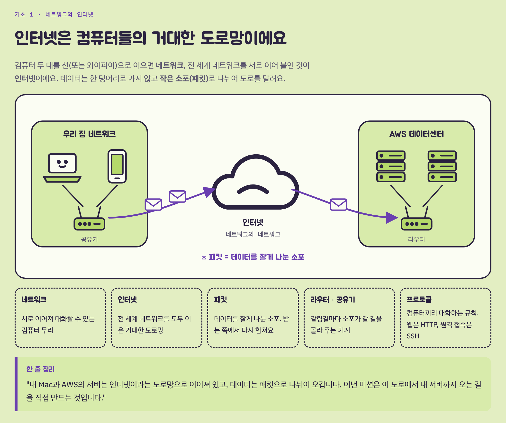

<details>
<summary>📖 글로 자세히 보기 (표 · 설명)</summary>

컴퓨터 두 대를 선(또는 와이파이)으로 이으면 **네트워크**, 전 세계 네트워크를 서로 이어 붙인 것이 **인터넷**이다. 데이터는 한 덩어리로 가지 않고 **작은 소포(패킷)**로 나뉘어 도로를 달린다.

```
[우리 집 네트워크]                                      [AWS 데이터센터]
 💻 노트북 ─┐                                         ┌─ 🗄️ 서버
 📱 휴대폰 ─┴─ 📶 공유기 ══✉✉══▶ ☁️ 인터넷 ══✉══▶ 📶 라우터 ─┴─ 🗄️ 서버
                              (네트워크의 네트워크)
```

| 용어 | 쉬운 뜻 | 비유 |
|---|---|---|
| **네트워크** | 서로 이어져 대화할 수 있는 컴퓨터 무리 | 동네 골목길 |
| **인터넷** | 전 세계 네트워크를 모두 이은 것 | 전국 도로망 |
| **패킷** | 데이터를 잘게 나눈 조각. 받는 쪽에서 다시 합침 | 소포 |
| **라우터 · 공유기** | 갈림길마다 소포가 갈 길을 골라 주는 기계 | 교차로 |
| **프로토콜** | 컴퓨터끼리 대화하는 규칙 (웹은 HTTP, 원격 접속은 SSH) | 같은 언어로 말하기 |

> 📝 **한 줄 정리**
> "내 Mac과 AWS의 서버는 인터넷이라는 도로망으로 이어져 있고, 데이터는 패킷으로 나뉘어 오갑니다. 이번 미션은 이 도로에서 내 서버까지 오는 길을 직접 만드는 것입니다."

</details>

---

## 기초 2 · IP 주소는 컴퓨터의 집 주소

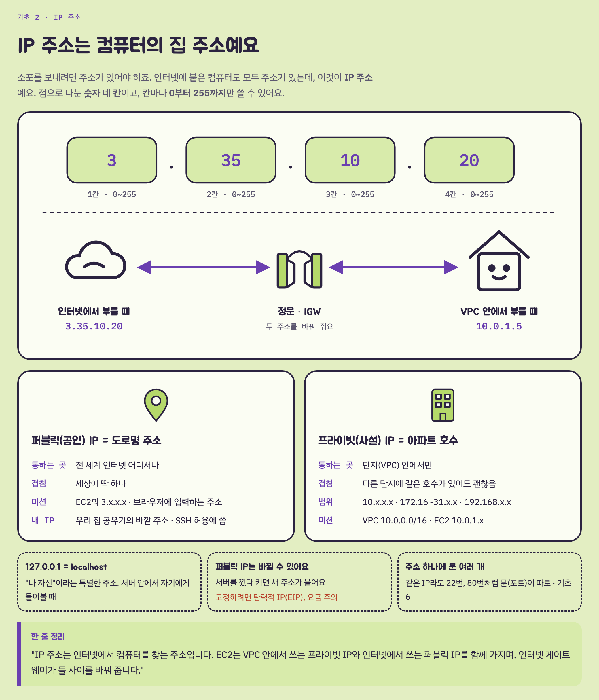

<details>
<summary>📖 글로 자세히 보기 (표 · 설명)</summary>

소포를 보내려면 주소가 있어야 한다. 인터넷에 붙은 컴퓨터도 모두 주소가 있는데, 이것이 **IP 주소**다.

```
   3   .   35   .   10   .   20        ← 점으로 나눈 숫자 4칸
 1칸      2칸       3칸      4칸        ← 칸마다 0 ~ 255 만 가능
```

### 주소는 두 종류: 바깥 주소와 안 주소

```
☁️ 인터넷에서 부를 때          🚪 정문 (IGW)            🏠 VPC 안에서 부를 때
   3.35.10.20       ◀────▶   두 주소를 바꿔 줌   ◀────▶    10.0.1.5
   (퍼블릭 IP)                                          (프라이빗 IP)
```

| | 📍 퍼블릭(공인) IP | 🏢 프라이빗(사설) IP |
|---|---|---|
| 비유 | **도로명 주소** | **아파트 동·호수** |
| 통하는 곳 | 전 세계 인터넷 어디서나 | 단지(VPC) 안에서만 |
| 겹침 | 세상에 딱 하나 | 다른 단지에 같은 번호가 있어도 됨 |
| 정해진 범위 | 아래 세 범위를 뺀 나머지 | `10.x.x.x` · `172.16~31.x.x` · `192.168.x.x` |
| 이번 미션에서 | EC2의 `3.x.x.x` 같은 주소 → 브라우저에 입력 | VPC `10.0.0.0/16`, EC2 `10.0.1.x` |

| 꼭 알아 둘 주소 | 뜻 | 이번 미션에서 |
|---|---|---|
| **내 IP** | 우리 집 공유기의 바깥(퍼블릭) 주소 | SSH(22번)를 "내 IP만" 허용할 때 씀 |
| **127.0.0.1 = localhost** | "나 자신"이라는 특별한 주소 | 서버 안에서 `curl http://localhost`로 자기에게 물어봄 |
| **퍼블릭 IP는 바뀔 수 있음** | 서버를 껐다 켜면 새 주소가 붙음 | 고정하려면 탄력적 IP(EIP), 요금 주의 |

> 📝 **한 줄 정리**
> "IP 주소는 인터넷에서 컴퓨터를 찾는 주소입니다. EC2는 VPC 안에서 쓰는 프라이빗 IP와 인터넷에서 쓰는 퍼블릭 IP를 함께 가지며, 인터넷 게이트웨이가 둘 사이를 바꿔 줍니다."

</details>

---

## 기초 3 · 10진수와 2진수

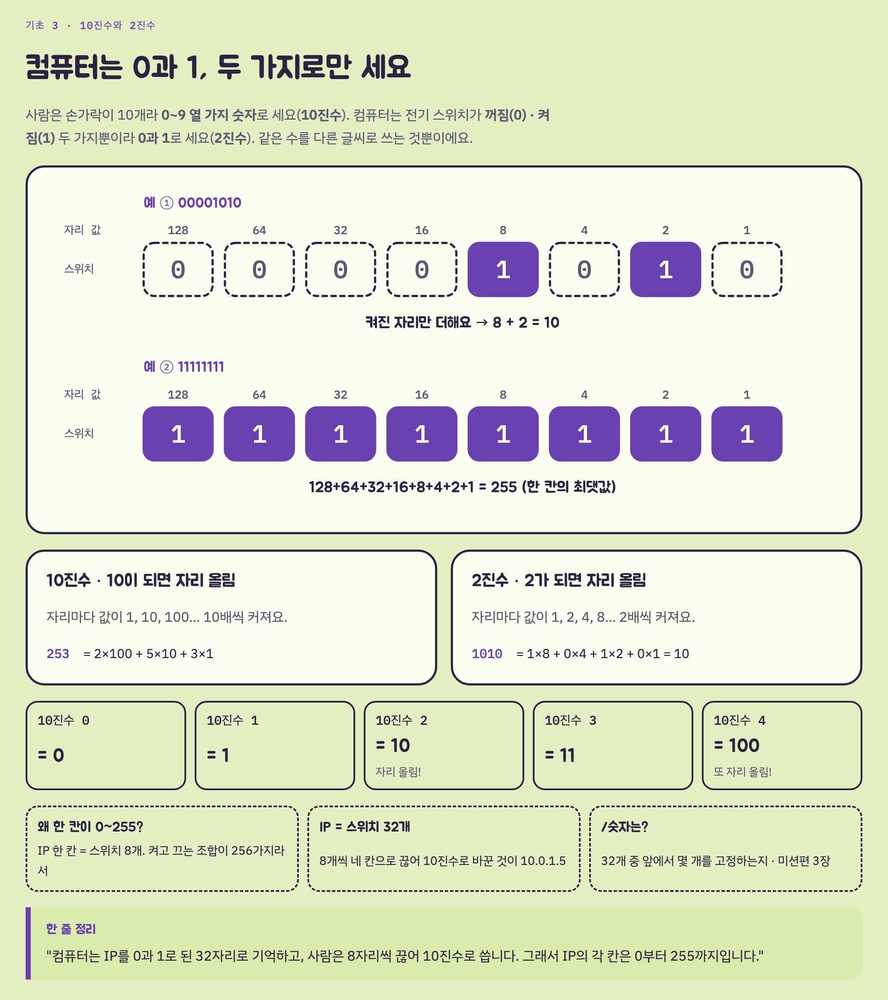

<details>
<summary>📖 글로 자세히 보기 (표 · 설명)</summary>

사람은 손가락이 10개라 **0~9 열 가지 숫자**로 센다(**10진수**). 컴퓨터는 전기 스위치가 **꺼짐(0) · 켜짐(1)** 두 가지뿐이라 **0과 1**로 센다(**2진수**). **같은 수를 다른 글씨로 쓰는 것**뿐이다.

### 자리 값으로 바꾸기

```
자리 값 :  128   64   32   16    8    4    2    1
스위치  :   0    0    0    0   [1]   0   [1]   0      ← 00001010
                                 8    +    2   = 10  ← 켜진 자리만 더하기

스위치  :  [1]  [1]  [1]  [1]  [1]  [1]  [1]  [1]     ← 11111111
           128 + 64 + 32 + 16 +  8 +  4 +  2 +  1 = 255  ← 한 칸의 최댓값
```

| | 10진수 (사람) | 2진수 (컴퓨터) |
|---|---|---|
| 쓰는 숫자 | 0 ~ 9 | 0, 1 |
| 자리 올림 | 10이 되면 | 2가 되면 |
| 자리 값 | 1, 10, 100 … (10배씩) | 1, 2, 4, 8 … (2배씩) |
| 예 | 253 = 2×100 + 5×10 + 3×1 | 1010 = 1×8 + 0×4 + 1×2 + 0×1 = 10 |

| 10진수 | 0 | 1 | 2 | 3 | 4 | 10 | 255 |
|---|---|---|---|---|---|---|---|
| 2진수 | 0 | 1 | 10 ← 자리 올림 | 11 | 100 ← 자리 올림 | 1010 | 11111111 |

### 이게 IP와 무슨 상관?

```
컴퓨터가 보는 IP : 00001010 00000000 00000001 00000101   ← 스위치 32개
8개씩 끊어 바꾸기:    10   .    0    .    1    .    5      ← 우리가 보는 10.0.1.5
```

- IP 한 칸 = 스위치 8개 → 켜고 끄는 조합이 **256가지** → 그래서 칸마다 **0~255**
- `10.0.0.0/16`의 `/16` = 32개 중 **앞 16개를 고정** → 자세한 건 [미션편 3장](#3장--00000-은-전-세계라는-뜻)

> 📝 **한 줄 정리**
> "컴퓨터는 IP를 0과 1로 된 32자리로 기억하고, 사람은 8자리씩 끊어 10진수로 씁니다. 그래서 IP의 각 칸은 0부터 255까지입니다."

</details>

---

## 기초 4 · 서버는 주는 쪽 컴퓨터

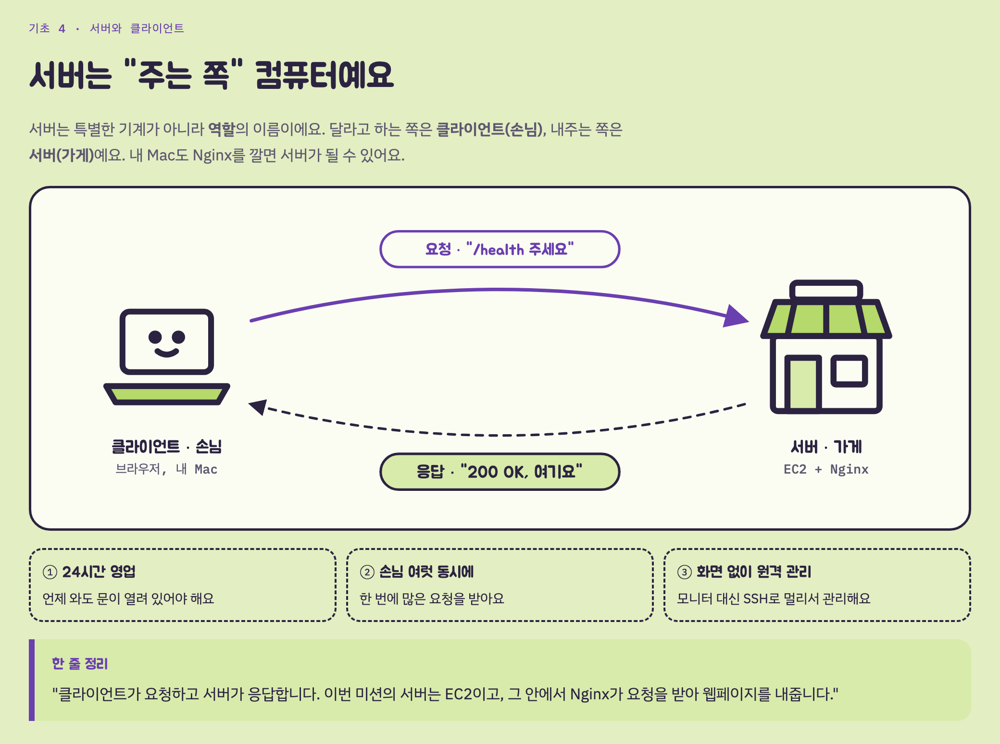

<details>
<summary>📖 글로 자세히 보기 (표 · 설명)</summary>

서버는 특별한 기계가 아니라 **역할의 이름**이다. 달라고 하는 쪽이 **클라이언트(손님)**, 내주는 쪽이 **서버(가게)**다.

```
💻 클라이언트 (손님)  ── 요청: "/health 주세요" ──▶  🏪 서버 (가게)
   브라우저, 내 Mac   ◀── 응답: "200 OK, 여기요" ──   EC2 + Nginx
```

| 용어 | 쉬운 뜻 | 비유 | 이번 미션에서 |
|---|---|---|---|
| **클라이언트** | 서비스를 달라고 하는 쪽 | 손님 | 내 Mac의 브라우저, curl |
| **서버** | 서비스를 내주는 쪽 | 가게 | EC2 + Nginx |
| **요청 (Request)** | 클라이언트가 보내는 부탁 | 주문 | `GET /health` |
| **응답 (Response)** | 서버가 돌려주는 답 | 요리 | `200 OK` + `OK` |

**서버의 3가지 특징**: ① 24시간 켜져 있다 ② 여러 손님을 동시에 받는다 ③ 화면 없이 원격(SSH)으로 관리한다.

> 📝 **한 줄 정리**
> "클라이언트가 요청하고 서버가 응답합니다. 이번 미션의 서버는 EC2이고, 그 안에서 Nginx가 요청을 받아 웹페이지를 내줍니다."

</details>

---

## 기초 5 · 서버 속은 4층 건물

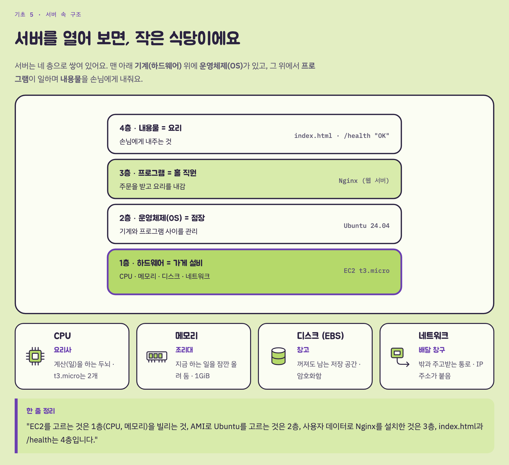

<details>
<summary>📖 글로 자세히 보기 (표 · 설명)</summary>

서버는 **네 층**으로 쌓여 있다. 아래층이 없으면 위층도 없다.

```
4층 🍲 내용물   = 요리      index.html · /health "OK"
3층 🙋 프로그램 = 홀 직원   Nginx (웹 서버)
2층 🧑‍💼 OS      = 점장      Ubuntu 24.04
1층 🔧 하드웨어 = 가게 설비 EC2 t3.micro (CPU · 메모리 · 디스크 · 네트워크)
```

| 부품 | 비유 | 하는 일 | 이번 미션에서 |
|---|---|---|---|
| **CPU** | 요리사 | 계산(일)을 하는 두뇌 | t3.micro = vCPU 2개 |
| **메모리** | 조리대 | 지금 하는 일을 잠깐 올려 둠 (끄면 사라짐) | 1 GiB |
| **디스크 (EBS)** | 창고 | 꺼져도 남는 저장 공간 | EBS, 암호화 |
| **네트워크** | 배달 창구 | 밖과 주고받는 통로 | 프라이빗 IP · 퍼블릭 IP가 붙음 |

| 내가 한 일 | 몇 층? |
|---|---|
| 인스턴스 유형 t3.micro 고르기 | 1층 |
| AMI로 Ubuntu 24.04 고르기 | 2층 |
| 사용자 데이터로 Nginx 설치 | 3층 |
| index.html, /health 만들기 | 4층 |

> 📝 **한 줄 정리**
> "EC2를 고르는 것은 1층(CPU, 메모리)을 빌리는 것, AMI로 Ubuntu를 고르는 것은 2층, 사용자 데이터로 Nginx를 설치한 것은 3층, index.html과 /health는 4층입니다."

</details>

---

## 기초 6 · 주소창의 글자는 네 조각

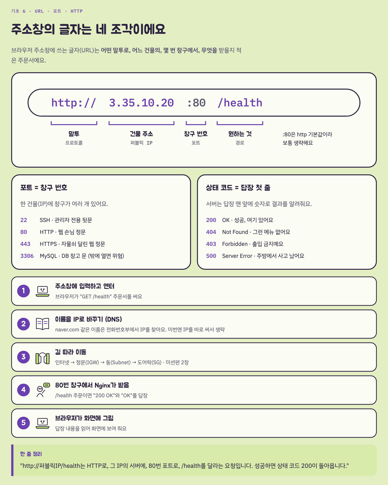

<details>
<summary>📖 글로 자세히 보기 (표 · 설명)</summary>

URL은 **어떤 말투로, 어느 건물의, 몇 번 창구에서, 무엇을** 받을지 적은 주문서다.

```
http://   3.35.10.20   :80        /health
└ 말투 ┘  └ 건물 주소 ┘ └ 창구 번호 ┘ └ 원하는 것 ┘
프로토콜   퍼블릭 IP     포트         경로
```

> `:80`은 http의 기본값이라 보통 생략한다. 그래서 `http://3.35.10.20/health`로 쓴다. (IP는 예시)

### 포트 = 창구 번호

한 건물(IP)에 창구(포트)가 여러 개 있다. 번호마다 맡은 일이 정해져 있다.

| 포트 | 이름 | 비유 | 이번 미션 보안 그룹 |
|---|---|---|---|
| **22** | SSH | 관리자 전용 뒷문 | 내 IP/32만 허용 |
| **80** | HTTP | 웹 손님 정문 | 0.0.0.0/0 허용 |
| **443** | HTTPS | 자물쇠 달린 웹 정문 | (이번엔 안 씀) |
| **3306** | MySQL | DB 창고 문 | 열지 않음 (밖에 열면 위험) |

### 상태 코드 = 답장 첫 줄

| 코드 | 뜻 | 비유 |
|---|---|---|
| **200** | OK | 성공, 여기 있어요 |
| **404** | Not Found | 그런 메뉴 없어요 |
| **403** | Forbidden | 출입 금지예요 |
| **500** | Server Error | 주방에서 사고 났어요 |

> 상태 코드가 왔다는 건 **서버까지는 도착했다**는 뜻이다. 아예 답이 없으면(timed out) 길에서 막힌 것이다 → 미션편 5장.

### 엔터를 누르면 일어나는 일

| 순서 | 무슨 일 |
|---|---|
| 1 | 💻 브라우저가 `GET /health` 주문서를 쓴다 |
| 2 | 📖 이름(naver.com)이면 **DNS**(전화번호부)에서 IP를 찾는다. 이번엔 IP를 바로 써서 생략 |
| 3 | 🚪 인터넷 → 정문(IGW) → 동(Subnet) → 도어락(SG) 길을 따라간다 (미션편 2장) |
| 4 | 🙋 80번 창구에서 Nginx가 받고 `200 OK` + `OK`를 답장한다 |
| 5 | 💻 브라우저가 답장을 화면에 그린다 |

> 📝 **한 줄 정리**
> "http://퍼블릭IP/health는 HTTP로, 그 IP의 서버에, 80번 포트로, /health를 달라는 요청입니다. 성공하면 상태 코드 200이 돌아옵니다."

</details>

---

## 기초 7 · 길 안내는 표지판 문단속은 방화벽

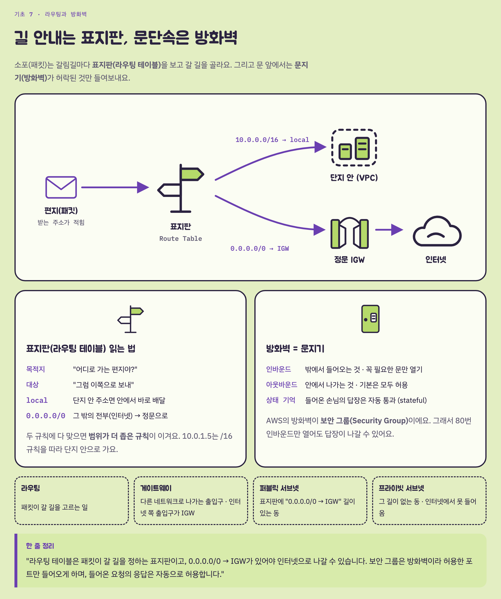

<details>
<summary>📖 글로 자세히 보기 (표 · 설명)</summary>

소포(패킷)는 갈림길마다 **표지판(라우팅 테이블)**을 보고 갈 길을 고른다. 문 앞에서는 **문지기(방화벽)**가 허락된 것만 들여보낸다.

```
                       ┌─ 10.0.0.0/16 → local ──▶ 🏘️ 단지 안 (VPC)
✉️ 편지 ──▶ 🪧 표지판 ─┤
  (받는 주소)  (Route Table) └─ 0.0.0.0/0  → IGW ───▶ 🚪 정문 ──▶ ☁️ 인터넷
```

### 표지판(라우팅 테이블) 읽는 법

| 칸 이름 | 뜻 | 예 |
|---|---|---|
| **대상 (Destination)** | "어디로 가는 편지야?" | `0.0.0.0/0` (그 밖의 전부) |
| **타깃 (Target)** | "그럼 이쪽으로 보내" | `igw-…` (정문) |
| **local** | 단지 안 주소면 안에서 바로 배달 | `10.0.0.0/16 → local` (자동으로 있음) |

> 두 규칙에 다 맞으면 **범위가 더 좁은 규칙이 이긴다.** `10.0.1.5`는 `/16` 규칙을 따라 단지 안으로 간다.

### 방화벽 = 문지기

| 용어 | 뜻 | 이번 미션 보안 그룹 |
|---|---|---|
| **인바운드** | 밖에서 **들어오는** 것 | 80(누구나), 22(내 IP만)만 열기 |
| **아웃바운드** | 안에서 **나가는** 것 | 기본값(모두 허용) 그대로 |
| **상태 기억 (stateful)** | 들어온 손님의 **답장은 자동 통과** | 그래서 응답용 규칙을 따로 안 만들어도 됨 |

| 용어 | 쉬운 뜻 |
|---|---|
| **라우팅** | 패킷이 갈 길을 고르는 일 |
| **게이트웨이** | 다른 네트워크로 나가는 출입구. 인터넷 쪽 출입구가 **IGW** |
| **퍼블릭 서브넷** | 표지판에 "0.0.0.0/0 → IGW" 길이 **있는** 동 |
| **프라이빗 서브넷** | 그 길이 **없는** 동. 인터넷에서 못 들어옴 |

> 📝 **한 줄 정리**
> "라우팅 테이블은 패킷이 갈 길을 정하는 표지판이고, 0.0.0.0/0 → IGW가 있어야 인터넷으로 나갈 수 있습니다. 보안 그룹은 방화벽이라 허용한 포트만 들어오게 하며, 들어온 요청의 응답은 자동으로 허용합니다."

</details>

---

## 기초 8 · SSH와 터미널

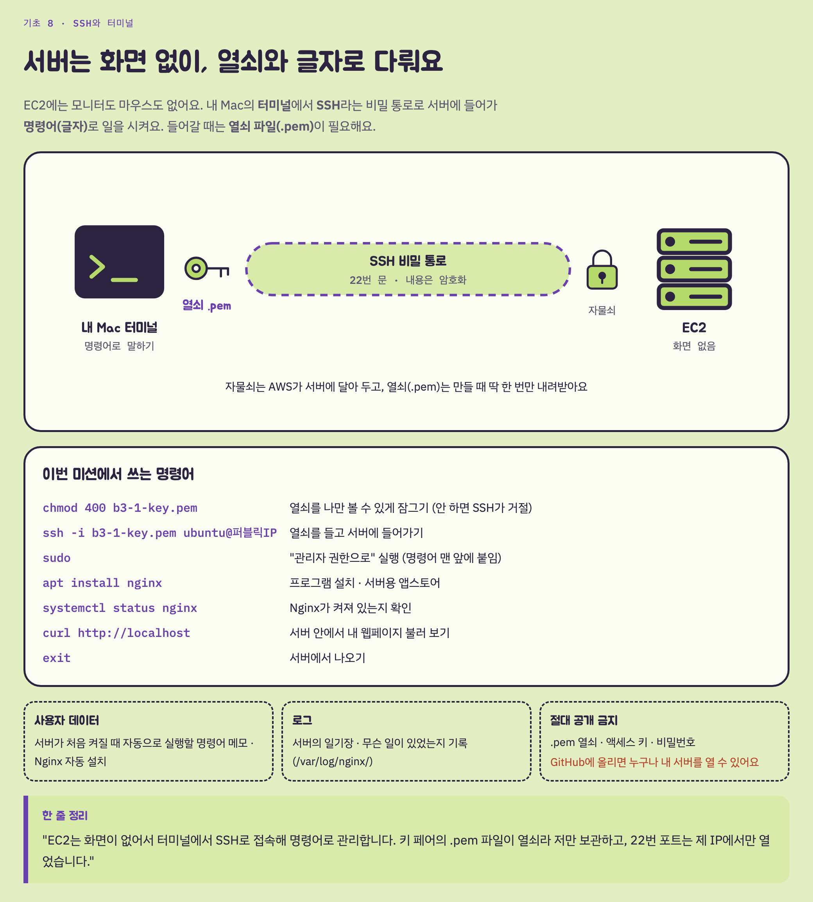

<details>
<summary>📖 글로 자세히 보기 (표 · 설명)</summary>

EC2에는 모니터도 마우스도 없다. 내 Mac의 **터미널**(글자로 명령하는 프로그램)에서 **SSH**라는 비밀 통로로 서버에 들어가 **명령어**로 일을 시킨다. 들어갈 때는 **열쇠 파일(.pem)**이 필요하다.

```
⌨️ 내 Mac 터미널 ─ 🔑 .pem 열쇠 ═══ SSH 비밀 통로 (22번 문 · 암호화) ═══ 🔒 자물쇠 ─ 🗄️ EC2
```

| 용어 | 쉬운 뜻 | 비유 |
|---|---|---|
| **터미널** | 마우스 대신 글자로 컴퓨터에 명령하는 창 | 문자 메시지로 일 시키기 |
| **SSH**<br>*Secure Shell* | 다른 컴퓨터에 안전하게 원격 접속하는 방법 (22번 포트) | 비밀 통로 |
| **키 페어** | 자물쇠(서버에 달림) + 열쇠(.pem, 내가 보관) 한 쌍 | 현관 자물쇠와 열쇠 |
| **.pem 파일** | 열쇠. 만들 때 **딱 한 번만** 내려받음 | 잃어버리면 재발급 안 됨 |

### 이번 미션에서 쓰는 명령어

| 명령어 | 뜻 |
|---|---|
| `chmod 400 b3-1-key.pem` | 열쇠를 나만 볼 수 있게 잠그기 (안 하면 SSH가 거절) |
| `ssh -i b3-1-key.pem ubuntu@퍼블릭IP` | 열쇠를 들고 서버에 들어가기 (`ubuntu` = 접속 사용자 이름) |
| `sudo …` | "관리자 권한으로" 실행 |
| `apt install nginx` | 프로그램 설치 (서버용 앱스토어) |
| `systemctl status nginx` | Nginx가 켜져 있는지 확인 |
| `curl http://localhost` | 서버 안에서 내 웹페이지 불러 보기 |
| `exit` | 서버에서 나오기 |

| 함께 알아 둘 것 | 뜻 |
|---|---|
| **사용자 데이터 (User data)** | 서버가 처음 켜질 때 자동으로 실행할 명령어 메모 → Nginx 자동 설치 ([infra/user-data.sh](infra/user-data.sh)) |
| **로그** | 서버의 일기장. 무슨 일이 있었는지 기록 (`/var/log/nginx/`) |
| **⚠️ 절대 공개 금지** | `.pem` 열쇠 · 액세스 키 · 비밀번호 → GitHub에 올리면 누구나 내 서버를 열 수 있음 |

> 📝 **한 줄 정리**
> "EC2는 화면이 없어서 터미널에서 SSH로 접속해 명령어로 관리합니다. 키 페어의 .pem 파일이 열쇠라 저만 보관하고, 22번 포트는 제 IP에서만 열었습니다."

</details>

---

## 기초 9 · API는 메뉴판과 주문 규칙

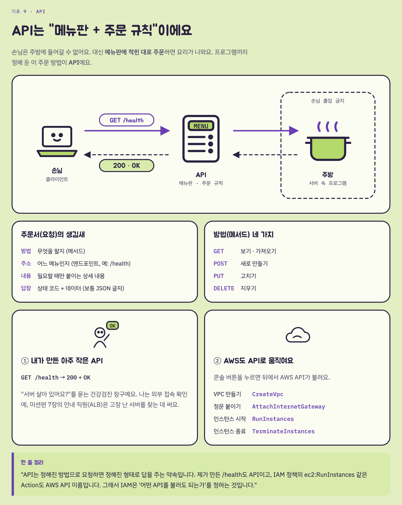

<details>
<summary>📖 글로 자세히 보기 (표 · 설명)</summary>

손님은 주방에 들어갈 수 없다. 대신 **메뉴판에 적힌 대로 주문**하면 요리가 나온다. 프로그램끼리 정해 둔 이 주문 방법이 **API**(Application Programming Interface)다.

```
💻 손님 ── GET /health ──▶ 📋 API (메뉴판) ──▶ ┊ 🍲 주방 (서버 속 프로그램) ┊
        ◀── 200 · OK ────                  ◀── ┊      손님 출입 금지       ┊
```

### 주문서(요청)의 생김새

| 부분 | 뜻 | 예 |
|---|---|---|
| **방법 (메서드)** | 무엇을 할지 | `GET` |
| **주소 (엔드포인트)** | 어느 메뉴인지 | `/health` |
| **내용 (본문)** | 필요할 때만 붙이는 상세 내용 | (없음) |
| **답장 (응답)** | 상태 코드 + 데이터 | `200` + `OK` (보통은 JSON 글자) |

| 메서드 | 뜻 |
|---|---|
| **GET** | 보기 · 가져오기 |
| **POST** | 새로 만들기 |
| **PUT** | 고치기 |
| **DELETE** | 지우기 |

### 이번 미션 속 API 두 가지

**① 내가 만든 아주 작은 API** — `GET /health` → `200` + `OK`
"서버 살아 있어요?"를 묻는 **건강검진 창구**. 나는 외부 접속 확인에, 미션편 7장의 ALB는 고장 난 서버를 찾는 데 쓴다.

**② AWS도 API로 움직인다** — 콘솔 버튼을 누르면 뒤에서 AWS API가 불린다.

| 콘솔에서 하는 일 | 실제로 불리는 API | IAM 정책에 적는 이름 |
|---|---|---|
| VPC 만들기 | CreateVpc | `ec2:CreateVpc` |
| 정문 붙이기 | AttachInternetGateway | `ec2:AttachInternetGateway` |
| 인스턴스 시작 | RunInstances | `ec2:RunInstances` |
| 인스턴스 종료 | TerminateInstances | `ec2:TerminateInstances` |

> 📝 **한 줄 정리**
> "API는 정해진 방법으로 요청하면 정해진 형태로 답을 주는 약속입니다. 제가 만든 /health도 API이고, IAM 정책의 ec2:RunInstances 같은 Action도 AWS API 이름입니다. 그래서 IAM은 '어떤 API를 불러도 되는가'를 정하는 것입니다."

</details>

---

## 기초 10 · 클라우드는 컴퓨터를 빌려 쓰는 것

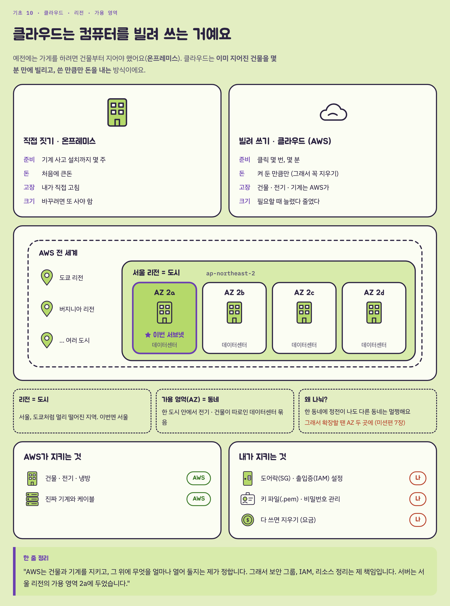

<details>
<summary>📖 글로 자세히 보기 (표 · 설명)</summary>

| | 🏢 직접 짓기 · 온프레미스 | ☁️ 빌려 쓰기 · 클라우드 (AWS) |
|---|---|---|
| 준비 | 기계 사고 설치까지 몇 주 | 클릭 몇 번, 몇 분 |
| 돈 | 처음에 큰돈 | **켜 둔 만큼만** (그래서 꼭 지우기) |
| 고장 | 내가 직접 고침 | 건물 · 전기 · 기계는 AWS가 |
| 크기 | 바꾸려면 또 사야 함 | 필요할 때 늘렸다 줄였다 |

### 리전과 가용 영역

```
🌏 AWS 전 세계
 ├ 📍 도쿄 리전, 버지니아 리전, … 여러 도시
 └ 📍 서울 리전 (ap-northeast-2)        = 도시
     ├ 🏢 AZ 2a  ★ 이번 서브넷           = 동네 (데이터센터 묶음)
     ├ 🏢 AZ 2b
     ├ 🏢 AZ 2c
     └ 🏢 AZ 2d
```

| 용어 | 비유 | 뜻 |
|---|---|---|
| **리전** | 도시 | 서울, 도쿄처럼 멀리 떨어진 지역. 이번엔 서울 |
| **가용 영역 (AZ)**<br>*Availability Zone* | 동네 | 한 리전 안에서 전기 · 건물이 따로인 데이터센터 묶음 |
| **왜 나눠?** | | 한 동네에 정전이 나도 다른 동네는 멀쩡 → 확장할 땐 AZ 두 곳에 (미션편 7장) |
| **프리 티어** | 체험판 | 정해진 범위 안에서 무료. 넘으면 요금 |

### 누가 무엇을 지키나 (책임 나누기)

| AWS가 지키는 것 | 내가 지키는 것 |
|---|---|
| 건물 · 전기 · 냉방 | 도어락(SG) · 출입증(IAM) 설정 |
| 진짜 기계와 케이블 | 키 파일(.pem) · 비밀번호 관리 |
| | 다 쓰면 지우기 (요금) |

> 📝 **한 줄 정리**
> "AWS는 건물과 기계를 지키고, 그 위에 무엇을 얼마나 열어 둘지는 제가 정합니다. 그래서 보안 그룹, IAM, 리소스 정리는 제 책임입니다. 서버는 서울 리전의 가용 영역 2a에 두었습니다."

</details>

---

## 기초 11 · AWS를 다루는 법

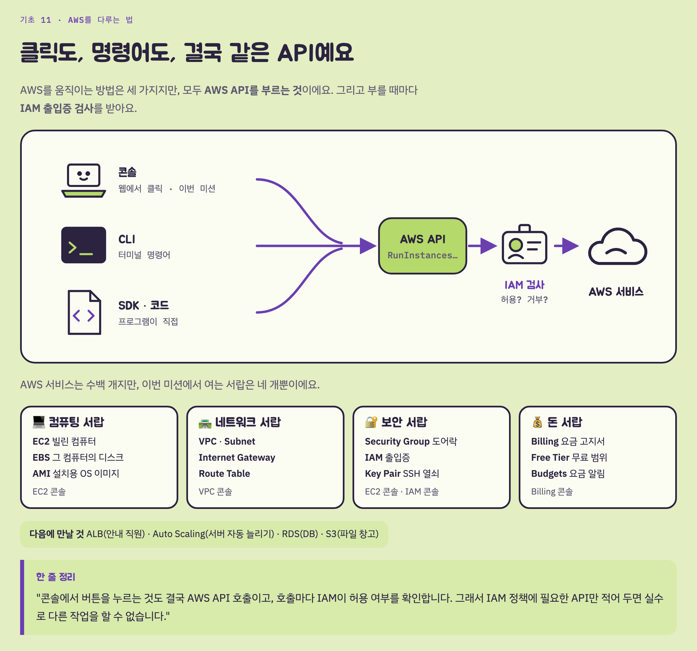

<details>
<summary>📖 글로 자세히 보기 (표 · 설명)</summary>

```
💻 콘솔 (웹 클릭 · 이번 미션) ─┐
⌨️ CLI (터미널 명령어)        ─┼─▶ 📡 AWS API ─▶ 🪪 IAM 검사 ─▶ ☁️ AWS 서비스
📄 SDK (코드)                ─┘     RunInstances…   허용? 거부?
```

세 방법 모두 **AWS API를 부르는 것**이고, 부를 때마다 **IAM 출입증 검사**를 받는다.

### 계정의 두 종류

| | 👑 루트 사용자 | 🪪 IAM 사용자 |
|---|---|---|
| 비유 | 건물주 (마스터키) | 직원 출입증 |
| 할 수 있는 일 | 전부 (결제, 계정 삭제까지) | 정책에 적힌 일만 |
| 이번 미션에서 | 처음 가입과 IAM 사용자 만들기, Billing 확인에만 | 실습은 이 계정으로 (최소 권한) |
| 지킬 것 | MFA(2단계 인증) 켜기, 평소엔 안 쓰기 | 액세스 키 · 비밀번호 공개 금지 |

### 이번 미션에서 여는 서랍 네 개

| 서랍 | 서비스 | 찾는 곳 |
|---|---|---|
| 💻 컴퓨팅 | **EC2** 빌린 컴퓨터 · **EBS** 그 디스크 · **AMI** 설치용 OS 이미지 | EC2 콘솔 |
| 🛣️ 네트워크 | **VPC** · **Subnet** · **Internet Gateway** · **Route Table** | VPC 콘솔 |
| 🔐 보안 | **Security Group** 도어락 · **IAM** 출입증 · **Key Pair** SSH 열쇠 | EC2 콘솔 · IAM 콘솔 |
| 💰 돈 | **Billing** 요금 고지서 · **Free Tier** 무료 범위 · **Budgets** 요금 알림 | Billing 콘솔 |

> **태그(Tag)** = 리소스에 붙이는 이름표. 이번 미션은 `Project=B3-1`을 붙여, 나중에 지울 것을 빠짐없이 찾는다.
>
> **다음에 만날 것**: ALB(안내 직원) · Auto Scaling(서버 자동 늘리기) · RDS(DB) · S3(파일 창고)

> 📝 **한 줄 정리**
> "콘솔에서 버튼을 누르는 것도 결국 AWS API 호출이고, 호출마다 IAM이 허용 여부를 확인합니다. 그래서 IAM 정책에 필요한 API만 적어 두면 실수로 다른 작업을 할 수 없습니다."

</details>

---

## 기초 12 · 웹 앱 DB 3계층

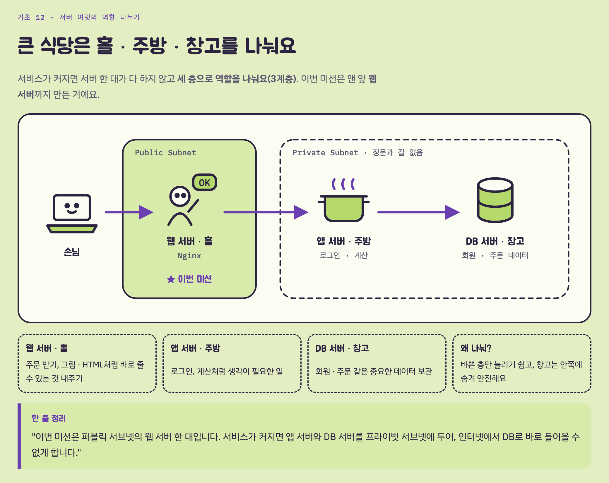

<details>
<summary>📖 글로 자세히 보기 (표 · 설명)</summary>

서비스가 커지면 서버 한 대가 다 하지 않고 **세 층으로 역할을 나눈다(3계층)**. 이번 미션은 맨 앞 **웹 서버**까지다.

```
💻 손님 ─▶ ┃ Public Subnet ┃ ─▶ ┊ Private Subnet (정문과 길 없음)            ┊
           ┃ 🙋 웹 서버·홀  ┃    ┊ 🍲 앱 서버·주방  ─▶  💾 DB 서버·창고     ┊
           ┃ Nginx ★이번   ┃    ┊ 로그인·계산         회원·주문 데이터     ┊
```

| 계층 | 비유 | 하는 일 | 두는 곳 |
|---|---|---|---|
| **웹 서버** | 홀 | 주문 받기, HTML · 그림처럼 바로 줄 수 있는 것 내주기 | 퍼블릭 서브넷 ★ 이번 미션 |
| **앱 서버** | 주방 | 로그인, 계산처럼 생각이 필요한 일 | 프라이빗 서브넷 |
| **DB 서버** | 창고 | 회원 · 주문 같은 중요한 데이터 보관 | 프라이빗 서브넷 |

**왜 나눌까?** 바쁜 층만 늘리기 쉽고, 창고(DB)는 안쪽에 숨겨 안전하다.

> 📝 **한 줄 정리**
> "이번 미션은 퍼블릭 서브넷의 웹 서버 한 대입니다. 서비스가 커지면 앱 서버와 DB 서버를 프라이빗 서브넷에 두어, 인터넷에서 DB로 바로 들어올 수 없게 합니다."

</details>

---

# 미션편 · 아파트 단지로 보는 B3-1

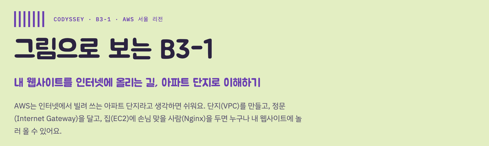

AWS는 인터넷에서 빌려 쓰는 아파트 단지라고 생각하면 쉽다. 단지(VPC)를 만들고, 정문(Internet Gateway)을 달고, 집(EC2)에 손님 맞을 사람(Nginx)을 두면 누구나 내 웹사이트에 놀러 올 수 있다.

| 장 | 내용 | 관련 평가 질문 |
|---|---|---|
| [1장](#1장--등장인물-아홉) | 등장인물 아홉 | 전체 |
| [2장](#2장--편지-한-통이-집까지-가는-길) | 편지 한 통이 집까지 가는 길 | Q1-1 · Q2-1 |
| [3장](#3장--00000-은-전-세계라는-뜻) | 0.0.0.0/0 은 "전 세계" | Q3-1 |
| [4장](#4장--도어락과-출입증은-하는-일이-다르다) | 도어락과 출입증 | Q1-3 · Q2-2 · Q3-2 · Q3-3 |
| [5장](#5장--접속이-안-되면-집-안부터-확인) | 고장 찾기 | Q3-4 · Q4-1 |
| [6장](#6장--지울-때는-안쪽부터-바깥으로) | 이사 나가기 (정리) | Q1-5 · Q4-4 |
| [7장](#7장--집을-두-채로-안내-직원은-한-명) | 손님이 많아지면 (확장) | Q4-3 |

---

## 1장 · 등장인물 아홉

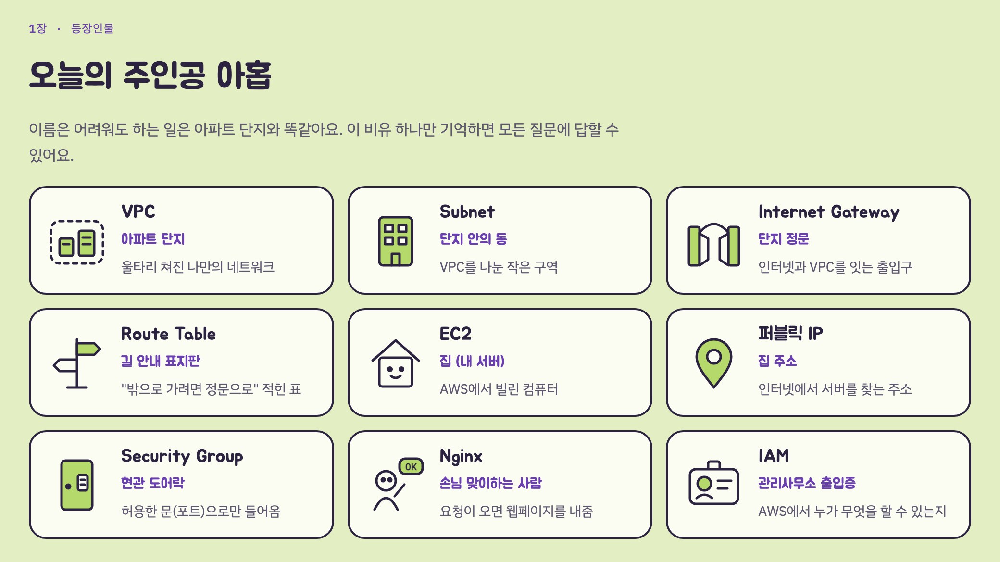

<details>
<summary>📖 글로 자세히 보기 (표 · 설명)</summary>

이름은 어려워도 하는 일은 아파트 단지와 똑같다. **이 비유 하나만 기억하면 모든 질문에 답할 수 있다.**

| 그림 | AWS 이름 | 아파트 비유 | 하는 일 |
|---|---|---|---|
| 🏘️ | **VPC** | 아파트 단지 | 울타리 쳐진 나만의 네트워크 |
| 🏢 | **Subnet** | 단지 안의 동 | VPC를 나눈 작은 구역 |
| 🚪 | **Internet Gateway** | 단지 정문 | 인터넷과 VPC를 잇는 출입구 |
| 🪧 | **Route Table** | 길 안내 표지판 | "밖으로 가려면 정문으로" 적힌 표 |
| 🏠 | **EC2** | 집 (내 서버) | AWS에서 빌린 컴퓨터 |
| 📍 | **퍼블릭 IP** | 집 주소 | 인터넷에서 서버를 찾는 주소 |
| 🔒 | **Security Group** | 현관 도어락 | 허용한 문(포트)으로만 들어옴 |
| 🙋 | **Nginx** | 손님 맞이하는 사람 | 요청이 오면 웹페이지를 내줌 |
| 🪪 | **IAM** | 관리사무소 출입증 | AWS에서 누가 무엇을 할 수 있는지 |

</details>

---

## 2장 · 편지 한 통이 집까지 가는 길

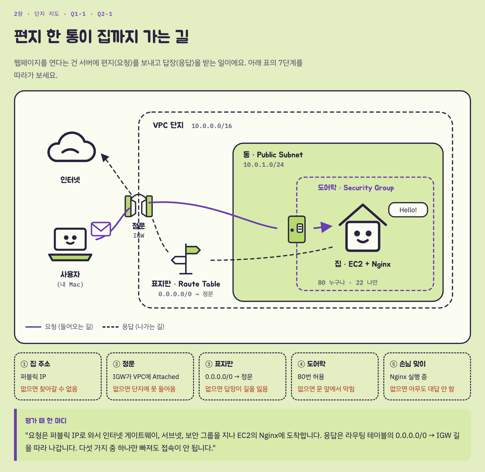

<details>
<summary>📖 글로 자세히 보기 (표 · 설명)</summary>

웹페이지를 연다는 건 **서버에 편지(요청)를 보내고 답장(응답)을 받는 일**이다.

### 단지 지도

```
☁️ 인터넷
 │
💻 사용자 (내 Mac)
 │  ✉️ 편지 출발
 ▼
🚪 정문 (IGW) ─────────── VPC 울타리에 붙어 있음
 │
┌ 🏘️ VPC 단지 · 10.0.0.0/16
│
│  🪧 표지판 (Route Table)
│     └ 0.0.0.0/0 → 정문
│
│  🏢 동 · Public Subnet · 10.0.1.0/24
│     └ 🔒 도어락 (Security Group) · 80 누구나 / 22 나만
│          └ 🏠 집 (EC2) + 🙋 Nginx "Hello!"
└
```

### 편지 여행 7단계

| 단계 | 장소 | 무슨 일이? | 이게 없으면? |
|---|---|---|---|
| 1 | 💻 사용자 | 브라우저에 `http://퍼블릭IP/health` 입력. 편지에 받는 주소로 퍼블릭 IP가 적힘 | 퍼블릭 IP가 없으면 주소를 몰라 출발도 못 함 |
| 2 | 🚪 정문 (IGW) | 바깥 주소(퍼블릭 IP)를 단지 안 주소(10.0.1.x)로 바꿔 들여보냄 | 정문이 없거나 Attached가 아니면 단지에 못 들어옴 |
| 3 | 🏢 동 (Subnet) | 서버가 사는 동에 도착. 정문과 길이 이어져 있어 "퍼블릭" 서브넷 | — |
| 4 | 🔒 도어락 (SG) | "80번 문으로 왔네? 80번은 누구나 허용!" 통과 | 80 규칙이 없으면 문 앞에서 막혀 **타임아웃** |
| 5 | 🏠 집 (EC2 · Nginx) | Nginx가 편지를 받고 답장(`200 OK`, `OK`)을 씀 | Nginx가 꺼져 있으면 **Connection refused** |
| 6 | 🪧 표지판 (Route Table) | 답장이 나갈 때 표지판을 봄. "0.0.0.0/0 → 정문" | 이 길이 없으면 답장이 길을 잃어 **타임아웃** |
| 7 | 💻 사용자 | 답장 도착! 화면에 `200 OK` / `OK` | — |

```
[요청 ──▶]  💻 사용자 → 🚪 정문 → 🏢 동 → 🔒 도어락 → 🏠 집·Nginx
[응답 ◀╌╌]  🏠 집 → 🪧 표지판(0.0.0.0/0 → 정문) → 🚪 정문 → 💻 사용자
```

### 접속에 필요한 5가지 (하나만 빠져도 안 됨)

| # | 비유 | AWS 설정 | 없으면 |
|---|---|---|---|
| ① | 집 주소 | 퍼블릭 IP | 찾아갈 수 없음 |
| ② | 정문 | IGW가 VPC에 Attached | 단지에 못 들어옴 |
| ③ | 표지판 | 0.0.0.0/0 → IGW | 답장이 길을 잃음 |
| ④ | 도어락 | SG 80번 허용 | 문 앞에서 막힘 |
| ⑤ | 손님 맞이 | Nginx 실행 중 | 아무도 대답 안 함 |

> 💬 **평가 때 한 마디**
> "요청은 퍼블릭 IP로 와서 인터넷 게이트웨이, 서브넷, 보안 그룹을 지나 EC2의 Nginx에 도착합니다. 응답은 라우팅 테이블의 0.0.0.0/0 → IGW 길을 따라 나갑니다. 다섯 가지 중 하나만 빠져도 접속이 안 됩니다."

</details>

---

## 3장 · 0.0.0.0/0 은 "전 세계"라는 뜻

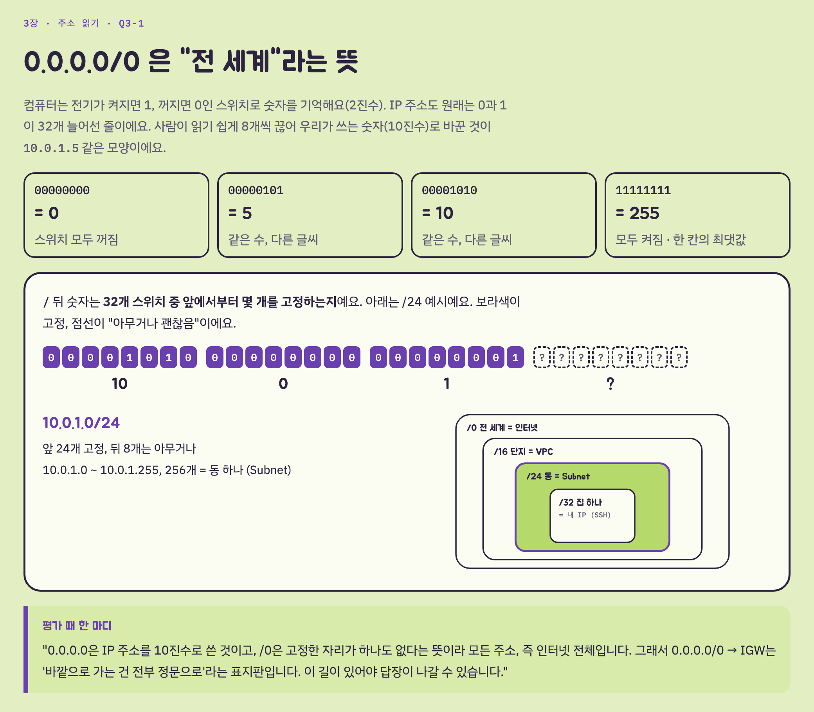

<details>
<summary>📖 글로 자세히 보기 (표 · 설명)</summary>

### 10진수와 2진수

컴퓨터는 전기가 **켜지면 1, 꺼지면 0**인 스위치로 숫자를 기억한다(**2진수**). 사람은 0~9로 센다(**10진수**). **같은 수를 다른 글씨로 쓴 것**일 뿐이다.

| 2진수 (컴퓨터) | 10진수 (사람) | 설명 |
|---|---|---|
| `00000000` | **0** | 스위치 모두 꺼짐 |
| `00000101` | **5** | 같은 수, 다른 글씨 |
| `00001010` | **10** | 같은 수, 다른 글씨 |
| `11111111` | **255** | 모두 켜짐 · 한 칸의 최댓값 |

### IP 주소는 원래 2진수 32자리

```
컴퓨터가 보는 IP : 00001010000000000000000100000101   ← 읽기 어려움 😵

① 8자리씩 자르기 : 00001010 | 00000000 | 00000001 | 00000101
② 10진수로 바꾸기:    10    |     0    |     1    |     5
③ 점으로 잇기    : 10.0.1.5                                ← 우리가 보는 IP 😊
```

> 전화번호 `01012345678`을 `010-1234-5678`로 끊어 쓰는 것과 같은 원리다.
> 한 칸이 8자리라서 각 칸은 **0~255**까지만 가능하다.

### `/숫자` = 32개 스위치 중 앞에서 몇 개를 고정하나

🟪 = 고정 · ⬜ = 아무거나 괜찮음

```
/32  🟪🟪🟪🟪🟪🟪🟪🟪 🟪🟪🟪🟪🟪🟪🟪🟪 🟪🟪🟪🟪🟪🟪🟪🟪 🟪🟪🟪🟪🟪🟪🟪🟪   집 하나
/24  🟪🟪🟪🟪🟪🟪🟪🟪 🟪🟪🟪🟪🟪🟪🟪🟪 🟪🟪🟪🟪🟪🟪🟪🟪 ⬜⬜⬜⬜⬜⬜⬜⬜   동
/16  🟪🟪🟪🟪🟪🟪🟪🟪 🟪🟪🟪🟪🟪🟪🟪🟪 ⬜⬜⬜⬜⬜⬜⬜⬜ ⬜⬜⬜⬜⬜⬜⬜⬜   단지
/0   ⬜⬜⬜⬜⬜⬜⬜⬜ ⬜⬜⬜⬜⬜⬜⬜⬜ ⬜⬜⬜⬜⬜⬜⬜⬜ ⬜⬜⬜⬜⬜⬜⬜⬜   전 세계
```

| 표기 | 고정 | 범위 | 개수 | 비유 | 이번 미션에서 |
|---|---|---|---|---|---|
| `10.0.1.5/32` | 32개 전부 | 딱 한 주소 | 1 | 집 한 채 | SSH를 내 IP만 허용 |
| `10.0.1.0/24` | 앞 24개 | 10.0.1.0 ~ 10.0.1.255 | 256 | 동 | Subnet |
| `10.0.0.0/16` | 앞 16개 | 10.0.0.0 ~ 10.0.255.255 | 약 6.5만 | 단지 | VPC |
| `0.0.0.0/0` | 0개 | 모든 주소 | 약 43억 | 전 세계 | 인터넷 (IGW로 보냄) |

```
┌ /0 전 세계 = 인터넷
│ ┌ /16 단지 = VPC
│ │ ┌ /24 동 = Subnet
│ │ │ ┌ /32 집 하나 = 내 IP
```

**규칙 하나: `/` 뒤 숫자가 작을수록 범위가 넓다.**

> 💬 **평가 때 한 마디**
> "0.0.0.0은 IP 주소를 10진수로 쓴 것이고, /0은 고정한 자리가 하나도 없다는 뜻이라 모든 주소, 즉 인터넷 전체입니다. 그래서 0.0.0.0/0 → IGW는 '바깥으로 가는 건 전부 정문으로'라는 표지판입니다. 이 길이 있어야 답장이 나갈 수 있습니다."

</details>

---

## 4장 · 도어락과 출입증은 하는 일이 다르다

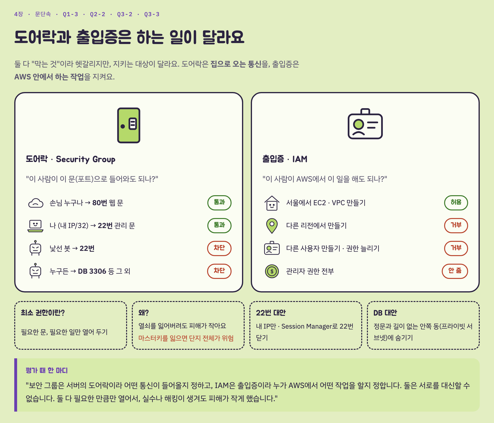

<details>
<summary>📖 글로 자세히 보기 (표 · 설명)</summary>

둘 다 "막는 것"이라 헷갈리지만 지키는 대상이 다르다. **도어락은 집으로 오는 통신**을, **출입증은 AWS 안에서 하는 작업**을 지킨다.

| | 🔒 도어락 · Security Group | 🪪 출입증 · IAM |
|---|---|---|
| 묻는 질문 | "이 사람이 이 문(포트)으로 들어와도 되나?" | "이 사람이 AWS에서 이 일을 해도 되나?" |
| 지키는 것 | 서버로 오는 네트워크 통신 | AWS 계정 안의 작업 |
| 대상 | 컴퓨터 (IP · 포트) | 사람 · 프로그램 |

### 🔒 도어락 앞에서

| 누가 | 어느 문 | 결과 |
|---|---|---|
| ☁️ 손님 누구나 | **80번** 웹 문 | ✅ 통과 |
| 💻 나 (내 IP/32) | **22번** 관리 문 | ✅ 통과 |
| 🤖 낯선 봇 | **22번** | ❌ 차단 |
| 🤖 누구든 | **DB 3306** 등 그 외 | ❌ 차단 |

### 🪪 출입증으로

| 하려는 일 | 결과 |
|---|---|
| 🏠 서울에서 EC2 · VPC 만들기 | ✅ 허용 |
| 📍 다른 리전에서 만들기 | ❌ 거부 |
| 🪪 다른 사용자 만들기 · 권한 늘리기 | ❌ 거부 |
| 💰 관리자 권한 전부 | ❌ 안 줌 |

### 한눈에 정리

| 질문 | 답 |
|---|---|
| **최소 권한이란?** | 필요한 문, 필요한 일만 열어 두기 |
| **왜?** | 열쇠를 잃어버려도 피해가 작다. 마스터키를 잃으면 단지 전체가 위험 |
| **22번 대안** | 내 IP만 허용 · Session Manager로 22번 닫기 |
| **DB 대안** | 정문과 길이 없는 안쪽 동(프라이빗 서브넷)에 숨기기 |

> 💬 **평가 때 한 마디**
> "보안 그룹은 서버의 도어락이라 어떤 통신이 들어올지 정하고, IAM은 출입증이라 누가 AWS에서 어떤 작업을 할지 정합니다. 둘은 서로를 대신할 수 없습니다. 둘 다 필요한 만큼만 열어서, 실수나 해킹이 생겨도 피해가 작게 했습니다."

</details>

---

## 5장 · 접속이 안 되면, 집 안부터 확인

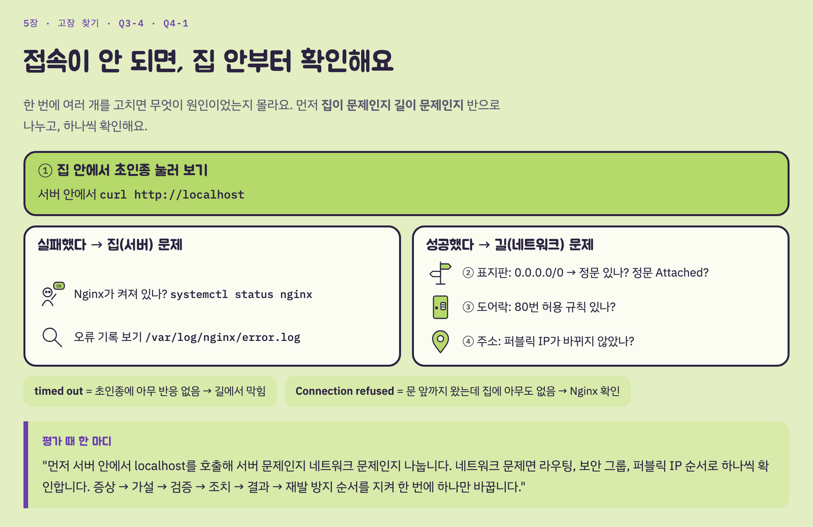

<details>
<summary>📖 글로 자세히 보기 (표 · 설명)</summary>

한 번에 여러 개를 고치면 무엇이 원인이었는지 모른다. 먼저 **집이 문제인지 길이 문제인지** 반으로 나누고, 하나씩 확인한다.

```
① 집 안에서 초인종 눌러 보기
   서버 안에서 curl http://localhost
        │
   ┌────┴─────────────────────┐
   ▼                          ▼
 실패 → 🏠 집(서버) 문제        성공 → 🛣️ 길(네트워크) 문제
   ├ 🙋 Nginx 켜져 있나?         ├ ② 🪧 표지판: 0.0.0.0/0 → 정문? 정문 Attached?
   │   systemctl status nginx    ├ ③ 🔒 도어락: 80번 허용 규칙?
   └ 🔍 오류 기록 보기            └ ④ 📍 주소: 퍼블릭 IP가 바뀌지 않았나?
       /var/log/nginx/error.log
```

| 증상 | 비유 | 의심할 곳 |
|---|---|---|
| **timed out** | 초인종에 아무 반응 없음 | 길에서 막힘 → 표지판 · 도어락 · 주소 |
| **Connection refused** | 문 앞까지 왔는데 집에 아무도 없음 | Nginx 확인 |

**트러블슈팅 6단계**: 증상 → 가설 → 검증 → 조치 → 결과 → 재발 방지 (한 번에 하나만 바꾸기)

> 💬 **평가 때 한 마디**
> "먼저 서버 안에서 localhost를 호출해 서버 문제인지 네트워크 문제인지 나눕니다. 네트워크 문제면 라우팅, 보안 그룹, 퍼블릭 IP 순서로 하나씩 확인합니다. 증상 → 가설 → 검증 → 조치 → 결과 → 재발 방지 순서를 지켜 한 번에 하나만 바꿉니다."

</details>

---

## 6장 · 지울 때는 안쪽부터 바깥으로

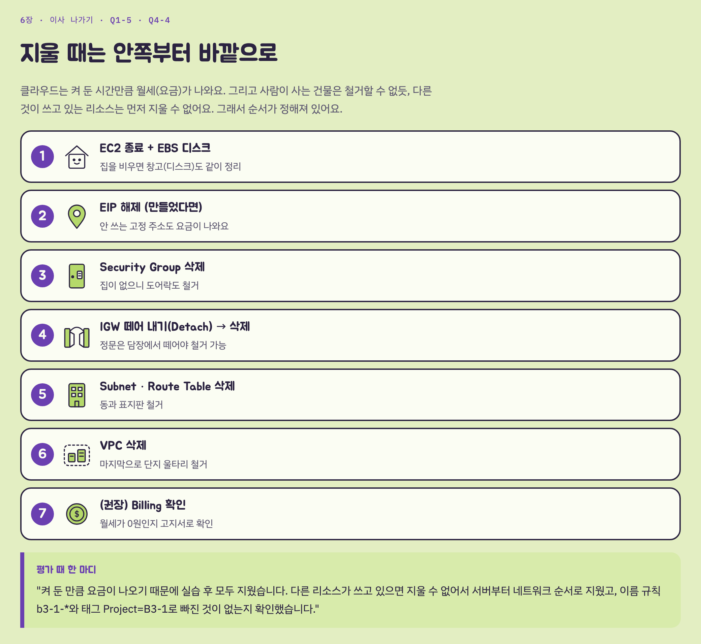

<details>
<summary>📖 글로 자세히 보기 (표 · 설명)</summary>

클라우드는 **켜 둔 시간만큼 월세(요금)**가 나온다. 그리고 **사람이 사는 건물은 철거할 수 없듯**, 다른 것이 쓰고 있는 리소스는 먼저 지울 수 없다. 그래서 순서가 정해져 있다.

| 순서 | 그림 | 지울 것 | 비유 |
|---|---|---|---|
| 1 | 🏠💾 | **EC2 종료 + EBS 디스크** | 집을 비우면 창고(디스크)도 같이 정리 |
| 2 | 📍 | **EIP 해제** (만들었다면) | 안 쓰는 고정 주소도 요금이 나옴 |
| 3 | 🔒 | **Security Group 삭제** | 집이 없으니 도어락도 철거 |
| 4 | 🚪 | **IGW 떼어 내기(Detach) → 삭제** | 정문은 담장에서 떼어야 철거 가능 |
| 5 | 🏢🪧 | **Subnet · Route Table 삭제** | 동과 표지판 철거 |
| 6 | 🏘️ | **VPC 삭제** | 마지막으로 단지 울타리 철거 |
| 7 | 💰 | **(권장) Billing 확인** | 월세가 0원인지 고지서로 확인 |

> 💬 **평가 때 한 마디**
> "켜 둔 만큼 요금이 나오기 때문에 실습 후 모두 지웠습니다. 다른 리소스가 쓰고 있으면 지울 수 없어서 서버부터 네트워크 순서로 지웠고, 이름 규칙 b3-1-*와 태그 Project=B3-1로 빠진 것이 없는지 확인했습니다."

</details>

---

## 7장 · 집을 두 채로, 안내 직원은 한 명

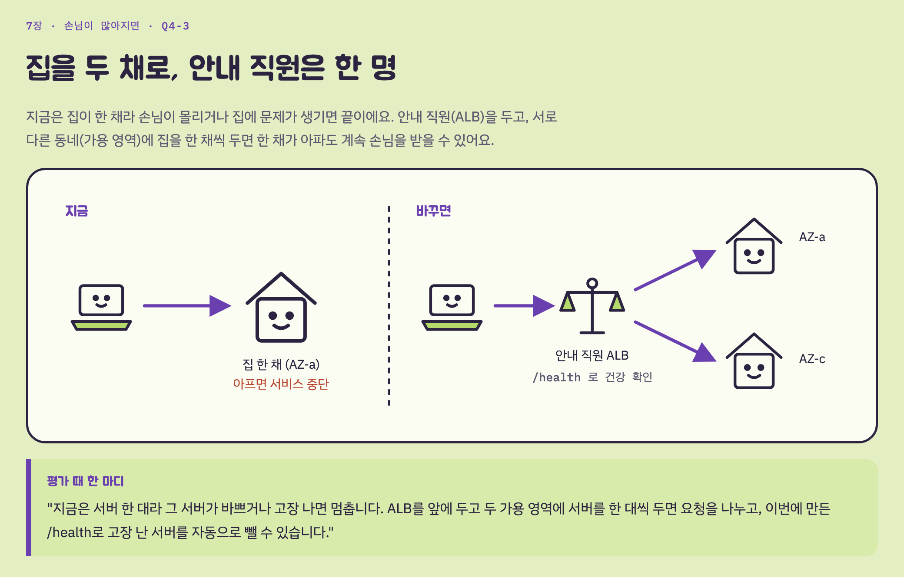

<details>
<summary>📖 글로 자세히 보기 (표 · 설명)</summary>

지금은 집이 한 채라 손님이 몰리거나 집에 문제가 생기면 끝이다. **안내 직원(ALB)**을 두고, **서로 다른 동네(가용 영역)**에 집을 한 채씩 두면 한 채가 아파도 계속 손님을 받을 수 있다.

```
[지금]
💻 사용자 ──▶ 🏠 집 한 채 (AZ-a)
                └ 아프면 서비스 중단 ❌

[바꾸면]
💻 사용자 ──▶ ⚖️ 안내 직원 ALB ──┬──▶ 🏠 집 (AZ-a)
               /health 로 건강 확인 └──▶ 🏠 집 (AZ-c)
                                     한 채가 아파도 계속 ✅
```

| 지금의 약점 | 해결 |
|---|---|
| 서버 1대 → 바쁘거나 고장 나면 멈춤 | 서버 2대 이상 (Auto Scaling) |
| 가용 영역 1곳 → 데이터센터 장애 시 멈춤 | 2개 AZ에 나눠 배치 |
| 주소가 서버 1대에 묶임 | ALB가 하나의 주소로 받아 나눠 줌 |
| 아픈 서버를 모름 | ALB가 `/health`로 건강 확인 후 자동 제외 |

> 💬 **평가 때 한 마디**
> "지금은 서버 한 대라 그 서버가 바쁘거나 고장 나면 멈춥니다. ALB를 앞에 두고 두 가용 영역에 서버를 한 대씩 두면 요청을 나누고, 이번에 만든 /health로 고장 난 서버를 자동으로 뺄 수 있습니다."

</details>

---

자세한 답변은 [pass.md](pass.md), 실습 순서는 [GUIDE.md](GUIDE.md)를 본다.

---

# 부록 · 용어 사전

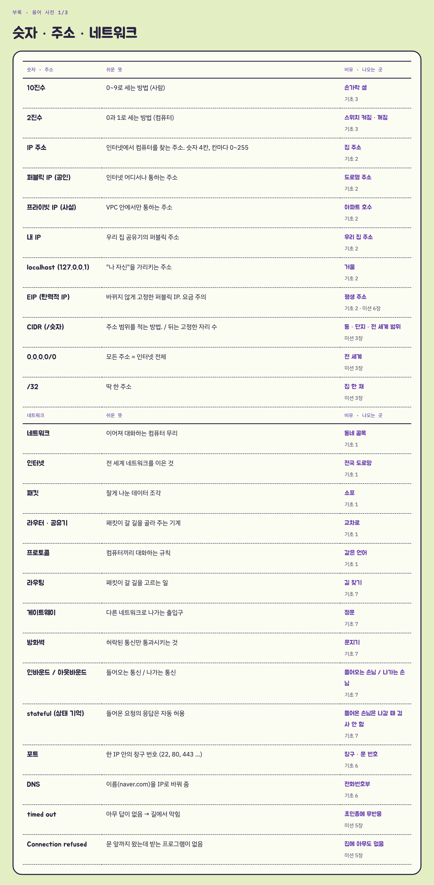

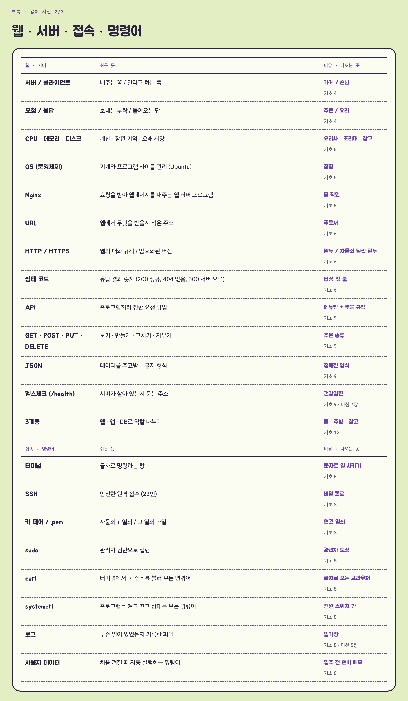

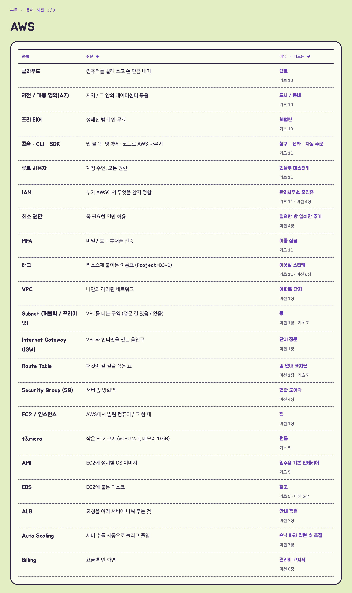


<details>
<summary>📖 글로 자세히 보기 (표 · 설명)</summary>

모르는 말이 나오면 여기서 찾는다. **비유**만 기억해도 평가에서 설명할 수 있다.

### 숫자 · 주소

| 용어 | 쉬운 뜻 | 비유 | 나오는 곳 |
|---|---|---|---|
| **10진수** | 0~9로 세는 방법 (사람) | 손가락 셈 | 기초 3 |
| **2진수** | 0과 1로 세는 방법 (컴퓨터) | 스위치 켜짐 · 꺼짐 | 기초 3 |
| **IP 주소**<br>*Internet Protocol address* | 인터넷에서 컴퓨터를 찾는 주소. 숫자 4칸, 칸마다 0~255 | 집 주소 | 기초 2 |
| **퍼블릭 IP (공인)**<br>*Public IP (Internet Protocol) address* | 인터넷 어디서나 통하는 주소 | 도로명 주소 | 기초 2 |
| **프라이빗 IP (사설)**<br>*Private IP (Internet Protocol) address* | VPC 안에서만 통하는 주소 | 아파트 호수 | 기초 2 |
| **내 IP**<br>*My IP (Internet Protocol) address* | 우리 집 공유기의 퍼블릭 주소 | 우리 집 주소 | 기초 2 |
| **localhost (127.0.0.1)** | "나 자신"을 가리키는 주소 | 거울 | 기초 2 |
| **EIP (탄력적 IP)**<br>*Elastic IP (Internet Protocol) address* | 바뀌지 않게 고정한 퍼블릭 IP. 요금 주의 | 평생 주소 | 기초 2 · 미션 6장 |
| **CIDR (/숫자)**<br>*Classless Inter-Domain Routing* | 주소 범위를 적는 방법. / 뒤는 고정한 자리 수 | 동 · 단지 · 전 세계 범위 | 미션 3장 |
| **0.0.0.0/0** | 모든 주소 = 인터넷 전체 | 전 세계 | 미션 3장 |
| **/32** | 딱 한 주소 | 집 한 채 | 미션 3장 |

### 네트워크

| 용어 | 쉬운 뜻 | 비유 | 나오는 곳 |
|---|---|---|---|
| **네트워크** | 이어져 대화하는 컴퓨터 무리 | 동네 골목 | 기초 1 |
| **인터넷** | 전 세계 네트워크를 이은 것 | 전국 도로망 | 기초 1 |
| **패킷** | 잘게 나눈 데이터 조각 | 소포 | 기초 1 |
| **라우터 · 공유기** | 패킷이 갈 길을 골라 주는 기계 | 교차로 | 기초 1 |
| **프로토콜** | 컴퓨터끼리 대화하는 규칙 | 같은 언어 | 기초 1 |
| **라우팅** | 패킷이 갈 길을 고르는 일 | 길 찾기 | 기초 7 |
| **게이트웨이** | 다른 네트워크로 나가는 출입구 | 정문 | 기초 7 |
| **방화벽** | 허락된 통신만 통과시키는 것 | 문지기 | 기초 7 |
| **인바운드 / 아웃바운드** | 들어오는 통신 / 나가는 통신 | 들어오는 손님 / 나가는 손님 | 기초 7 |
| **stateful (상태 기억)** | 들어온 요청의 응답은 자동 허용 | 들어온 손님은 나갈 때 검사 안 함 | 기초 7 |
| **포트** | 한 IP 안의 창구 번호 (22, 80, 443 …) | 창구 · 문 번호 | 기초 6 |
| **DNS**<br>*Domain Name System* | 이름(naver.com)을 IP로 바꿔 줌 | 전화번호부 | 기초 6 |
| **timed out** | 아무 답이 없음 → 길에서 막힘 | 초인종에 무반응 | 미션 5장 |
| **Connection refused** | 문 앞까지 왔는데 받는 프로그램이 없음 | 집에 아무도 없음 | 미션 5장 |

### 웹 · 서버

| 용어 | 쉬운 뜻 | 비유 | 나오는 곳 |
|---|---|---|---|
| **서버 / 클라이언트** | 내주는 쪽 / 달라고 하는 쪽 | 가게 / 손님 | 기초 4 |
| **요청 / 응답** | 보내는 부탁 / 돌아오는 답 | 주문 / 요리 | 기초 4 |
| **CPU · 메모리 · 디스크**<br>*Central Processing Unit* | 계산 · 잠깐 기억 · 오래 저장 | 요리사 · 조리대 · 창고 | 기초 5 |
| **OS (운영체제)**<br>*Operating System* | 기계와 프로그램 사이를 관리 (Ubuntu) | 점장 | 기초 5 |
| **Nginx** | 요청을 받아 웹페이지를 내주는 웹 서버 프로그램 | 홀 직원 | 기초 5 |
| **URL**<br>*Uniform Resource Locator* | 웹에서 무엇을 받을지 적은 주소 | 주문서 | 기초 6 |
| **HTTP / HTTPS**<br>*HTTP = HyperText Transfer Protocol · HTTPS = HyperText Transfer Protocol Secure* | 웹의 대화 규칙 / 암호화된 버전 | 말투 / 자물쇠 달린 말투 | 기초 6 |
| **상태 코드** | 응답 결과 숫자 (200 성공, 404 없음, 500 서버 오류) | 답장 첫 줄 | 기초 6 |
| **API**<br>*Application Programming Interface* | 프로그램끼리 정한 요청 방법 | 메뉴판 + 주문 규칙 | 기초 9 |
| **GET · POST · PUT · DELETE** | 보기 · 만들기 · 고치기 · 지우기 | 주문 종류 | 기초 9 |
| **JSON**<br>*JavaScript Object Notation* | 데이터를 주고받는 글자 형식 | 정해진 양식 | 기초 9 |
| **헬스체크 (/health)** | 서버가 살아 있는지 묻는 주소 | 건강검진 | 기초 9 · 미션 7장 |
| **3계층** | 웹 · 앱 · DB로 역할 나누기 | 홀 · 주방 · 창고 | 기초 12 |

### 접속 · 명령어

| 용어 | 쉬운 뜻 | 비유 | 나오는 곳 |
|---|---|---|---|
| **터미널** | 글자로 명령하는 창 | 문자로 일 시키기 | 기초 8 |
| **SSH**<br>*Secure Shell* | 안전한 원격 접속 (22번) | 비밀 통로 | 기초 8 |
| **키 페어 / .pem** | 자물쇠 + 열쇠 / 그 열쇠 파일 | 현관 열쇠 | 기초 8 |
| **sudo** | 관리자 권한으로 실행 | 관리자 도장 | 기초 8 |
| **curl** | 터미널에서 웹 주소를 불러 보는 명령어 | 글자로 보는 브라우저 | 기초 8 |
| **systemctl** | 프로그램을 켜고 끄고 상태를 보는 명령어 | 전원 스위치 판 | 기초 8 |
| **로그** | 무슨 일이 있었는지 기록한 파일 | 일기장 | 기초 8 · 미션 5장 |
| **사용자 데이터** | 처음 켜질 때 자동 실행하는 명령어 | 입주 전 준비 메모 | 기초 8 |

### AWS

| 용어 | 쉬운 뜻 | 비유 | 나오는 곳 |
|---|---|---|---|
| **클라우드** | 컴퓨터를 빌려 쓰고 쓴 만큼 내기 | 렌트 | 기초 10 |
| **리전 / 가용 영역(AZ)**<br>*Availability Zone* | 지역 / 그 안의 데이터센터 묶음 | 도시 / 동네 | 기초 10 |
| **프리 티어** | 정해진 범위 안 무료 | 체험판 | 기초 10 |
| **콘솔 · CLI · SDK**<br>*CLI = Command Line Interface · SDK = Software Development Kit* | 웹 클릭 · 명령어 · 코드로 AWS 다루기 | 창구 · 전화 · 자동 주문 | 기초 11 |
| **루트 사용자** | 계정 주인. 모든 권한 | 건물주 마스터키 | 기초 11 |
| **IAM**<br>*Identity and Access Management* | 누가 AWS에서 무엇을 할지 정함 | 관리사무소 출입증 | 기초 11 · 미션 4장 |
| **최소 권한** | 꼭 필요한 일만 허용 | 필요한 방 열쇠만 주기 | 미션 4장 |
| **MFA**<br>*Multi-Factor Authentication* | 비밀번호 + 휴대폰 인증 | 이중 잠금 | 기초 11 |
| **태그** | 리소스에 붙이는 이름표 (`Project=B3-1`) | 이삿짐 스티커 | 기초 11 · 미션 6장 |
| **VPC**<br>*Virtual Private Cloud* | 나만의 격리된 네트워크 | 아파트 단지 | 미션 1장 |
| **Subnet (퍼블릭 / 프라이빗)**<br>*Subnetwork (Public / Private)* | VPC를 나눈 구역 (정문 길 있음 / 없음) | 동 | 미션 1장 · 기초 7 |
| **Internet Gateway (IGW)** | VPC와 인터넷을 잇는 출입구 | 단지 정문 | 미션 1장 |
| **Route Table** | 패킷이 갈 길을 적은 표 | 길 안내 표지판 | 미션 1장 · 기초 7 |
| **Security Group (SG)** | 서버 앞 방화벽 | 현관 도어락 | 미션 4장 |
| **EC2 / 인스턴스**<br>*Elastic Compute Cloud* | AWS에서 빌린 컴퓨터 / 그 한 대 | 집 | 미션 1장 |
| **t3.micro** | 작은 EC2 크기 (vCPU 2개, 메모리 1GiB) | 원룸 | 기초 5 |
| **AMI**<br>*Amazon Machine Image* | EC2에 설치할 OS 이미지 | 입주용 기본 인테리어 | 기초 5 |
| **EBS**<br>*Elastic Block Store* | EC2에 붙는 디스크 | 창고 | 기초 5 · 미션 6장 |
| **ALB**<br>*Application Load Balancer* | 요청을 여러 서버에 나눠 주는 것 | 안내 직원 | 미션 7장 |
| **Auto Scaling** | 서버 수를 자동으로 늘리고 줄임 | 손님 따라 직원 수 조절 | 미션 7장 |
| **Billing** | 요금 확인 화면 | 관리비 고지서 | 미션 6장 |


</details>
